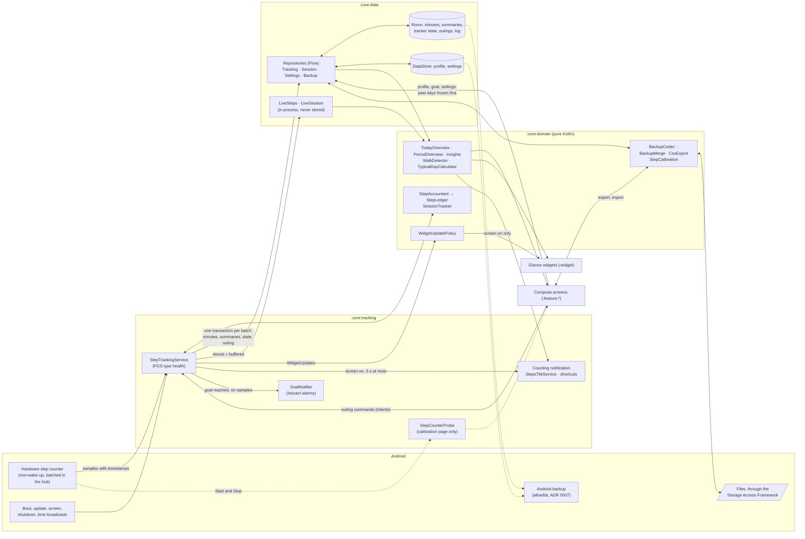

# Passo — Technical Planning

> Companion to [VISION.md](VISION.md). This document defines the architecture, the design of the tracking engine, and the delivery phases.
> It is written to be read by humans and by Claude Code.
>
> How it is kept, and where its closed parts went (the phases done, the log's past periods): «How it is made», below.

---

## How it is made (2 Nov 2026)

The same rules as the family's other plans (owner, 2 Nov 2026: "the same rules and mechanism,
so they are uniform"):

- **This file** is the live plan: how it is made, the state, what is open, the architecture
  (§1 to §10, §12 to §14, cited by number in the code), the phases not yet done (§11), and the
  log of the current period (§15). A new decision or deviation is written **at the end of §15's
  log**, one entry each, with its date and who asked, as always; a box opened or ticked goes in
  «Open» below.
- **`docs/planning/NN-<period>.md`** are the closed parts of the plan (the phases done, the log's
  past periods), **frozen**: never edited. A decision that changes an archived one is written
  here, naming the archived file and the entry it changes.
- **`docs/planning/README.md`** is the index of every archived title (`##`, `###`, `####`) and
  every log entry (its bold title), with its line: a reference by name in the code (Ǥ11
  Phase 10», «§15 "Phase 11's device checks done"») that is not in this file is found there. It
  is written by `python3 tools/planning_index.py`, never by hand, and changes only when the plan
  is archived (`--check` says whether it is behind).
- **Archive** when §15's log passes ~1,000 lines, or at a release, whichever comes first: the log
  becomes the next archive file (with the same header as the others), a phase done moves with it,
  here an empty log stays with its start date, «Open» is read again, and the index script is run.

## State

- **Released**: 1.0.0 (1 Oct 2026, `v1.0.0`) and **1.1.0** (2 Nov 2026, `v1.1.0`, tagged by the
  owner on `main` after the device checks below): its notes in `CHANGELOG.md`, its record in
  `docs/CHANGELOG-1.1.0.md`. What comes after it goes in `CHANGELOG.md`, `[Unreleased]`.
- **Done since 1.0.0**: Phase 11 (the Ways and the city walks), Phase 13 (the interval walk), Phase
  14 (more ways, beyond Europe), in archive 01 with Phases 0 to 8 and 10; Phase 12 in archive 03.
- **Done on 2 Nov 2026**: Phase 12, Your year on foot (archive 03), checked on a device by the owner.
- **Not started**: Phase 9, Google Play (optional, later; §11, below).
- **Done on 21 Nov 2026**, checked on a phone by the owner (archive 05, «The phone checks up to
  Phase 23 done»), on `main` and not released: the first of the location's phases
  (`docs/adr/0016-location.md`; archive 04, from «Location, for an outing that asks for it» on),
  Phase 15, the measured outing, and Phase 16, the outing's page, released together or not at
  all; Phase 17, the step that learns; Phase 21, the open outing, in three steps; Phase 23, the
  doors, with Your outings. All five in archive 05, with the log that built them. Left: the
  figures of Phase 15's measure, written where they are said (the box in «Open»), before any
  release.
- **Next: 18**, a city walk measured with GPS (re-planned on 19 Nov 2026), not started, and to
  be weighed by the owner before it is (22 Nov 2026). Phases 19 and 20 dropped; Phase 22, the
  walk already begun, later, when the owner asks.

## Open

What is left to do or decide, in one place: a box opens here, naming the entry it comes from,
and closes here, naming the one that closes it. Phase 12's own boxes stay in its section (§11).

- [ ] **Baseline Profiles; R8 full mode; startup check** (archive 01, «Phase 7»).
- [x] **The accessibility scanner reports no critical issues** (archive 01, «Phase 7»). Done by
  the owner (confirmed on 21 Nov 2026).
- [x] **The full install and update path**: install the last release, then update to the next
  over it, with the data kept (archive 01, «Phase 8»). Done by the owner on 2 Nov 2026, 1.0.0 to
  1.1.0, before the tag («I did the tests and everything works»); the database's road from schema
  3 to 6 is also tested (`UpgradeFromFirstReleaseTest`).
- [x] **On a device (owner): the new icon** (archive 04, «The new icon: two prints on the green», 9 Nov
  2026): the launcher icon in the phone's own mask, the themed icon, the status-bar icon and the
  Quick Settings tile, the Outing shortcut and the walker on an outing's bar. Done by the owner on
  9 Nov 2026 (archive 04, «The new icon checked on the phone»).
- [x] **On a device (owner): the Outing shortcut as an adaptive icon** (archive 04, «The Outing
  shortcut, an adaptive icon», 9 Nov 2026): long press on the icon, in the phone's own mask and
  with the themed icons on. Done by the owner on 9 Nov 2026 (archive 04, «The adaptive shortcut checked
  on the phone, and Tetto in the family»).
- [x] **On a device (owner): each outing's shortcut wears its own mark** (archive 04, «Each outing's
  shortcut wears its own mark», 9 Nov 2026): after starting or saving a plan, a long press on the
  icon shows the interval walk with its slow and fast line, a run with its bolt. Done by the owner
  on 9 Nov 2026 (archive 04, «The outings' own marks checked on the phone»).
- [x] **On a device (owner): a 30-minute interval outing with the screen off**: each change
  felt, its delay read from the log, the battery check of §9, numbers in `docs/battery/`
  (archive 01, «Phase 13»). Done by the owner (confirmed on 21 Nov 2026). Its numbers are
  left to the box «The figures of the two measures, written», below.
- [x] **On a device (owner): the new ways' maps** in both themes and on an open foldable; the
  Ways page with its groups at twice the text size (archive 01, «Phase 14»). Done by the owner
  (confirmed on 2 Nov 2026).
- [x] **On a device (owner): an outing left still on a phone with no wake-up step counter**: the
  log's `SIGNAL_WAKE` row says it was let go about 15 minutes after the last step (archive 03, «2 Nov
  2026. A review of the wakes»). Done by the owner on 2 Nov 2026, before the tag.
- [x] **Your year on foot names the cities walked that year** (archive 01, «Phase 11»): done
  with Phase 12, on its ways' page (archive 03, «Your year on foot»).
- [x] **On a device (owner): Your year on foot**: the share sheet with two or three apps, the
  image in both themes, a page saved (archive 03, «Phase 12»). Done by the owner on 2 Nov 2026,
  before the tag.

- [x] **On a device (owner): the outings, the editor and the maps reviewed** (archive 04, «The outings,
  their editor and the city walks' maps, reviewed», 11 Nov 2026): the Outings page and an outing
  under way in both themes and at a large text size; the editor's legend, each signal felt; a
  city walk's map before a start and under way, a way's map; TalkBack on a card and on the legend.
  Done by the owner (confirmed on 21 Nov 2026).

- [x] **On a device (owner): Phase 15's proof, before the rest is built** (archive 05, Phase 15, «On a
  device (owner), the proof first»; archive 04, «Phase 15, the slice for the proof on the phone», 18 Nov
  2026). With the debug build of `feature/phase-15-measured-outing`: an outing with «Measure
  with GPS» started from the Outings page and from the launcher's shortcut; the screen off for
  ten minutes; pause and Resume from the notification; the app opened and closed meanwhile; a
  stop of five minutes; "Walk now" from the evening reminder with GPS on that plan; the
  permission as «Only this time»; the process ended mid-outing and the app opened again. Each
  outing's `GPS` row in the log says whether the type was added, and whether fixes came with
  the screen off, in batches or one by one.
  With the card built (archive 04, «Phase 15, what the reader sees, and the documents»), also: the
  card's line in each state (finding the satellites at the start, a tunnel or an arcade,
  location turned off and on from the quick settings, «GPS stopped» after the process is
  ended, with «Resume GPS» from the card and from the notification); «measured» under the
  distance and the pace beside a known one; the permission refused, then allowed from the
  card, and refused twice (the system's page); in both themes, at a large text size, with
  TalkBack. Done by the owner (confirmed on 21 Nov 2026).

- [x] **On a device (owner): Phase 15's measure** (archive 05, Phase 15, «On a device (owner), the
  measure»): a 30-minute and a 2-hour outing with GPS, the battery an hour, a known distance
  against the fused one; numbers in `docs/battery/`, then the editor's cost line, §9's rule 9
  and the CHANGELOG say the figure. Done by the owner (confirmed on 21 Nov 2026). Its
  numbers are left to the box «The figures of the two measures, written», below.

- [x] **On a device (owner): Phase 16's page** (archive 05, Phase 16; archive 04, «Phase 16, the outing's
  page», 18 Nov 2026): a walk with a hill and a tunnel or an arcade, then its page: the line
  where it was walked, the dashed stretch, the climb against a known figure, each kilometre's
  pace; the map pinched, dragged and brought back whole, a bead touched, the page scrolled
  with a finger that starts on the map; the GPX opened in a map app; the image shared to two
  apps; «With the routes» in a backup, imported on the other phone; «Delete this route» and
  «Delete all routes»; the page at a large text size, in both themes, on the open foldable,
  with TalkBack. On a phone with no barometer, if one is at hand: the climb said as rough.
  Done by the owner (confirmed on 21 Nov 2026). The GPX was also imported into Google My Maps, which
  drew it on the streets walked.

- [x] **On a device (owner): Phase 17's step that learns** (archive 05, Phase 17, and «Phase 17 built:
  the step that learns», 19 Nov 2026): after three or more outings with GPS at the usual pace,
  the line «Your step at this pace» on each finished page, and on the one that made it ready the
  line to the card; the proposal's figures against the wizard's own measure; «Use it», then a
  walk without GPS on a known distance reads closer than before; «Apply to past days too» and
  History; «Not now», the quiet row on the calibration page, the card opened again; «Go back»
  to the step measured, typed or estimated; the card in both themes, at a large text size and
  with TalkBack on the chart. Done by the owner (confirmed on 21 Nov 2026).

- [x] **On a device (owner): Phase 21.1's open outing** (archive 05, Phase 21, step 21.1, and «Phase
  21.1 built: the open outing», 20 Nov 2026). Done by the owner (confirmed on 21 Nov 2026).
  Step 21.1's own box «On a device (owner)» says it all; in short:
  - an open outing with GPS at a park, started from the Outings page and from the shortcut;
  - its card, «See the outing», the route growing on the page, Pause and Stop from the page;
  - the notification and its chip; both widgets and the tile;
  - one forgotten, with a ride of more than 15 minutes and one of less;
  - the doors to its page from the notification, «Still walking?», «GPS stopped», a widget and
    the tile;
  - one without GPS with two pauses; the editor's «None» in Italian;
  - an update over the old build: «Walk» offered once at the top of the list;
  - in both themes, at a large text size, with TalkBack.

- [x] **On a device (owner): Phase 21.2's marks on the way** (archive 05, Phase 21, step 21.2, and «Phase
  21.2 built: the marks on the way», 20 Nov 2026). Done by the owner (confirmed on 21 Nov 2026).
  Step 21.2's own box «On a device (owner)» says it all; in short:
  - an open outing with GPS: the pulse at each kilometre in a pocket with the screen off, and the
    voice in the headphones with that kilometre's pace;
  - one without GPS: the ten minutes, and a pause inside them;
  - the editor's group «Signals» for «None» (in Italian too), its «Try it» felt and heard;
  - the battery note of §9 unchanged: no wake beyond the signals' own.

- [x] **On a device (owner): Phase 21.3's shape on the card** (archive 05, Phase 21, step 21.3, and «Phase
  21.3 built: the shape on the card», 20 Nov 2026). Done by the owner (confirmed on 21 Nov 2026).
  Step 21.3's own box «On a device (owner)» says it all; in short:
  - an open outing with GPS at a park, halfway: the strip before the first fixes, then the route
    taking its place with a fade, growing as you walk; a touch on it opens the page;
  - one without GPS, with a pause: its strip, the pause a gap, the minutes growing to the right;
  - the day's share against Today's ring, and after a change of the day's goal;
  - a goal outing taken on with «Keep going»: «Goal reached, and 20 minutes more», the strip with
    the goal's line where the bar stood;
  - a long walk's card and page (scrolling smooth, the route drawn at once);
  - «The shape of the walk» on an outing's page, and none on an outing from before;
  - in both themes, at a large text size, on the open foldable, with TalkBack on the strip and the
    route.

- [x] **On a device (owner): Phase 23.1's doors** (archive 05, Phase 23, step 23.1, and «Phase 23.1 built:
  the doors that lead where they say», 21 Nov 2026). Done by the owner (confirmed on 21 Nov 2026).
  Step 23.1's own box «On a device (owner)» says it all; in short:
  - with the app left on Settings (or a Way), the tile, each widget and the counting
    notification open Today, and back from Today leaves the app;
  - a paused tile or card: Today, counting again;
  - while an outing counts, the same three open its page, and back lands on Today;
  - the weekly summary opens its week; goal reached and the evening reminder open Today;
  - a stage's notification opens its way, on the new stamp, with an outing's notification in the
    shade at the same time (each opens its own page);
  - from an outing on a city walk, its page's row and its card's small map open the walk;
  - «Walk through a city» lands on the cities;
  - a launcher shortcut's outing, then back out of the app, then Passo from Recents: no second
    outing starts, no page opens again;
  - an outing's row in Today's and History's lists wears its arrow; TalkBack says «See the
    outing» on it, and «See the walk» on the walk's row and map.

- [x] **On a device (owner): Phase 23.2's Your outings** (archive 05, Phase 23, step 23.2, and «Phase 23.2
  built: Your outings», 21 Nov 2026). Done by the owner (confirmed on 21 Nov 2026).
  Step 23.2's own box «On a device (owner)» says it all; in short:
  - the door under the plans, with its count and its latest, the latest's route as its picture;
  - the list after a few weeks of outings, scrolled fast: the routes drawn as their rows come, the
    months' headers, the page's sentence;
  - the filter both ways; from Your data's «Your routes» to the list on its filter, one route
    deleted from its outing's page, back: the row wears its mark, the count is one fewer;
  - «Ready to start» over the plans, «Outings to start» in Settings;
  - in both themes, at a large text size, on the open foldable, with TalkBack (a row read whole,
    the months as headings).

- [ ] **The figures of the two measures, written** (archive 05, «The phone checks up to Phase 23
  done», 21 Nov 2026). The owner made both measures, Phase 15's and Phase 13's 30-minute interval outing;
  their numbers are not written yet, and no figure is written without them:
  - Phase 15's, in `docs/battery/`: the phone and whether it held the wake lock of §9.7, the
    battery an hour of the 30-minute and the 2-hour outing with GPS, the measured share, the
    receiver asleep at a stop and awake at the first step, the known distance against the
    fused one. Then the editor's cost line, §9's rule 9 and the CHANGELOG say the figure.
    Before any release.
  - Phase 13's, in `docs/battery/` beside the outings of 4 and 5 Oct: each change's delay
    read from the log, the battery an hour; then §9's rule 7 says it («About 1 to 3% of a
    battery an hour, to be measured»).

Read again on 2 Nov 2026, at archive 01 and 02: the boxes above are the ones the phases done had
left open, and the review's device check. Read again at 1.1.0's tag: the owner's checks of the
update, the outing let go, Your year on foot and the new ways' maps are done; §15 has no open
question.

Read again on 18 Nov 2026, at archive 04: nothing closed. Phase 15's and Phase 16's boxes wait
for a phone, and the entries they name are in archive 04 now.

Read again on 21 Nov 2026, at archive 05: every phone check of the phases built up to 23 is
done, and the reviews' with them (archive 05, «The phone checks up to Phase 23 done»); those
phases and the entries their boxes name are in archive 05 now. Open: Phase 7's Baseline
Profiles, and the figures of the two measures.

---

## 1. Tech stack

| Concern | Choice |
|---|---|
| Language | Kotlin (latest stable 2.x), with the Compose compiler Gradle plugin |
| Build | Gradle with Kotlin DSL; version catalog (`gradle/libs.versions.toml`); convention plugins in `build-logic/` |
| JDK | Toolchain 21, `jvmTarget` 21 |
| SDK levels | `minSdk 34`, `targetSdk 37`, `compileSdk 37` |
| UI | Jetpack Compose, Material 3 in Chiaro's design language (its generated schemes, dynamic color on request), edge-to-edge |
| Widget | Jetpack Glance (`glance-appwidget` + `glance-material3`), latest stable (1.2.x at the time of writing) |
| Architecture | MVVM with unidirectional data flow; coroutines and `Flow` |
| Dependency injection | Hilt (`hilt-work` only if WorkManager is ever introduced) |
| Persistence | Room for step data and tracker state; DataStore (Preferences) for settings and profile |
| Navigation | Navigation 3 if stable at setup time, otherwise Navigation Compose with type-safe routes |
| Charts | Custom Compose `Canvas` components in `core:designsystem` (no third-party chart library) |
| Time | `java.time` |
| Testing | JUnit 5 or JUnit 4, Turbine, Truth or AssertK, Robolectric (Room and receivers), Compose UI tests, Glance unit test utilities |
| Quality | Android Lint, ktlint (via Spotless) or detekt; Baseline Profiles in Phase 7 |
| CI | GitHub Actions: build, unit tests, lint, formatting, and a forbidden-permission check on the merged manifest. A release workflow on version tags builds the signed APK and publishes it to GitHub Releases |
| License | GPL-3.0. Every new dependency must have a GPL-3.0-compatible license (Apache-2.0, MIT, BSD are fine) |

Always pick the **latest stable** versions at setup time and record them in the version catalog. Avoid alpha versions unless a phase needs them.

---

## 2. Project structure

```
passo/
├── app/                    # Application, MainActivity, navigation, DI entry points
├── build-logic/            # Convention plugins (android-library, compose, hilt, room…)
├── core/
│   ├── model/              # Pure Kotlin data classes (no Android deps)
│   ├── domain/             # Pure Kotlin: StepAccountant, calculators, streaks/records, outings, backup format
│   ├── data/               # Room DB, DAOs, DataStore, repositories
│   ├── tracking/           # StepTrackingService, sensor source, receivers, notification
│   ├── designsystem/       # M3 theme, typography, shared components, charts, icons
│   └── testing/            # test-only: the accessibility checks and the page walk the UI tests share
├── feature/
│   ├── today/
│   ├── history/
│   ├── insights/           # records, streaks, totals
│   ├── settings/           # Settings, your data (export, import), the step calibration
│   ├── onboarding/
│   ├── sessions/           # the Outings page and the outing editor (Phase 10)
│   ├── ways/               # the Ways and the city walks (Phase 11)
│   ├── year/               # Your year on foot (Phase 12)
│   └── guide/              # the guide, in Chiaro's shape
├── widget/                 # Glance widget(s), receiver, update coordinator
├── docs/                   # ADRs, formulas, battery test notes
├── VISION.md
├── PLANNING.md
└── CLAUDE.md
```

Rules:

- `core:model` and `core:domain` are pure Kotlin/JVM modules. All business logic lives there and is unit-tested without Android.
- Feature modules depend on `core:*`, never on each other.
- `app` wires everything together.

---

## 3. Architecture overview

Reviewed at Phase 7 (25 Sep 2026) against the code: the Phase 1 diagram showed the tracking
path alone; the app now also has outings, in-process live state, pushed widget updates, goal
alarms, the tile, the export and import, and the calibration.



**The write path, and its one writer.** Only the service writes steps. The sensor's samples go
through `StepAccountant` (deltas into minutes, §4.4) and `StepLedger` (the buffer and its write
triggers, §4.5); `SessionTracker` measures the outing under way from the same deltas. A batch
is written by `TrackingRepository.persist` in **one** Room transaction: the minutes, the
summaries of the days they touch, the tracker state, the log lines and the outing. The same
repository is the only way to change the profile or the goal, and the import's only way in: one
lock orders all of them, so a day is frozen before a new profile or goal can reach it (§5,
ADR 0003) and no batch lands inside an import.

**The read path is computed, not stored.** The screens, the widgets and the notification read
the repositories' `Flow`s and derive everything in `:core:domain`: today's sentence and pace
(`TodayOverview`), the periods (`PeriodOverview`), records and streaks (`Insights`), walks and
the usual day. Nothing of it runs in the background or is cached in a table (§5, §6).

**Live state stays in the process.** Between two writes the service publishes today's stored
plus buffered count (`LiveSteps`) and the outing as it stands (`LiveSession`). Today, the tile
and the widgets add it to what is stored (`withPending`, `byDayWithLive`), so every surface
shows the same count and it never goes back during a write. It is never persisted: the
database is the truth after any crash.

**Surfaces update only when someone can see them** (§7, §8, §9). The service tells the widgets
through `WidgetUpdates` (declared in `:core:data`, so the service never depends on `:widget`),
and `WidgetUpdatePolicy` decides now, later or not at all; with the screen off, only a change
of tracking state or of a setting repaints. The notification follows the screen; the tile reads
only between `onStartListening` and `onStopListening`. Goal reached rides on the samples; the
evening reminder and the weekly summary are one inexact alarm each (`GoalNotifier`), after a
catch-up with the sensor (`TrackerLink`).

**Control has two doors.** Pause and resume go through `TrackingControl` (Settings' switch,
Today's card, a paused widget's or tile's tap): a pause stops the service, which writes its
buffer as it goes; a resume forgets the baseline, then starts the service from the activity,
where a foreground service may start (a widget's tap opens the app to do it). An outing's
start, pause, resume, stop and "keep going" are intents to the running service
(`SessionControl`), from the screens, the notification's actions, the launcher's shortcuts and
the evening reminder's "Walk now".

**Data in and out, by the reader or by Android** (Phase 7, ADR 0011; ADR 0007). The reader's
export writes the whole history as JSON, or a table as CSV, to a file the system's picker
chose; the import reads one back and merges it (`BackupMerge`: every minute at its larger
count, never deleting). Android's backup copies the database and the settings file, nothing
else; a tracker state from another installation is dropped (`adoptTrackerState`). Passo itself
has no network access either way.

**The calibration reads the counter directly** (`StepCounterProbe`), only while its page is on
screen: the counter is cumulative, so its values at Start and Stop measure the walk whatever
happened in between, independently of the service.

`:app` wires the graph (Hilt), holds the activity and the navigation (Navigation 3: the three
tabs, Settings, the Outings page and editor, the calibration), and starts the service when the
app is opened.

---

## 4. Step tracking engine (core design)

This is the riskiest part of the app. Build it first, test it in the field, and don't build UI on top of it until it is proven.

### 4.1 Why a foreground service

- `TYPE_STEP_COUNTER` is **cumulative since boot** and **resets to 0 at every boot**.
  - Steps taken while the app isn't running are still counted by the hardware. They're only lost if the device reboots before the app reads them.
- Since Android 9, `ACTION_SHUTDOWN` is delivered **only to receivers registered at runtime**, so a live process is needed to save the last value before power-off.
- Since Android 9, apps in the background don't receive sensor events. A worker waking up periodically can't reliably read the sensor.
- A foreground service of type `health` is the documented mechanism for continuous fitness tracking.
  - Prerequisites: the `FOREGROUND_SERVICE_HEALTH` permission in the manifest, and the runtime permission `ACTIVITY_RECOGNITION`.
  - The service can be started from `BOOT_COMPLETED`. `BOOT_COMPLETED` and `MY_PACKAGE_REPLACED` are exemptions from the background-start restriction, and `health` is not among the types Android 15 forbids from a `BOOT_COMPLETED` receiver (`dataSync`, `camera`, `mediaPlayback`, `phoneCall`, `mediaProjection`, `microphone`). `ACTIVITY_RECOGNITION` is not a while-in-use permission, so it does not block a start from the background either. Established from the documentation in Phase 1 (§15).

### 4.2 Service lifecycle

| Trigger | Action |
|---|---|
| App opened (activity in foreground) | Start the service if it isn't running and permissions are granted |
| `BOOT_COMPLETED` (manifest receiver) | Start the service |
| `MY_PACKAGE_REPLACED` (manifest receiver) | Start the service after an app update |
| Service `onStartCommand` | `startForeground(FOREGROUND_SERVICE_TYPE_HEALTH)` and register the sensor listener; return `START_STICKY` |
| `ACTION_SHUTDOWN`, `QUICKBOOT_POWEROFF` (runtime receiver) | `goAsync()`, then `sensorManager.flush()`, wait for `onFlushCompleted` (at most about 1.5 s), then persist synchronously |
| `ACTION_SCREEN_ON`, `ACTION_USER_PRESENT` (runtime) | Re-register with low latency, flush, refresh notification and widget |
| `ACTION_SCREEN_OFF` (runtime) | Persist the buffer, then re-register with high latency |
| `ACTION_TIME_CHANGED`, `ACTION_TIMEZONE_CHANGED` (runtime) | Persist the buffer, recompute today's local date, refresh the surfaces |
| User toggles "Pause tracking" | Persist, unregister, `stopSelf()` |

If the user or the OEM stops the service, no data is lost as long as the device doesn't reboot in the meantime, because the counter is cumulative. The UI and widget then show a "Tracking paused" state with tap-to-resume. The limitation is that a force-stopped app doesn't receive `BOOT_COMPLETED` until the user opens it again; this is documented in the FAQ.

### 4.3 Sensor registration strategy

| Screen state | Sensor | `samplingPeriodUs` | `maxReportLatencyUs` |
|---|---|---|---|
| Off | Non-wake-up `TYPE_STEP_COUNTER` | `SENSOR_DELAY_NORMAL` | High, `SCREEN_OFF_LATENCY` (default 10 min) |
| On | Same sensor | `SENSOR_DELAY_NORMAL` | Low, `SCREEN_ON_LATENCY` (default 0 to 2 s) |

- A non-wake-up sensor never wakes the application processor. Events wait in the hardware FIFO and are delivered the next time the processor is awake.
- If the FIFO overflows, intermediate events are dropped, but the **total stays correct** because the counter is cumulative. Only minute-level attribution gets coarser.
- **Non-wake-up, decided from the platform documentation** (`docs/adr/0002-sensor-reporting.md`): the wake-up variant would only bound the loss on an *abrupt* power loss, and would pay for it with a wakeup per report window, every day. A device that has only a wake-up step counter still gets it.
- `sensor.fifoMaxEventCount`, `fifoReservedEventCount`, vendor, name and wake-up mode are written to the diagnostics log at every service start, with whether the phone has a wake-up counter (and its FIFO) and which step detectors it has (read, never registered).
- Some phones have no FIFO at all (`fifoMax=0`, the owner's Samsung, Oct 2026): with the screen off the counter's events are dropped while the processor sleeps, and its latest value arrives in a clump when the phone next wakes. The total stays exact; the attribution of §4.4 lays the clump over the minutes it took.

### 4.4 Accounting algorithm (`StepAccountant`, pure Kotlin)

Input for each sensor event: `counterValue` (total since boot), `eventElapsedNanos` (the event timestamp), plus an injected `SystemSnapshot(bootCount, elapsedRealtimeNanos, wallClockMillis, zoneId)`.
`bootCount` comes from `Settings.Global.BOOT_COUNT`.

```
state = TrackerState(bootCount, lastCounterValue, lastSampleElapsedNanos, lastSampleWallMillis)   // persisted in Room

delta = when {
    state == null                       -> 0                   // first run ever: baseline, don't count steps from before install
    snapshot.bootCount != state.bootCount -> counterValue      // new boot session: counter restarted from 0
    counterValue < state.lastCounterValue -> counterValue      // sensor/HAL reset without reboot
    else                                -> counterValue - state.lastCounterValue
}

eventWall = snapshot.wallClockMillis - (snapshot.elapsedRealtimeNanos - eventElapsedNanos) / 1e6
if (eventWall is in the future or before the lower bound) eventWall = snapshot.wallClockMillis   // guard against buggy timestamps

lowerBound = if (same boot session) state.lastSampleWallMillis else bootWallMillis

// Attribute delta to minute buckets, by the milliseconds each minute holds of the stretch walked:
//  - the stretch ends at eventWall and lasts delta / DEFAULT_CADENCE (≈110 spm), never before
//    lowerBound; a delta faster than that is spread evenly over [lowerBound, eventWall]
//  - one rule for every gap: a lone step lands in its own minute; a clump handed over at once
//    (a sensor with no FIFO, whose events are dropped while the processor sleeps) is laid over
//    the minutes it was walked in, never 170 steps in one minute and 25 in the next
//  (until Oct 2026: a gap ≤ 2 min put everything in the eventWall minute, §15)
// Sanity: if delta > MAX_CADENCE (250 spm) × gapMinutes + 50 → cap, log a diagnostics anomaly

newState = state.copy(bootCount, lastCounterValue = counterValue, lastSampleWallMillis = eventWall)
```

Output: a list of `(epochMinute, localEpochDay, steps)` increments, plus the new state.
All wall-clock and time-zone logic is injected, so the algorithm can be fully unit-tested.

### 4.5 Persistence rules

- Keep an in-memory buffer of minute increments in the service.
- Flush the buffer to Room in **one transaction** that also updates `TrackerState` and today's `DailySummary`. Flush when any of these happens:
  - a minute boundary is crossed while events are flowing
  - the screen turns off
  - shutdown
  - `onDestroy`
  - 100 or more buffered steps
  - Once per drain: a write asked for and still under way carries the samples recorded meanwhile, so a FIFO handed over in one burst asks for one write, not one per sample (2 Nov 2026, §15).
- Invariant: the steps stored in Room plus the stored `lastCounterValue` are always consistent.
  - If the process dies with an unflushed buffer, the next sample recomputes the delta from the stored `lastCounterValue`. Nothing is double-counted and nothing is lost; only the minute attribution may shift.

### 4.6 Edge cases (all need unit tests)

| Case | Expected behavior |
|---|---|
| First install mid-day | Baseline at the current value. Today starts from 0 and the UI explains this once. |
| Nightly shutdown | The shutdown flush saves the last value. After boot, the first sample has a new `bootCount`, so `delta = counterValue`. |
| Abrupt power loss or crash | Steps since the last delivered batch are lost (bounded by the latency window). Documented. |
| Walking across midnight | Event timestamps split the steps between days. The gap rule splits long gaps proportionally. |
| Time-zone change | Buckets are stored in UTC `epochMinute` together with the `localEpochDay` computed at write time. Days already recorded are never re-bucketed. |
| Manual clock change | Same as a time-zone change. Timestamps come from elapsed realtime, so they are monotonic. |
| Sensor jumps (buggy HAL) | Capped by `MAX_CADENCE` and logged. |
| A counter with no FIFO, handing steps over in clumps | Each clump laid back over the time it took at 110 spm, minute by minute: no false minute of running, the total exact. |
| `ACTIVITY_RECOGNITION` revoked | The service stops. The UI, notification and widget show "Permission needed". |
| No step counter sensor | The APK from GitHub installs on any device, so a blocking explanation screen is **required**. `uses-feature required=true` stays in the manifest for a future Play listing, where it filters these devices. |
| Counter float precision | Values are `Float`; convert with `toLong()`. Exact up to 2^24 steps per boot session, which is far beyond realistic use. |

---

## 5. Data model

### Room

```kotlin
@Entity(tableName = "tracker_state")          // single row, id = 0
data class TrackerStateEntity(
    @PrimaryKey val id: Int = 0,
    val bootCount: Int,
    val lastCounterValue: Long,
    val lastSampleElapsedNanos: Long,           // monotonic: gaps are measured on this clock (§15)
    val lastSampleWallMillis: Long,
    val updatedAtMillis: Long,
)

@Entity(tableName = "minute_steps", indices = [Index("localEpochDay")])
data class MinuteStepsEntity(
    @PrimaryKey val epochMinute: Long,         // UTC minute
    val localEpochDay: Long,                    // local date at write time
    val steps: Int,
)

@Entity(tableName = "daily_summary")
data class DailySummaryEntity(
    @PrimaryKey val localEpochDay: Long,
    val steps: Int,
    val distanceMeters: Double,
    val activeKcal: Double,
    val activeMinutes: Int,
    val briskMinutes: Int,
    val goalSteps: Int,                         // goal in effect that day
    val finalized: Boolean,                     // true after the day is over
)

@Entity(tableName = "diagnostics_event")      // ring buffer, ~500 rows
data class DiagnosticsEventEntity(
    @PrimaryKey(autoGenerate = true) val id: Long = 0,
    val wallMillis: Long,
    val type: String,                           // BOOT, SHUTDOWN_FLUSH, ANOMALY, SERVICE_START…
    val detail: String,
)
```

- Size estimate: about 300 minute rows per day, roughly 110k rows per year, a few MB. Keep minute data indefinitely; it's needed for hourly charts and recalculation.
- Today's `DailySummary` is recomputed from today's minute rows at every flush.
- Past days are **frozen**, so changing the profile doesn't silently rewrite history. Settings offers **"Apply profile to past data"**, which recomputes every summary from the minute rows.
- Use Room auto-migrations with exported schemas (`room.schemaLocation`) committed to the repo.
- **Schema v4 (Phase 11):** `way_journey`, a way the reader started (the way, its start day and instant, its state `ACTIVE` / `FINISHED` / `LEFT`, the day it ended, how far its stages were told). No distance: what was walked is the days' own estimates from the start, read with them (`docs/adr/0014-ways.md`).
- **Schema v5 (Phase 11, part two):** `session.walk` (the city walk an outing walks, by name; null for every other outing) and `session.walkFromMeters` (where along the walk it began). A walk's journey is a `way_journey` row like a way's; its progress is its outings', read with them (`docs/adr/0015-city-walks.md`).
- **No tables for walks or the typical day.** Both are computed on read from `minute_steps` (§6.1, §6.2). Add a cache table only if profiling shows a need.
- **Schema v2 (Phase 10), an auto-migration adding two tables and touching nothing else:**
  - `session_plan`: the reader's outings (name or null, goal kind and value, intensity, milestones as a bit set, vibrate, position, last started).
  - v3: `voice` (`OFF`, `HEADPHONES`, `ALWAYS`) on both, default `OFF` (the voice, ADR 0010).
  - `session`: each outing walked, with its goal copied at the start (frozen like a day), its state (`ACTIVE`, `PAUSED`, `FINISHED`) and end reason, its totals (steps, time in motion, time at its pace, estimated distance and energy), its last step and last measured moment, the milestones already told. The one under way is written in the step batch's transaction (§4.5).

### DataStore (Preferences)

- Profile: height, weight, sex (optional), step length mode (auto, manual, calibrated or learned), walking step length, running step length, and the learnt step in use (`profile_learned_step`, Phase 17: its points of cadence and length, the usual cadence, the metres and outings it came from, the latest outing it holds, the mode it replaced, whether its running part is in use), written as one line of text (`LearnedStepText`); the backup's `ProfileDto` carries it as `learnedStep`.
- The learnt step last proposed and put away (`step_curve_put_away`, Phase 17): the phone's state, never in the backup's file, what a new proposal must move 2% from.
- Goal, units, first day of week, theme, dynamic color, notification opt-ins, reminder time and threshold, tracking enabled.
- The last day whose goal was seen reached (not a setting: the record that keeps "goal reached" once a day).
- Walk detection enabled (default on), minimum walk duration (5, 10 or 15 min; default 10), typical-day line shown (default on), Today's "Start an outing" button shown (default on).
- Whether the outing presets were written once (so deleting them is final), and the last finished outing whose card Today has put away.

---

## 6. Derived metrics (`core:domain`)

All constants live in one file (`MetricsConstants.kt`) with comments that cite their sources. All defaults are to be validated.

- **Default walking step length:** `height × 0.415` (`× 0.413` when the profile says female). If height is unknown, 0.70 m.
- **Running step length:** default `walking × 1.3`, user-editable. It applies to minutes with a cadence of at least `RUNNING_CADENCE` (140 spm).
- **The step learnt** (Phase 17, `StepLengthLearner`): once accepted, `stepLength(cadence)` reads its curve where it has a part for the gait (walking below 140, running from it; a straight line between its points, flat beyond them), and the lengths above elsewhere.
- **Distance:** the sum over minutes of `steps × stepLength(cadence)`.
- **Active calories (net):** the sum over minutes of `distanceKm × weightKg × k(cadence)`.
  - `k_walk ≈ 0.5 kcal/kg/km`, rising slightly for brisk cadences: flat up to 100 spm, then linearly to 0.6 just below 140 spm (Phase 2, §15).
  - `k_run ≈ 1.0 kcal/kg/km`.
  - Default weight if not set: 70 kg.
  - Net means basal metabolism is not included. The UI calls this "active calories".
  - Alternative considered: MET-based tables by speed. Rejected because it is less robust for sparse minutes.
- **Active minutes:** count of minutes with at least `ACTIVE_MINUTE_THRESHOLD` (40) steps.
- **Brisk minutes:** count of minutes with at least 100 steps.
- **Average cadence:** steps in active minutes divided by the number of active minutes.
- **Streak:** consecutive finalized days with `steps ≥ goalSteps`, plus today if its goal is already met.
- **Records:** best day, ISO or locale week, month, and longest streak.

### 6.1 Walk detection (`WalkDetector`, pure Kotlin)

Input: the minute buckets of one local day, plus the settings. Output: a list of `Walk(start, end, steps, distanceM, activeKcal, avgCadence, type)`.

```
1. Mark each minute as "moving" if steps ≥ WALK_MINUTE_THRESHOLD (60).
2. Merge moving minutes into runs, bridging gaps of up to WALK_MAX_GAP_MINUTES (2) non-moving
   minutes (traffic lights, doors). Steps inside a bridged gap belong to the walk.
3. Discard runs shorter than the minimum duration setting (default 10 min).
4. For each remaining run compute the metrics with the same calculators as §6.
5. type = RUN if avgCadence ≥ RUNNING_CADENCE, else WALK.
   (Optional refinement: MIXED if both walking and running minutes exceed 30% of the walk.)
```

- A walk crossing midnight is split at midnight, like every other daily metric.
- Constants live in `MetricsConstants.kt` next to the others.
- Cost: one linear pass over at most 1,440 rows, only when the day detail or Today screen is visible. No background work.
- Accuracy depends on minute attribution (§4.4). With a working FIFO it's minute-accurate; after a FIFO overflow or a service restart, walk boundaries may be off by a few minutes. This is acceptable and documented.

### 6.2 Typical day curve (`TypicalDayCalculator`, pure Kotlin)

- Take the same weekday over the last `TYPICAL_DAY_WEEKS` (4) weeks, skipping days with fewer than 500 steps (phone left at home, tracking paused).
- For each day, build the cumulative curve in 15-minute slots (96 points).
- The typical curve is the mean of those curves, slot by slot. It is shown only if at least 2 valid days exist.
- "Ahead or behind" = today's cumulative value minus the typical value at the current slot. It is shown as a short label, for example "+1,240 vs usual".
- Computed when the Today screen opens and then once every 15 minutes while it stays visible. It never runs in the background.

---

## 7. Widgets (Glance)

Two widgets since Phase 4 (owner's request), in Chiaro's dress so a Passo card and a Chiaro card on one home screen read as one family: «At a glance» / «A colpo d'occhio» (`GlanceWidget`: today's ring where Chiaro's weather glyph was) and «In words» / «In parole» (`WordsWidget`: the day in type, with two small marks). The names were swapped on 14 Nov 2026 and swapped back on 15 Nov 2026 (owner, §15): in the whole family «At a glance» is the card with a picture and «In words» the card in type alone, and the code's names say the same again. «At a glance» is first in the manifest and opens at 4×1; a new card wears the app's green. Decisions and reasons: `docs/adr/0005-widgets.md`.

### Configuration

- `SizeMode.Exact`: every form is read off the size the launcher really granted.
- **One size spec for both cards** (`WidgetProviderTest`): default placement 4×1 (`targetCellWidth` 4, `targetCellHeight` 1, where Chiaro's pair opens), minimum one cell (`minResizeWidth`/`minResizeHeight` 40 dp), `resizeMode="horizontal|vertical"`, and **no maximum**: Launcher3 turns a dp maximum into cells on every grid profile and keeps the smallest, so no value means "four cells" everywhere (ADR 0005). Each layout has a form for any grant instead.
- `updatePeriodMillis = 0`; `configure` is the per-widget settings screen, `reconfigurable|configuration_optional`.
- Reference grants the layout tests measure against (Chiaro's): one row ≈ 85 dp tall, two cells ≈ 159 dp, three ≈ 250, four ≈ 340; two rows ≈ 189 dp.

| «At a glance» (`GlanceWidget`) form | When | Content |
|---|---|---|
| DOT | narrower than 120 dp | The ring with the count inside (compact where the language shortens thousands) |
| NARROW | one row | Ring, count, «of 10,000 steps» |
| WIDE | one row with a sentence column (4 cells) | The same, and the day's sentence at the far edge; or mirrored, the ring on the right |
| TALL | two rows and up | Ring in the top corner; count, sentence and goal from the bottom. At every form and size the ring is the family's circle, the dial of Tempo's «At a glance» at the same size (§15, 4 Nov 2026, «at every size») |
| PANEL | two rows and up, three cells or wider | The row on top, its ring the family's circle, larger without the sentence as the tall card's (the sentence under the count where the ring leaves it no room at the far edge), and under it today's steps by hour (24 bars built from boxes, current hour highlighted) or, as the reader chooses, the last 7 days against the goal (7 bars, today highlighted, a line at today's goal; §15, 2 Nov 2026) |

| «In words» (`WordsWidget`) form | When | Content |
|---|---|---|
| LINE | one row, one or two cells | «Steps today», the count, the share of the goal where it costs the number nothing |
| ROW | one row, three cells and up | The count on the leading side; the sentence, the goal and the distance and calories at the far edge |
| STACK | two rows and up | The eyebrow on top; the count large, the sentence and the facts at the bottom; «the day in figures» with height to spare |
| PANEL | two rows and up, four cells | The count beside the words, on one baseline; the day in figures under both |

### Rendering

- Colours are resolved at render time against the ground the card really has (Chiaro's ink rule, `widgetInk`), never left to the launcher's day/night resolution: white inks on one of Chiaro's six card colours, the dress's own inks on light or dark, and below 50% solidity the wallpaper's hint decides. Material 3 dynamic color when the reader turned wallpaper colours on in the app.
- **The ring is a bitmap** painted at the size shown, capped at 416 px a side (at most 0.7 MB, about 50 KB in a row), one per card: far under the Android 17 RemoteViews bitmap cap. Vector levels were rejected (5% steps for the arc and the notch). The bars are boxes.
- Previews: a static `previewLayout` of the default card, and generated previews on Android 15+ (`providePreview`), published once per app version.
- Tapping a card opens the Today screen. A paused card opens the app asking it to resume (the service is started from the activity). A card without the permission or stopped by the system opens the app, which fixes or restarts it.

### Update strategy (battery-aware)

- Push-based from `StepTrackingService` through `WidgetUpdates` (interface in `:core:data`, `WidgetUpdateCoordinator` in `:widget`), decided by `WidgetUpdatePolicy` (pure, `:core:domain`). There is **no periodic polling**.
  - Screen on or user present: flush the sensor, then update immediately.
  - While the screen is on: update at most every 60 s, and only if the steps changed (a trailing timer, cancelled at screen-off).
  - Day rollover (detected by the screen-on ticker), goal reached: update immediately.
  - Settings or profile changed, tracking started or stopped, an outing started, paused or ended: update immediately, with the screen off too (one repaint, and a stopped service cannot repaint at the next screen-on).
- While an outing is under way, both cards say it in the sentence's place («Brisk walk: 12 of 20 min»), as the tile's line does (Phase 10).
  - Screen off: no updates.
- The widget reads the repository plus the service's in-process buffer (`LiveSteps`), exactly as Today does, so it shows persisted truth and the steps not written yet.

---

## 8. Notifications and Quick Settings tile

- **Channel `tracking`** (low importance, silent, `setOnlyAlertOnce`): the ongoing foreground service notification.
  - Content: collapsed, today's steps; expanded, the way to the goal (or when it was reached), the share of the goal with the active minutes, the estimated distance and calories, and a progress bar to the goal.
  - Updated only while the screen is on, at most every 5 s. Both forms are built in the same update; today's minutes are read again only after a write.
  - How it shows (in full, minimized, off) is the reader's, on the system's channel page: Settings reads it and opens that page (§15).
- **During an outing** (Phase 10) the `tracking` notification is the outing's: its name, its sentence, «12 of 20 min», the pace against the outing's, the steps and the estimates, Pause/Resume and Stop. Android 16+: `ProgressStyle` with the milestones as points, promoted to a Live Update (`POST_PROMOTED_NOTIFICATIONS`); below, `BigTextStyle` and a progress bar. Updated as the day's form is (screen on, every 5 s at most), plus once at each milestone.
- **Channel `sessions`** (default importance, no sound, no vibration of its own): an outing's goal reached, with "Keep going" for 15 minutes; an outing ended by a long stillness, with "Resume" for as long. The milestones on the way are Passo's own vibration patterns, played only while this channel is on.
- **Channel `goals`** (default importance, opt-in): goal reached once per day, the evening reminder (with "Walk now": an outing for the rest of the day), the weekly summary.
  - Goal reached rides on the service's samples. The reminder is an inexact `setAndAllowWhileIdle` with a wakeup, the summary an inexact `RTC` alarm without one; both armed again at every start of the process, every change of what they depend on, every clock or zone change, and every firing. No exact alarm permission (Phase 6, §15).
  - Each alerts when posted (no "only alert once": under a fixed id it silenced today's while yesterday's was still shown). Goal reached and the reminder go by themselves at the end of their day (`setTimeoutAfter`); the reminder also when its "Walk now" is touched or the goal is reached. No reminder during an outing, and no reminder alarm armed while the goals' notifications cannot show (armed again when they can: the app's return, the system's block-state broadcasts) (2 Nov 2026, §15).
- **Channel `ways`** (default importance, Phase 11): a stage reached on the way under way, and its end. Told by the days being written (`WayNotifier`), never by a timer; touching it opens that way's page, on its journey, where the new stamp is (Phase 23; until then, the Ways page).
- **Every touch names the page it opens** (Phase 23, `AppDoors`; ADR 0008 decision 8, amended): the launch intent alone brings the `singleTask` task back on whichever page it was left. The counting notification, the tile, the widgets, goal reached and the evening reminder open Today; while they show an outing, its page, over Today; the weekly summary its week in History; a stage its way, over Today. Each door has its own request code (`DoorRequest`), and an intent handed back from Recents is not a touch.
- If `POST_NOTIFICATIONS` is denied, the foreground service still runs; its notification only shows in the system's task manager. Explain this in onboarding; don't block on it.
- **QS tile (`TileService`):** reads today's steps from `onStartListening()` to `onStopListening()`, following the live count meanwhile. It costs nothing when the panel is closed.

---

## 9. Battery rules (non-negotiable)

1. No accelerometer. No continuous `TYPE_STEP_DETECTOR` unless measurements prove it's cheap.
2. No wakelocks held by the app, except inside `goAsync()` for the shutdown flush, and the one of §9.7: an outing with signals on a phone whose step counter cannot wake it.
3. No exact alarms, no `REQUEST_IGNORE_BATTERY_OPTIMIZATIONS`, no periodic workers for tracking.
4. Nothing runs on a timer while the screen is off. All screen-on tickers are coroutines tied to the screen state.
5. Database writes are batched (§4.5).
6. Each phase that touches the service ends with a battery check:
   - `adb shell dumpsys batterystats --charged <pkg>`
   - `adb shell dumpsys sensorservice` (confirm batching is active)
   - Doze simulation: `adb shell dumpsys deviceidle force-idle`
   - Battery Historian for the longer field tests
7. **The one exception (Phase 10, `docs/adr/0009-sessions.md`):** while an outing the reader started is counting, the wake-up step counter (if the phone has one besides the usual one) reports within 30 s, and 2 s in the 40 s before a change of an interval outing (Phase 13, `docs/adr/0013-interval-walks.md`), so its signals reach a phone in a pocket on time: about two brief wakes a minute while walking, a few more in each of an interval outing's last 40 s before a change, none while still, no wake lock or timer of the app's own. Paused, over or with no outing, the registration is the usual one. An outing ends by itself (goal, 15 min still, 1 h paused, 4 h), noticed at a step or a screen-on, never by a timer.
   *Amended 4 Oct 2026 (owner, after the first interval walk; `docs/adr/0013-interval-walks.md`):* on a phone with **no** wake-up step counter, an outing that tells its signals (vibration or voice, and the outings' channel on) holds a partial wake lock while it counts, so the counter's steps arrive as they are taken and every signal with them; the screen stays off; let go at a pause, the end or the service's, bounded at 4 h 10 min; logged when taken and let go. No timer: the signals still ride on the steps. An outing with no signal, a paused one, and every phone with a wake-up counter never hold it. About 1 to 3% of a battery an hour, to be measured.
   *Amended 2 Nov 2026 (owner, after a review):* that wake lock is also let go once the outing has been still for 15 minutes (`SignalWake.letGoAt`), when it is over and has nothing left to tell on time; it is closed at the next step or look, as on every phone. A forgotten outing had kept the processor awake until the screen came on, up to the 4 h 10 min bound. The moment is kept by a timer in the service, the one timer that runs with the screen off, and only while the wake lock already keeps the processor awake: it shortens a wake and never makes one.
8. OEM task killers: onboarding shows a battery tip, with a button to the app's own settings page, only when `Build.MANUFACTURER` is on a known list (`OemTips`). Samsung is not on it (§15).

9. **The second exception (Phase 15, `docs/adr/0016-location.md` decisions 5, 10 and 14):** the satellite receiver, for an outing the reader started with «Measure with GPS» on. On while it counts and the reader walks (a fix a second; with the screen off the fixes are held up to 60 s and asked for by each step batch, in the wake that batch already made); asleep 2 minutes after the last step, awake at the next (`GpsDuty`); off at a pause and at the end; for at most 15 minutes after an end that can be taken back, steered the same way, and off when the card is put away. Never for the day's count, never with no outing, never by a timer or a geofence; every part rides on a step batch, a batch of fixes, a touch or the screen. Its cost is to be measured on a phone and written in `docs/battery/` (expected: a few percent of a battery an hour while walking).
   *Rule 7, amended with it (18 Nov 2026):* its wake lock is also held by an outing with GPS, with signals or without, on a phone with no wake-up step counter: there the steps steer the receiver, and nothing else could bring the step that wakes it. Its bound is ten minutes past the outing's own cap, which «Keep going» moves, no longer 4 h 10 min from when it is taken.

---

## 10. Permissions and manifest

| Permission / element | Type | Why |
|---|---|---|
| `ACTIVITY_RECOGNITION` | Runtime | Read the step counter; prerequisite for the `health` foreground service |
| `POST_NOTIFICATIONS` | Runtime | Show the tracking and goal notifications (optional) |
| `FOREGROUND_SERVICE` | Normal | Foreground service |
| `FOREGROUND_SERVICE_HEALTH` | Normal | Foreground service of type `health` |
| `RECEIVE_BOOT_COMPLETED` | Normal | Restart tracking after boot |
| `VIBRATE` | Normal | An outing's signals, in their own patterns (Phase 10) |
| `POST_PROMOTED_NOTIFICATIONS` | Normal | The outing under way as a Live Update on Android 16+ (Phase 10) |
| `<queries>` for `TTS_SERVICE` | Manifest | Lets Android 11+ show Passo the text-to-speech engine, for the outings' voice (ADR 0010). Not a permission |
| `WAKE_LOCK` | Normal | An outing's signals on a phone whose step counter cannot wake it: the processor kept awake while the outing counts (§9.7, ADR 0013). Also brought by WorkManager, held by the job while a widget card is drawn |
| `ACCESS_FINE_LOCATION`, `ACCESS_COARSE_LOCATION` | Runtime | An outing the reader started with «Measure with GPS» on: the satellites, read from its start to its pause or end (Phase 15, ADR 0016). Asked together, in context, the first time such an outing starts; approximate alone measures no walk, and the outing then counts from the steps |
| `FOREGROUND_SERVICE_LOCATION` | Normal | The service's second type, `location`, added while such an outing counts and dropped at its pause or end |
| `<uses-feature android:name="android.hardware.location.gps" android:required="false"/>` | Feature | So that a phone with no receiver is not filtered out on a future listing: there the switch is absent |
| `ACCESS_NETWORK_STATE` | Normal | Brought by WorkManager, which Glance runs its widget sessions on (Phase 4): it lets nothing leave the phone without `INTERNET`. Passo's own code does not use it |
| `android:allowBackup="true"` + `dataExtractionRules` | Manifest | Android's backup and device transfer carry the step history, the profile and the settings, an allowlist (`docs/adr/0007-backup.md`). No permission: Android sends the copy, not Passo |
| `<uses-feature android:name="android.hardware.sensor.stepcounter" android:required="true"/>` | Feature | Documents the requirement; filters devices on a future Play listing. It does not block APK installs, so the app also checks the sensor at runtime |

**Forbidden, by name:** `INTERNET`, `ACCESS_BACKGROUND_LOCATION`, `REQUEST_IGNORE_BATTERY_OPTIMIZATIONS`, `SCHEDULE_EXACT_ALARM`, `USE_EXACT_ALARM`, `HIGH_SAMPLING_RATE_SENSORS`, `BODY_SENSORS`.

**An allowlist** (since Phase 15, 18 Nov 2026; `docs/adr/0016-location.md` decision 2). A CI task checks each variant's merged manifest and fails unless it requests exactly the permissions above, written in `build-logic` (`AllowedPermissions`): one more fails the build, a forbidden one by name, and so does one on the list that nothing requests any longer. Letting location in made the gate stricter than the list of forbidden names it was. A library that adds a permission must be removed or patched with `tools:node="remove"`. Beside the table, the list holds the one permission AndroidX declares for the app itself, named after the application id (`DYNAMIC_RECEIVER_NOT_EXPORTED_PERMISSION`).

---

## 11. Delivery phases

Each phase ends with a merged PR, green CI and its acceptance criteria met.
Phases 1 and 4 need **field testing on a physical device**; an emulator is not enough for sensors or batching.

The phases done, with their acceptance and their boxes as they stood, are frozen in the archive:
0 to 8, 10, 11, 13 and 14 in [`docs/planning/01-phases-0-14.md`](docs/planning/01-phases-0-14.md),
12 in [`docs/planning/03-towards-1.1.0.md`](docs/planning/03-towards-1.1.0.md), 15, 16, 17, 21 and
23 in [`docs/planning/05-phases-15-17-21-23.md`](docs/planning/05-phases-15-17-21-23.md); the boxes
they left open are in «Open» above. Here stay the phases not done yet.

### Phase 9 — Google Play (optional, later)

Kept open, not planned yet. Notes to avoid closing the door:

- [ ] Enroll in Play App Signing **with the existing release key** (upload your own key during enrollment), so builds from GitHub and from Play share the same signature and users can move between them without reinstalling
- [ ] Build an AAB in addition to the APK
- [ ] Privacy policy (e.g. on GitHub Pages): no data collected or shared
- [ ] Play Console:
  - foreground service permission declaration (`health` use case, with a demo video)
  - health apps declaration, if required
  - Data safety form
  - content rating
- [ ] Store listing in Italian and English, with screenshots and a feature graphic
- [ ] Internal test track, then closed testing (check the current tester requirements for personal developer accounts), then production

### Phases 15 to 20 — Location, for an outing that asks for it

Asked for and approved by the owner on 18 Nov 2026 (archive 04, «Location, for an outing that asks for
it»). The decisions, with their reasons and the platform's rules, are in
`docs/adr/0016-location.md`: **read it whole before any of these phases**; the sections below
say what to build and in what order, not why.

In one paragraph: location is a measuring tape, never a tracker. It is read only inside an
outing the reader started with «Measure with GPS» on; the day's count, the widgets and every
screen are untouched for a reader who never turns it on. `INTERNET` and
`ACCESS_BACKGROUND_LOCATION` stay forbidden. The steps and the fixes are fused (the steps say
when the reader moves, the fixes how far); routes live in a database of their own that Android's
cloud backup never carries; the day's distance stays the steps'.

| Phase | Name | Brings | Needs |
|---|---|---|---|
| 15 | The measured outing («Uscita misurata») | Permissions and the gate, the receiver, the fusion, the storage, the switch, the numbers | nothing before it |
| 16 | The outing's page | The route drawn, splits, climb, GPX and image, Your data | 15 |
| 17 | The step that learns («Il passo che impara») | The step length by cadence, from the outings with GPS | 15 |
| 18 | City walks measured with GPS («Passeggiate misurate») | A city walk's distance measured on the reader's own streets, and their real route kept; the walk stays imaginary | 15, 16 |
| 19 | Dropped (owner, 19 Nov 2026) | Was «On the spot: the ways»; the first Phase 18, «On the spot: the cities», went with it | |
| 20 | Dropped (owner, 22 Nov 2026) | Was «Your usual round» | |

**Done**, and checked on a phone (21 Nov 2026): 15, 16 and 17, with 21 and 23 beside them, in
archive 05 (21 and 23 are not location phases, but were planned beside these). Left: 18, to be
weighed first (State, above). Phase 22, the walk already begun, is later, when the owner asks.
«The bar» below holds for 22 as for these.

**One phase, one session.** Each section is written to be enough for a session that has read
CLAUDE.md, ADR 0016 and that section: it names the files to read first, the steps in order, the
acceptance, the edge cases (each a test) and what only the owner's phone can check. A session
starts in plan mode on its section, builds on a branch, and ends by ticking its boxes here,
writing its entry at the end of §15's log (what was built, what was decided on the way, what was
checked) and opening its device box in «Open». A decision that departs from ADR 0016 is written
there as an amendment, with its date and reason, before the code that needs it.

**Releases.** Phases 15 and 16 are released together or not at all (ADR 0016, consequences);
17 and 18 may each follow in a release of their own; 18, being small, may go out with 17. 21
and 23 may go out with 15 to 17, or in a release of their own before 18.

**The bar** (owner, 18 Nov 2026: "precise work, premium quality as this app is; no compromises,
no shortcuts, complete and feasible features, premium in the code and in the design and
UI/UX"). It holds for every step below and is part of each phase's acceptance:

- *Code.* The logic is pure Kotlin in `:core:domain`, written with its tests: every row of a
  phase's edge-case table is a test that says so in its name. The service stays the one writer;
  a page's ViewModel is a `stateIn(WhileSubscribed)` and collects nothing in `init`. Constants
  carry their reason and, where there is one, their source. No `!!`, no `TODO`, no stub, no
  switch or row for something not built yet, no new dependency. `spotlessCheck`, `test`,
  `:app:lintDebug` and the permission check are green before the phase is called done.
- *Design.* Passo's own language (`docs/adr/0004-design-language.md`): one sentence before any
  number, every number with the line that says what it means, colour, type and shape as roles,
  icons from `PassoIcons`, maps and charts in Canvas, every animation a fade under reduced
  motion. Every state is designed, not only the happy one: nothing yet, waiting for the
  satellites, refused, turned off on the phone, under way, lost and found again, done. The
  screenshots of each new or changed screen are looked at in both themes and both dresses
  before the phase ends, and the README's are regenerated where one changed.
- *Reach.* `assertAccessible()` on every state drawn, `walkPage()` at twice the text size and on
  an open foldable, `pageGutter()` on each side, a sentence for TalkBack for every map and
  chart, the vibrations felt before they are chosen (the editor's "Try them").
- *Words.* Every string a resource in English and Italian, plurals where a count appears.
  «Measured» / «misurati» only for a distance at least nine tenths from fixes (ADR 0016
  decision 6); an estimate still says it is one. A refusal is told once, with what it costs and
  the way back, and never asked again by itself. Nothing that describes the Ways names a faith
  (CLAUDE.md, «The Ways' words»). The sister apps are never named in code or strings.
- *The record.* CHANGELOG's `[Unreleased]`, the guide's chapter, VISION and this file kept true
  in the same change; a README screenshot where the phase brings something worth showing.

### Phase 18 — City walks measured with GPS («Passeggiate misurate»)

A city walk stays imaginary: the city on its map, its places told by the distance the reader
walks wherever they are. With «Measure with GPS» on, that distance is measured instead of
estimated, and the outing keeps the reader's real route, as every outing with GPS does: one walk
gives the story and the measure, where today the reader must choose one of the two (owner,
19 Nov 2026; ADR 0016 decision 13, amended). It replaces «On the spot: the cities», dropped with
Phase 19 the same day (archive 05, «The places on the spot dropped, the city walk measured»).

**Read first:** ADR 0016 (decisions 2, 5 and 13, with their amendments),
`docs/adr/0015-city-walks.md`; here Phase 15 (the switch, the one door, `GpsReadiness`) and
Phase 16 (the outing's page). In the code: `WalkScreen.kt`, `WaysViewModel.kt`,
`SessionControl.kt` (`startWalk`), `StepTrackingService.startWalk`, `SessionPlans.startWalk`,
`OutingStarter.kt`, `GpsStart.kt`, `GpsSwitchNote`, `PlanEditorScreen.kt` (the switch and its
note, to reuse, not to copy), `SessionTracker.kt` (`placesPassed`), `WalkPlaces.kt`, `WalkDays`,
`SessionCard.kt`, `OutingScreen.kt`.

- [ ] **The switch** (`:feature:ways`, `WalkScreen`). «Measure with GPS» beside Start on a
  walk's page, the outing editor's own switch and note (`GpsSwitchNote`: what it gives and
  costs, when Android asks, what holds after a refusal): off by default, one choice for every
  city walk, remembered (`walkGps` in DataStore, beside `walkVoice`; in the JSON backup with the
  other settings, an added field). Shown only where GPS can be used on this phone (Phase 15's
  readiness). One line says what changes: the city stays on its map, the distance is measured
  on the reader's own streets, and their route is kept as an outing's.
- [ ] **The start, through the one door** (`OutingStarter`, `:app`). A walk with the switch on
  starts through the door every outing with GPS goes through, never a second way to ask: asked
  in context the first time, a refusal remembered, approximate alone answered as for a plan,
  location off on the phone said with the way to the system's switch; in each of those the walk
  starts on the steps and its card says so once. `SessionControl.startWalk`,
  `StepTrackingService.startWalk` and `SessionPlans.startWalk` gain `gps`; the service's
  `location` type and `GpsDuty` then do for a walk what they do for any outing.
  - **The walk's page and its card.** On a walk's page, the card of the walk under way has no
    `onGps` today (`WalkScreen` draws it, with the `SessionCardActions` that `WayScreen` builds).
    That is harmless while a walk is never
    measured. Once it is, the GPS line's way out («Resume GPS», the permission, location's
    switch) must work there as it does on Today. `onOpen` comes with Phase 21.1 (the doors'
    review, archive 05, «The open outing's plan reviewed»).
- [ ] **The walk measured.** Nothing new to measure: in an outing with GPS the outing's
  distance is the fused one (ADR 0016 decision 5), and `placesPassed`, `WalkPlaces` and
  `WalkDays` read that distance, so the places are told by the measured kilometres and the walk
  goes on from where it stands, measured or not. Proven by tests, not assumed. The walk's page
  and its map stay the walk's (the city, the place ahead, and the reader's point on the walk
  set by the distance walked, as from home, the measured distance now; never their real
  position: owner, 19 Nov 2026, the sentence made plain); the
  outing's card shows «measured», the pace and the receiver's line as any outing with GPS does;
  the outing's page is Phase 16's (the reader's real route, on their own city's map where Passo
  carries it, on plain ground elsewhere), with one line naming the walk it moved on («From the
  Duomo to the Navigli: 3.2 km of it, measured on your streets»).
- [ ] **The words.** The Ways' sentence «No location, only your steps» stays true of every way
  and of a city walk with the switch off; where a page says it of a city walk, it says what
  holds with the switch on. «Measured» only as Phase 15 allows (nine tenths from fixes). Never
  the reader's real position on the city's map, nor a word that places them in the city: the
  city is imaginary, the measure is real. A reader who is in that very city with the switch on
  sees their point move by the distance, not by the street they take: following the streets
  was «On the spot», dropped; their real route is on the outing's page.
- [ ] **Tests.** The tracker's (a walk replayed with fixes: each place at its measured
  distance; no fix at all: the steps, as today; a walk measured and then continued from home,
  and the reverse, adding up), the start through the door (each answer), `WalkScreen`'s UI
  tests with the switch in each state, Italian on a small phone, the backup's round trip with
  `walkGps`.
- [ ] Strings in English and Italian; CHANGELOG; the guide («City walks», «With GPS»); README:
  the city walks' line if it changes.
- [ ] On a device (owner): a city walk with the switch on, walked in the reader's own streets:
  the places told as the measured kilometres pass, the outing's page with the real route
  afterwards, the walk going on from there the next day with the switch off.

**Acceptance:** a city walk with GPS on tells its places by the measured distance and leaves an
outing with the reader's real route; with the switch off nothing changes; the city's map shows
the reader's point on the walk by the distance walked, never their real position.

**Edge cases** (`SessionTrackerTest`, the door's tests, `WalkScreenTest`):

| Case | Expected behavior |
|---|---|
| The permission refused, or approximate alone | The walk starts on the steps, said once on its card, as any outing with GPS |
| Location off on the phone | The same, with the way to the system's switch |
| No fix in the whole walk | The places told by the steps; the outing's page says the satellites never answered |
| A walk measured, continued from home the next day | Goes on from the place reached; the places ahead told by the steps |
| The measured share under nine tenths | Not called measured; the places told by the fused distance as it is |
| The walk's last place reached | Its goal, as today; the receiver follows Phase 15's rules for an end that can be taken back |

### Phase 19 — Dropped («On the spot: the ways»)

Dropped by the owner on 19 Nov 2026, with the first Phase 18 (archive 05, «The places on the
spot dropped, the city walk measured»): a way walked from home goes on by the day's steps, which
Phase 17 makes truer, and a way walked in person is not built. The number stays, so that the
documents that cite the phases keep their names. The text of both dropped phases is
in `git show b842547:PLANNING.md`.

### Phase 20 — Dropped («Your usual round»)

Dropped by the owner on 22 Nov 2026, once built (§15, «Phase 20 dropped»): a walk repeated,
known and compared with its usual, cost the app and its code far more than it gave a step
counter. Its number stays, as 19's does. The text of the phase is in `git show 1aca37f:PLANNING.md`.

### Phase 22 — The walk already begun («La camminata già iniziata»), later

Asked by the owner on 20 Nov 2026 as a phase of its own, not to be built with Phase 21: "later,
in a phase apart". It is not planned in detail. The session that takes it up starts in plan mode
on this sketch, with the owner.

The known apps credit the walking done before the start (Apple's reminder, Samsung's walk
recorded from the tenth minute). Passo would do it without detecting anything live:
- **At a start**, the minutes just before are read. If they say the reader was already walking
  (a walk as `WalkDetector` finds one, still under way), the start offers «Count from 10:04,
  when you began» beside «From now».
- **The minutes before** come from `minute_steps`. Their time in motion is the minutes', not
  the steps' gaps. Their distance and energy are priced as the day prices them.
- **With GPS,** the route begins at the start. The minutes before have no fixes, and the page
  says so.
- **Nothing runs to find it:** it is read at the start, from what is stored. §9 is untouched.

To settle when it is taken up:
- every outing, or the open one only;
- with a goal, whether the minutes before count towards it;
- how many minutes make a walk already begun;
- the start's form: a second button, or a line on the card after the start («Walking since
  10:04? Count those minutes»);
- a walk with a pause in it.

---

## 12. Testing strategy

- **Unit (JVM):** `StepAccountant`, calculators, streaks and records, formatting. Use a fake clock and system snapshot. This is where most of the test effort goes.
- **Robolectric:** Room DAOs and transactions, receivers, the notification builder.
- **Compose UI tests:** onboarding, Today, Settings (with its data rows), the step calibration, History, Insights, the Outings page and its editor. Each state they draw also passes `assertAccessible()` (`:core:testing`), and each screen is walked at twice the text size on a 360dp phone and on an open foldable (Phase 7, `docs/adr/0012-foldables-and-accessibility.md`).
- **Contrast:** `ContrastTest`, every text ink on every ground, both dresses and themes, at 4.5:1.
- **Glance:** unit tests for the layout chosen at each size.
- **Manual device protocol** (`docs/testing/device-protocol.md`):
  - reboot
  - full shutdown overnight
  - Doze
  - time-zone change
  - revoking the permission
  - stopping the app from the system's task manager
  - app update
  - low battery
- **Battery:** the §9 checks at the end of Phases 1, 4 and 6, with the numbers logged in `docs/battery/`.

---

## 13. Working with Claude Code

### `CLAUDE.md` (create in Phase 0; keep it short)

Include:

- A one-paragraph project summary and links to `VISION.md` and `PLANNING.md`.
- Commands:
  - `./gradlew assembleDebug`
  - `./gradlew test`
  - `./gradlew lint`
  - `./gradlew spotlessApply`
  - the forbidden-permission check task
- The module map and dependency rules (§2).
- **Invariants:**
  - Never add `INTERNET`, location or other forbidden permissions (§10).
  - Business logic goes in `core:domain`, with unit tests.
  - Never poll or run timers while the screen is off.
  - Don't change the tracking engine without updating the tests for the §4.6 edge cases.
  - All user-facing strings go in resources, in both English and Italian.
  - No new third-party dependency without approval; its license must be GPL-3.0-compatible. Charts are custom Compose `Canvas` code, never a chart library.
- Code style: Kotlin official style, no `!!`, `Flow` over `LiveData`, immutable UI state.

### Workflow

1. One phase at a time. Start each session in **plan mode**, pointing to the phase section: *"Read PLANNING.md §11 Phase 1 and §4, propose a plan."*
2. Use one branch and PR per coherent chunk (e.g. `phase-1/accountant`, `phase-1/service`). Keep PRs small.
3. Write tests first for `core:domain` logic, and ask Claude Code to run them before finishing.
4. After each merge, tick the checkboxes in this file and record decisions as ADRs in `docs/adr/`.
5. Field-test the device-dependent phases yourself; paste the diagnostics logs back to Claude Code when something is off.

---

## 14. Risks and mitigations

| Risk | Impact | Mitigation |
|---|---|---|
| OEM task killers stop the service | Steps lost if a reboot happens while the service is stopped | Onboarding guidance; paused state in the widget and UI; the counter is cumulative, so no loss without a reboot |
| Buggy sensor timestamps on some devices | Wrong minute or day attribution | Timestamp validation and fallback to the arrival time; diagnostics log |
| Small or zero FIFO on low-end devices | Coarser minute attribution | Totals stay correct; the gap distribution heuristic |
| Lost or leaked release signing key | Users can't update without uninstalling (and losing data); a future Play listing can't reuse the key | Keystore created in Phase 0, kept outside the repo with an offline backup, stored only in GitHub Actions secrets |
| Play policy review of the `health` foreground service (only if Phase 9 happens) | Delay of a Play release | Continuous step tracking is the documented use case; prepare the declaration and video early |
| Users dislike the persistent notification | Uninstalls | Low-importance, useful content (live steps); explain why in onboarding; the user can minimize the channel |
| Abrupt power loss | Steps since the last batch are lost | Bounded by the latency window (10 min with the screen off), and only for steps the processor has not been awake for since; the wake-up variant was weighed and rejected (`docs/adr/0002-sensor-reporting.md`) |
| The wake-up step counter during an outing costs more than planned, or a phone lacks it | Battery, or late signals | Only while an outing counts, two wakes a minute at most while walking, ending by itself; without the sensor the page says signals can be late. To measure on a device (§9) |
| Android 17 RemoteViews bitmap cap | Widget crash | One ring bitmap per card, capped at 416 px a side (0.7 MB); the bars are boxes; test on API 37 |

---

## 15. Decisions log and open questions

### Decided

The decisions up to 1 Nov 2026, from Phase 0 on, are in
[`docs/planning/02-decisions-to-1-nov-2026.md`](docs/planning/02-decisions-to-1-nov-2026.md),
those of 2 Nov 2026 (the review, Your year on foot, 1.1.0 prepared) in
[`docs/planning/03-towards-1.1.0.md`](docs/planning/03-towards-1.1.0.md), those from 1.1.0's
tag to 18 Nov 2026 (the family's circle and icon, the reviews of the pages, location: ADR 0016,
Phases 15 and 16 as built) in
[`docs/planning/04-decisions-2-to-18-nov-2026.md`](docs/planning/04-decisions-2-to-18-nov-2026.md),
and those from Phase 16 built to 21 Nov 2026 (Phase 17, the open outing and the doors planned
and built, the phone checks up to Phase 23), with Phases 15, 16, 17, 21 and 23 themselves, in
[`docs/planning/05-phases-15-17-21-23.md`](docs/planning/05-phases-15-17-21-23.md), all frozen
(the index, [`docs/planning/README.md`](docs/planning/README.md), lists each by its title).

This log starts with the plan archived after the phone checks up to Phase 23 (21 Nov 2026); its
entries are written below.

- **21 Nov 2026.** **The plan archived, with the phases done** (owner: "yes, archive, commit and
  open the PR"). `docs/planning/05-phases-15-17-21-23.md`: the log had passed 1,000 lines with
  the phone checks up to Phase 23 (archive 05, «The phone checks up to Phase 23 done»), and the
  phases a phone has proved go with it, as «How it is made» says: 15, 16, 17, 21 and 23. §11
  keeps Phase 9, the location's introduction («Phases 15 to 20»), 18, 19 (dropped), 20 and 22.
  «Open» read again: what was ticked stays as it was; the figures of the two measures stay open,
  Phase 15's before any release. Where «State», a box or a phase left here named an entry of
  that log or a phase moved, it now names archive 05. The index is run again; CLAUDE.md says
  where the phases are.
- **22 Nov 2026.** **Phase 20 dropped** (owner, after it was built on a branch, PR #79: "it
  would complicate the app, its code and its pages, too much against the real benefit of the
  feature"). The PR is closed unmerged: nothing of it reaches `main`,
  whose `passo.db` stays at version 11, so no migration is undone and no backup changes. §11's
  Phase 20 section gives way to a note, as 19's did, the number kept; «State» and the
  location's introduction name 18 next, which the owner will weigh before it starts. CLAUDE.md,
  VISION and ADR 0016 (its status, and decision 16) say the same. The archives stay as they
  are: where 04 and 05 name Phase 20 (archive 05, «Phase 20 reviewed: the usual round alone»,
  and the entries that planned 21 and 23 for it to reuse), this entry closes it. What 21 and
  23 built for it (the still route, Your outings) stands on its own.

### Open

- [x] **On a device (owner): the shortcuts after an update** (archive 04, 15 Nov 2026, «The shortcuts
  written again at every start of the service»): install the build over the old one, then a long
  press on the icon: four outings, the Japanese walk with its slow and fast line, a run with its
  bolt, the other walks with the flag, without starting or saving a plan first. On the tablet the
  marks are right (owner, 15 Nov 2026); the fourth shortcut and the phone remain. Done by the
  owner (confirmed on 21 Nov 2026).

- [x] **On a device (owner): Today's premium review** (archive 04, «Today reviewed for a premium first
  screen»): the ring, the row of three, the streak by the date, the chart and the Intensity card,
  in the light and the dark, at a large text size and with TalkBack. Done by the owner (confirmed
  on 21 Nov 2026).

- [x] **On a device (owner): History's review** (archive 04, «History reviewed, after Today and the
  Outings»): the four scales in Italian, a bar's reading and «Open», the tiles' quiet marks (in
  Insights too), a day's walks on two lines, in the light and the dark, at a large text size and
  with TalkBack. Done by the owner (confirmed on 21 Nov 2026).

- [x] **On a device (owner): Insights' and the year's review** (archive 04, «Insights and Your year on
  foot reviewed, after Today, the Outings and History»): Insights with and without a streak, a way
  under way, the averages' strip and the tiles in Italian, in the light and the dark and at a
  large text size; Your year on foot page by page, a page shared and one saved (the image without
  the hint, the snackbar); a way kept on the Ways page; TalkBack on the averages and on a page.
  Done by the owner (confirmed on 21 Nov 2026).
