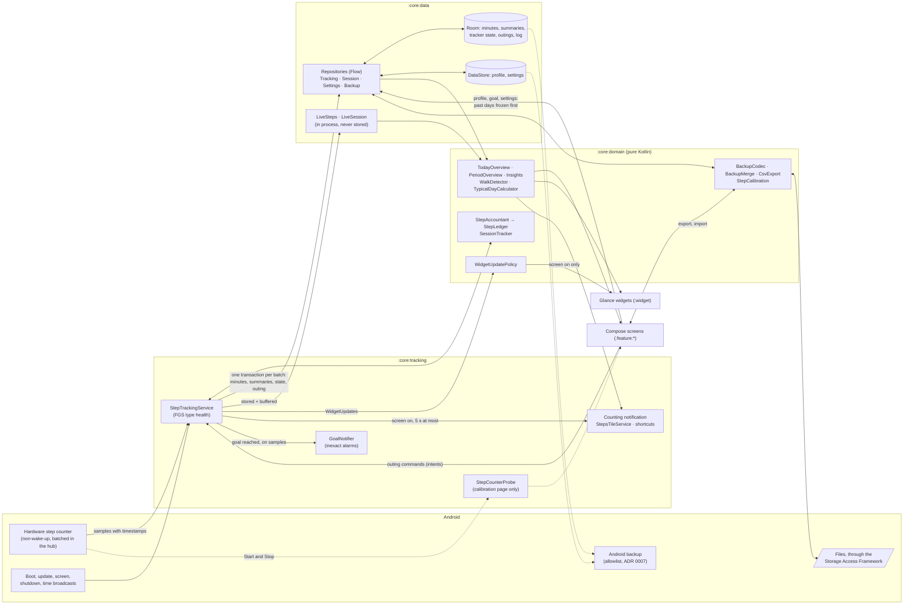

# Passo — Technical Planning

> Companion to [VISION.md](VISION.md). This document defines the architecture, the design of the tracking engine, and the delivery phases.
> It is written to be read by humans and by Claude Code.
>
> How it is kept, and where its closed parts went (the phases done, the log's past periods): «How it is made», below.

---

## How it is made (2 Nov 2026)

The same rules as the family's other plans (owner, 2 Nov 2026: "the same rules and mechanism,
so they are uniform"):

- **This file** is the live plan: how it is made, the state, what is open, the architecture
  (§1 to §10, §12 to §14, cited by number in the code), the phases not yet done (§11), and the
  log of the current period (§15). A new decision or deviation is written **at the end of §15's
  log**, one entry each, with its date and who asked, as always; a box opened or ticked goes in
  «Open» below.
- **`docs/planning/NN-<period>.md`** are the closed parts of the plan (the phases done, the log's
  past periods), **frozen**: never edited. A decision that changes an archived one is written
  here, naming the archived file and the entry it changes.
- **`docs/planning/README.md`** is the index of every archived title (`##`, `###`, `####`) and
  every log entry (its bold title), with its line: a reference by name in the code (Ǥ11
  Phase 10», «§15 "Phase 11's device checks done"») that is not in this file is found there. It
  is written by `python3 tools/planning_index.py`, never by hand, and changes only when the plan
  is archived (`--check` says whether it is behind).
- **Archive** when §15's log passes ~1,000 lines, or at a release, whichever comes first: the log
  becomes the next archive file (with the same header as the others), a phase done moves with it,
  here an empty log stays with its start date, «Open» is read again, and the index script is run.

## State

- **Released**: 1.0.0 (1 Oct 2026, `v1.0.0`) and **1.1.0** (2 Nov 2026, `v1.1.0`, tagged by the
  owner on `main` after the device checks below): its notes in `CHANGELOG.md`, its record in
  `docs/CHANGELOG-1.1.0.md`. What comes after it goes in `CHANGELOG.md`, `[Unreleased]`.
- **Done since 1.0.0**: Phase 11 (the Ways and the city walks), Phase 13 (the interval walk), Phase
  14 (more ways, beyond Europe), in archive 01 with Phases 0 to 8 and 10; Phase 12 in archive 03.
- **Done on 2 Nov 2026**: Phase 12, Your year on foot (archive 03), checked on a device by the owner.
- **Not started**: Phase 9, Google Play (optional, later; §11, below).

## Open

What is left to do or decide, in one place: a box opens here, naming the entry it comes from,
and closes here, naming the one that closes it. Phase 12's own boxes stay in its section (§11).

- [ ] **Baseline Profiles; R8 full mode; startup check** (archive 01, «Phase 7»).
- [ ] **The accessibility scanner reports no critical issues** (archive 01, «Phase 7»).
- [x] **The full install and update path**: install the last release, then update to the next
  over it, with the data kept (archive 01, «Phase 8»). Done by the owner on 2 Nov 2026, 1.0.0 to
  1.1.0, before the tag («I did the tests and everything works»); the database's road from schema
  3 to 6 is also tested (`UpgradeFromFirstReleaseTest`).
- [x] **On a device (owner): the new icon** (§15, «The new icon: two prints on the green», 9 Nov
  2026): the launcher icon in the phone's own mask, the themed icon, the status-bar icon and the
  Quick Settings tile, the Outing shortcut and the walker on an outing's bar. Done by the owner on
  9 Nov 2026 (§15, «The new icon checked on the phone»).
- [x] **On a device (owner): the Outing shortcut as an adaptive icon** (§15, «The Outing
  shortcut, an adaptive icon», 9 Nov 2026): long press on the icon, in the phone's own mask and
  with the themed icons on. Done by the owner on 9 Nov 2026 (§15, «The adaptive shortcut checked
  on the phone, and Tetto in the family»).
- [x] **On a device (owner): each outing's shortcut wears its own mark** (§15, «Each outing's
  shortcut wears its own mark», 9 Nov 2026): after starting or saving a plan, a long press on the
  icon shows the interval walk with its slow and fast line, a run with its bolt. Done by the owner
  on 9 Nov 2026 (§15, «The outings' own marks checked on the phone»).
- [ ] **On a device (owner): a 30-minute interval outing with the screen off**: each change
  felt, its delay read from the log, the battery check of §9, numbers in `docs/battery/`
  (archive 01, «Phase 13»).
- [x] **On a device (owner): the new ways' maps** in both themes and on an open foldable; the
  Ways page with its groups at twice the text size (archive 01, «Phase 14»). Done by the owner
  (confirmed on 2 Nov 2026).
- [x] **On a device (owner): an outing left still on a phone with no wake-up step counter**: the
  log's `SIGNAL_WAKE` row says it was let go about 15 minutes after the last step (archive 03, «2 Nov
  2026. A review of the wakes»). Done by the owner on 2 Nov 2026, before the tag.
- [x] **Your year on foot names the cities walked that year** (archive 01, «Phase 11»): done
  with Phase 12, on its ways' page (archive 03, «Your year on foot»).
- [x] **On a device (owner): Your year on foot**: the share sheet with two or three apps, the
  image in both themes, a page saved (archive 03, «Phase 12»). Done by the owner on 2 Nov 2026,
  before the tag.

Read again on 2 Nov 2026, at archive 01 and 02: the boxes above are the ones the phases done had
left open, and the review's device check. Read again at 1.1.0's tag: the owner's checks of the
update, the outing let go, Your year on foot and the new ways' maps are done; §15 has no open
question.

---

## 1. Tech stack

| Concern | Choice |
|---|---|
| Language | Kotlin (latest stable 2.x), with the Compose compiler Gradle plugin |
| Build | Gradle with Kotlin DSL; version catalog (`gradle/libs.versions.toml`); convention plugins in `build-logic/` |
| JDK | Toolchain 21, `jvmTarget` 21 |
| SDK levels | `minSdk 34`, `targetSdk 37`, `compileSdk 37` |
| UI | Jetpack Compose, Material 3 in Chiaro's design language (its generated schemes, dynamic color on request), edge-to-edge |
| Widget | Jetpack Glance (`glance-appwidget` + `glance-material3`), latest stable (1.2.x at the time of writing) |
| Architecture | MVVM with unidirectional data flow; coroutines and `Flow` |
| Dependency injection | Hilt (`hilt-work` only if WorkManager is ever introduced) |
| Persistence | Room for step data and tracker state; DataStore (Preferences) for settings and profile |
| Navigation | Navigation 3 if stable at setup time, otherwise Navigation Compose with type-safe routes |
| Charts | Custom Compose `Canvas` components in `core:designsystem` (no third-party chart library) |
| Time | `java.time` |
| Testing | JUnit 5 or JUnit 4, Turbine, Truth or AssertK, Robolectric (Room and receivers), Compose UI tests, Glance unit test utilities |
| Quality | Android Lint, ktlint (via Spotless) or detekt; Baseline Profiles in Phase 7 |
| CI | GitHub Actions: build, unit tests, lint, formatting, and a forbidden-permission check on the merged manifest. A release workflow on version tags builds the signed APK and publishes it to GitHub Releases |
| License | GPL-3.0. Every new dependency must have a GPL-3.0-compatible license (Apache-2.0, MIT, BSD are fine) |

Always pick the **latest stable** versions at setup time and record them in the version catalog. Avoid alpha versions unless a phase needs them.

---

## 2. Project structure

```
passo/
├── app/                    # Application, MainActivity, navigation, DI entry points
├── build-logic/            # Convention plugins (android-library, compose, hilt, room…)
├── core/
│   ├── model/              # Pure Kotlin data classes (no Android deps)
│   ├── domain/             # Pure Kotlin: StepAccountant, calculators, streaks/records, outings, backup format
│   ├── data/               # Room DB, DAOs, DataStore, repositories
│   ├── tracking/           # StepTrackingService, sensor source, receivers, notification
│   ├── designsystem/       # M3 theme, typography, shared components, charts, icons
│   └── testing/            # test-only: the accessibility checks and the page walk the UI tests share
├── feature/
│   ├── today/
│   ├── history/
│   ├── insights/           # records, streaks, totals
│   ├── settings/           # Settings, your data (export, import), the step calibration
│   ├── onboarding/
│   ├── sessions/           # the Outings page and the outing editor (Phase 10)
│   ├── ways/               # the Ways and the city walks (Phase 11)
│   ├── year/               # Your year on foot (Phase 12)
│   └── guide/              # the guide, in Chiaro's shape
├── widget/                 # Glance widget(s), receiver, update coordinator
├── docs/                   # ADRs, formulas, battery test notes
├── VISION.md
├── PLANNING.md
└── CLAUDE.md
```

Rules:

- `core:model` and `core:domain` are pure Kotlin/JVM modules. All business logic lives there and is unit-tested without Android.
- Feature modules depend on `core:*`, never on each other.
- `app` wires everything together.

---

## 3. Architecture overview

Reviewed at Phase 7 (25 Sep 2026) against the code: the Phase 1 diagram showed the tracking
path alone; the app now also has outings, in-process live state, pushed widget updates, goal
alarms, the tile, the export and import, and the calibration.



**The write path, and its one writer.** Only the service writes steps. The sensor's samples go
through `StepAccountant` (deltas into minutes, §4.4) and `StepLedger` (the buffer and its write
triggers, §4.5); `SessionTracker` measures the outing under way from the same deltas. A batch
is written by `TrackingRepository.persist` in **one** Room transaction: the minutes, the
summaries of the days they touch, the tracker state, the log lines and the outing. The same
repository is the only way to change the profile or the goal, and the import's only way in: one
lock orders all of them, so a day is frozen before a new profile or goal can reach it (§5,
ADR 0003) and no batch lands inside an import.

**The read path is computed, not stored.** The screens, the widgets and the notification read
the repositories' `Flow`s and derive everything in `:core:domain`: today's sentence and pace
(`TodayOverview`), the periods (`PeriodOverview`), records and streaks (`Insights`), walks and
the usual day. Nothing of it runs in the background or is cached in a table (§5, §6).

**Live state stays in the process.** Between two writes the service publishes today's stored
plus buffered count (`LiveSteps`) and the outing as it stands (`LiveSession`). Today, the tile
and the widgets add it to what is stored (`withPending`, `byDayWithLive`), so every surface
shows the same count and it never goes back during a write. It is never persisted: the
database is the truth after any crash.

**Surfaces update only when someone can see them** (§7, §8, §9). The service tells the widgets
through `WidgetUpdates` (declared in `:core:data`, so the service never depends on `:widget`),
and `WidgetUpdatePolicy` decides now, later or not at all; with the screen off, only a change
of tracking state or of a setting repaints. The notification follows the screen; the tile reads
only between `onStartListening` and `onStopListening`. Goal reached rides on the samples; the
evening reminder and the weekly summary are one inexact alarm each (`GoalNotifier`), after a
catch-up with the sensor (`TrackerLink`).

**Control has two doors.** Pause and resume go through `TrackingControl` (Settings' switch,
Today's card, a paused widget's or tile's tap): a pause stops the service, which writes its
buffer as it goes; a resume forgets the baseline, then starts the service from the activity,
where a foreground service may start (a widget's tap opens the app to do it). An outing's
start, pause, resume, stop and "keep going" are intents to the running service
(`SessionControl`), from the screens, the notification's actions, the launcher's shortcuts and
the evening reminder's "Walk now".

**Data in and out, by the reader or by Android** (Phase 7, ADR 0011; ADR 0007). The reader's
export writes the whole history as JSON, or a table as CSV, to a file the system's picker
chose; the import reads one back and merges it (`BackupMerge`: every minute at its larger
count, never deleting). Android's backup copies the database and the settings file, nothing
else; a tracker state from another installation is dropped (`adoptTrackerState`). Passo itself
has no network access either way.

**The calibration reads the counter directly** (`StepCounterProbe`), only while its page is on
screen: the counter is cumulative, so its values at Start and Stop measure the walk whatever
happened in between, independently of the service.

`:app` wires the graph (Hilt), holds the activity and the navigation (Navigation 3: the three
tabs, Settings, the Outings page and editor, the calibration), and starts the service when the
app is opened.

---

## 4. Step tracking engine (core design)

This is the riskiest part of the app. Build it first, test it in the field, and don't build UI on top of it until it is proven.

### 4.1 Why a foreground service

- `TYPE_STEP_COUNTER` is **cumulative since boot** and **resets to 0 at every boot**.
  - Steps taken while the app isn't running are still counted by the hardware. They're only lost if the device reboots before the app reads them.
- Since Android 9, `ACTION_SHUTDOWN` is delivered **only to receivers registered at runtime**, so a live process is needed to save the last value before power-off.
- Since Android 9, apps in the background don't receive sensor events. A worker waking up periodically can't reliably read the sensor.
- A foreground service of type `health` is the documented mechanism for continuous fitness tracking.
  - Prerequisites: the `FOREGROUND_SERVICE_HEALTH` permission in the manifest, and the runtime permission `ACTIVITY_RECOGNITION`.
  - The service can be started from `BOOT_COMPLETED`. `BOOT_COMPLETED` and `MY_PACKAGE_REPLACED` are exemptions from the background-start restriction, and `health` is not among the types Android 15 forbids from a `BOOT_COMPLETED` receiver (`dataSync`, `camera`, `mediaPlayback`, `phoneCall`, `mediaProjection`, `microphone`). `ACTIVITY_RECOGNITION` is not a while-in-use permission, so it does not block a start from the background either. Established from the documentation in Phase 1 (§15).

### 4.2 Service lifecycle

| Trigger | Action |
|---|---|
| App opened (activity in foreground) | Start the service if it isn't running and permissions are granted |
| `BOOT_COMPLETED` (manifest receiver) | Start the service |
| `MY_PACKAGE_REPLACED` (manifest receiver) | Start the service after an app update |
| Service `onStartCommand` | `startForeground(FOREGROUND_SERVICE_TYPE_HEALTH)` and register the sensor listener; return `START_STICKY` |
| `ACTION_SHUTDOWN`, `QUICKBOOT_POWEROFF` (runtime receiver) | `goAsync()`, then `sensorManager.flush()`, wait for `onFlushCompleted` (at most about 1.5 s), then persist synchronously |
| `ACTION_SCREEN_ON`, `ACTION_USER_PRESENT` (runtime) | Re-register with low latency, flush, refresh notification and widget |
| `ACTION_SCREEN_OFF` (runtime) | Persist the buffer, then re-register with high latency |
| `ACTION_TIME_CHANGED`, `ACTION_TIMEZONE_CHANGED` (runtime) | Persist the buffer, recompute today's local date, refresh the surfaces |
| User toggles "Pause tracking" | Persist, unregister, `stopSelf()` |

If the user or the OEM stops the service, no data is lost as long as the device doesn't reboot in the meantime, because the counter is cumulative. The UI and widget then show a "Tracking paused" state with tap-to-resume. The limitation is that a force-stopped app doesn't receive `BOOT_COMPLETED` until the user opens it again; this is documented in the FAQ.

### 4.3 Sensor registration strategy

| Screen state | Sensor | `samplingPeriodUs` | `maxReportLatencyUs` |
|---|---|---|---|
| Off | Non-wake-up `TYPE_STEP_COUNTER` | `SENSOR_DELAY_NORMAL` | High, `SCREEN_OFF_LATENCY` (default 10 min) |
| On | Same sensor | `SENSOR_DELAY_NORMAL` | Low, `SCREEN_ON_LATENCY` (default 0 to 2 s) |

- A non-wake-up sensor never wakes the application processor. Events wait in the hardware FIFO and are delivered the next time the processor is awake.
- If the FIFO overflows, intermediate events are dropped, but the **total stays correct** because the counter is cumulative. Only minute-level attribution gets coarser.
- **Non-wake-up, decided from the platform documentation** (`docs/adr/0002-sensor-reporting.md`): the wake-up variant would only bound the loss on an *abrupt* power loss, and would pay for it with a wakeup per report window, every day. A device that has only a wake-up step counter still gets it.
- `sensor.fifoMaxEventCount`, `fifoReservedEventCount`, vendor, name and wake-up mode are written to the diagnostics log at every service start, with whether the phone has a wake-up counter (and its FIFO) and which step detectors it has (read, never registered).
- Some phones have no FIFO at all (`fifoMax=0`, the owner's Samsung, Oct 2026): with the screen off the counter's events are dropped while the processor sleeps, and its latest value arrives in a clump when the phone next wakes. The total stays exact; the attribution of §4.4 lays the clump over the minutes it took.

### 4.4 Accounting algorithm (`StepAccountant`, pure Kotlin)

Input for each sensor event: `counterValue` (total since boot), `eventElapsedNanos` (the event timestamp), plus an injected `SystemSnapshot(bootCount, elapsedRealtimeNanos, wallClockMillis, zoneId)`.
`bootCount` comes from `Settings.Global.BOOT_COUNT`.

```
state = TrackerState(bootCount, lastCounterValue, lastSampleElapsedNanos, lastSampleWallMillis)   // persisted in Room

delta = when {
    state == null                       -> 0                   // first run ever: baseline, don't count steps from before install
    snapshot.bootCount != state.bootCount -> counterValue      // new boot session: counter restarted from 0
    counterValue < state.lastCounterValue -> counterValue      // sensor/HAL reset without reboot
    else                                -> counterValue - state.lastCounterValue
}

eventWall = snapshot.wallClockMillis - (snapshot.elapsedRealtimeNanos - eventElapsedNanos) / 1e6
if (eventWall is in the future or before the lower bound) eventWall = snapshot.wallClockMillis   // guard against buggy timestamps

lowerBound = if (same boot session) state.lastSampleWallMillis else bootWallMillis

// Attribute delta to minute buckets, by the milliseconds each minute holds of the stretch walked:
//  - the stretch ends at eventWall and lasts delta / DEFAULT_CADENCE (≈110 spm), never before
//    lowerBound; a delta faster than that is spread evenly over [lowerBound, eventWall]
//  - one rule for every gap: a lone step lands in its own minute; a clump handed over at once
//    (a sensor with no FIFO, whose events are dropped while the processor sleeps) is laid over
//    the minutes it was walked in, never 170 steps in one minute and 25 in the next
//  (until Oct 2026: a gap ≤ 2 min put everything in the eventWall minute, §15)
// Sanity: if delta > MAX_CADENCE (250 spm) × gapMinutes + 50 → cap, log a diagnostics anomaly

newState = state.copy(bootCount, lastCounterValue = counterValue, lastSampleWallMillis = eventWall)
```

Output: a list of `(epochMinute, localEpochDay, steps)` increments, plus the new state.
All wall-clock and time-zone logic is injected, so the algorithm can be fully unit-tested.

### 4.5 Persistence rules

- Keep an in-memory buffer of minute increments in the service.
- Flush the buffer to Room in **one transaction** that also updates `TrackerState` and today's `DailySummary`. Flush when any of these happens:
  - a minute boundary is crossed while events are flowing
  - the screen turns off
  - shutdown
  - `onDestroy`
  - 100 or more buffered steps
  - Once per drain: a write asked for and still under way carries the samples recorded meanwhile, so a FIFO handed over in one burst asks for one write, not one per sample (2 Nov 2026, §15).
- Invariant: the steps stored in Room plus the stored `lastCounterValue` are always consistent.
  - If the process dies with an unflushed buffer, the next sample recomputes the delta from the stored `lastCounterValue`. Nothing is double-counted and nothing is lost; only the minute attribution may shift.

### 4.6 Edge cases (all need unit tests)

| Case | Expected behavior |
|---|---|
| First install mid-day | Baseline at the current value. Today starts from 0 and the UI explains this once. |
| Nightly shutdown | The shutdown flush saves the last value. After boot, the first sample has a new `bootCount`, so `delta = counterValue`. |
| Abrupt power loss or crash | Steps since the last delivered batch are lost (bounded by the latency window). Documented. |
| Walking across midnight | Event timestamps split the steps between days. The gap rule splits long gaps proportionally. |
| Time-zone change | Buckets are stored in UTC `epochMinute` together with the `localEpochDay` computed at write time. Days already recorded are never re-bucketed. |
| Manual clock change | Same as a time-zone change. Timestamps come from elapsed realtime, so they are monotonic. |
| Sensor jumps (buggy HAL) | Capped by `MAX_CADENCE` and logged. |
| A counter with no FIFO, handing steps over in clumps | Each clump laid back over the time it took at 110 spm, minute by minute: no false minute of running, the total exact. |
| `ACTIVITY_RECOGNITION` revoked | The service stops. The UI, notification and widget show "Permission needed". |
| No step counter sensor | The APK from GitHub installs on any device, so a blocking explanation screen is **required**. `uses-feature required=true` stays in the manifest for a future Play listing, where it filters these devices. |
| Counter float precision | Values are `Float`; convert with `toLong()`. Exact up to 2^24 steps per boot session, which is far beyond realistic use. |

---

## 5. Data model

### Room

```kotlin
@Entity(tableName = "tracker_state")          // single row, id = 0
data class TrackerStateEntity(
    @PrimaryKey val id: Int = 0,
    val bootCount: Int,
    val lastCounterValue: Long,
    val lastSampleElapsedNanos: Long,           // monotonic: gaps are measured on this clock (§15)
    val lastSampleWallMillis: Long,
    val updatedAtMillis: Long,
)

@Entity(tableName = "minute_steps", indices = [Index("localEpochDay")])
data class MinuteStepsEntity(
    @PrimaryKey val epochMinute: Long,         // UTC minute
    val localEpochDay: Long,                    // local date at write time
    val steps: Int,
)

@Entity(tableName = "daily_summary")
data class DailySummaryEntity(
    @PrimaryKey val localEpochDay: Long,
    val steps: Int,
    val distanceMeters: Double,
    val activeKcal: Double,
    val activeMinutes: Int,
    val briskMinutes: Int,
    val goalSteps: Int,                         // goal in effect that day
    val finalized: Boolean,                     // true after the day is over
)

@Entity(tableName = "diagnostics_event")      // ring buffer, ~500 rows
data class DiagnosticsEventEntity(
    @PrimaryKey(autoGenerate = true) val id: Long = 0,
    val wallMillis: Long,
    val type: String,                           // BOOT, SHUTDOWN_FLUSH, ANOMALY, SERVICE_START…
    val detail: String,
)
```

- Size estimate: about 300 minute rows per day, roughly 110k rows per year, a few MB. Keep minute data indefinitely; it's needed for hourly charts and recalculation.
- Today's `DailySummary` is recomputed from today's minute rows at every flush.
- Past days are **frozen**, so changing the profile doesn't silently rewrite history. Settings offers **"Apply profile to past data"**, which recomputes every summary from the minute rows.
- Use Room auto-migrations with exported schemas (`room.schemaLocation`) committed to the repo.
- **Schema v4 (Phase 11):** `way_journey`, a way the reader started (the way, its start day and instant, its state `ACTIVE` / `FINISHED` / `LEFT`, the day it ended, how far its stages were told). No distance: what was walked is the days' own estimates from the start, read with them (`docs/adr/0014-ways.md`).
- **Schema v5 (Phase 11, part two):** `session.walk` (the city walk an outing walks, by name; null for every other outing) and `session.walkFromMeters` (where along the walk it began). A walk's journey is a `way_journey` row like a way's; its progress is its outings', read with them (`docs/adr/0015-city-walks.md`).
- **No tables for walks or the typical day.** Both are computed on read from `minute_steps` (§6.1, §6.2). Add a cache table only if profiling shows a need.
- **Schema v2 (Phase 10), an auto-migration adding two tables and touching nothing else:**
  - `session_plan`: the reader's outings (name or null, goal kind and value, intensity, milestones as a bit set, vibrate, position, last started).
  - v3: `voice` (`OFF`, `HEADPHONES`, `ALWAYS`) on both, default `OFF` (the voice, ADR 0010).
  - `session`: each outing walked, with its goal copied at the start (frozen like a day), its state (`ACTIVE`, `PAUSED`, `FINISHED`) and end reason, its totals (steps, time in motion, time at its pace, estimated distance and energy), its last step and last measured moment, the milestones already told. The one under way is written in the step batch's transaction (§4.5).

### DataStore (Preferences)

- Profile: height, weight, sex (optional), step length mode (auto, manual or calibrated), walking step length, running step length.
- Goal, units, first day of week, theme, dynamic color, notification opt-ins, reminder time and threshold, tracking enabled.
- The last day whose goal was seen reached (not a setting: the record that keeps "goal reached" once a day).
- Walk detection enabled (default on), minimum walk duration (5, 10 or 15 min; default 10), typical-day line shown (default on), Today's "Start an outing" button shown (default on).
- Whether the outing presets were written once (so deleting them is final), and the last finished outing whose card Today has put away.

---

## 6. Derived metrics (`core:domain`)

All constants live in one file (`MetricsConstants.kt`) with comments that cite their sources. All defaults are to be validated.

- **Default walking step length:** `height × 0.415` (`× 0.413` when the profile says female). If height is unknown, 0.70 m.
- **Running step length:** default `walking × 1.3`, user-editable. It applies to minutes with a cadence of at least `RUNNING_CADENCE` (140 spm).
- **Distance:** the sum over minutes of `steps × stepLength(cadence)`.
- **Active calories (net):** the sum over minutes of `distanceKm × weightKg × k(cadence)`.
  - `k_walk ≈ 0.5 kcal/kg/km`, rising slightly for brisk cadences: flat up to 100 spm, then linearly to 0.6 just below 140 spm (Phase 2, §15).
  - `k_run ≈ 1.0 kcal/kg/km`.
  - Default weight if not set: 70 kg.
  - Net means basal metabolism is not included. The UI calls this "active calories".
  - Alternative considered: MET-based tables by speed. Rejected because it is less robust for sparse minutes.
- **Active minutes:** count of minutes with at least `ACTIVE_MINUTE_THRESHOLD` (40) steps.
- **Brisk minutes:** count of minutes with at least 100 steps.
- **Average cadence:** steps in active minutes divided by the number of active minutes.
- **Streak:** consecutive finalized days with `steps ≥ goalSteps`, plus today if its goal is already met.
- **Records:** best day, ISO or locale week, month, and longest streak.

### 6.1 Walk detection (`WalkDetector`, pure Kotlin)

Input: the minute buckets of one local day, plus the settings. Output: a list of `Walk(start, end, steps, distanceM, activeKcal, avgCadence, type)`.

```
1. Mark each minute as "moving" if steps ≥ WALK_MINUTE_THRESHOLD (60).
2. Merge moving minutes into runs, bridging gaps of up to WALK_MAX_GAP_MINUTES (2) non-moving
   minutes (traffic lights, doors). Steps inside a bridged gap belong to the walk.
3. Discard runs shorter than the minimum duration setting (default 10 min).
4. For each remaining run compute the metrics with the same calculators as §6.
5. type = RUN if avgCadence ≥ RUNNING_CADENCE, else WALK.
   (Optional refinement: MIXED if both walking and running minutes exceed 30% of the walk.)
```

- A walk crossing midnight is split at midnight, like every other daily metric.
- Constants live in `MetricsConstants.kt` next to the others.
- Cost: one linear pass over at most 1,440 rows, only when the day detail or Today screen is visible. No background work.
- Accuracy depends on minute attribution (§4.4). With a working FIFO it's minute-accurate; after a FIFO overflow or a service restart, walk boundaries may be off by a few minutes. This is acceptable and documented.

### 6.2 Typical day curve (`TypicalDayCalculator`, pure Kotlin)

- Take the same weekday over the last `TYPICAL_DAY_WEEKS` (4) weeks, skipping days with fewer than 500 steps (phone left at home, tracking paused).
- For each day, build the cumulative curve in 15-minute slots (96 points).
- The typical curve is the mean of those curves, slot by slot. It is shown only if at least 2 valid days exist.
- "Ahead or behind" = today's cumulative value minus the typical value at the current slot. It is shown as a short label, for example "+1,240 vs usual".
- Computed when the Today screen opens and then once every 15 minutes while it stays visible. It never runs in the background.

---

## 7. Widgets (Glance)

Two widgets since Phase 4 (owner's request), in Chiaro's dress so a Passo card and a Chiaro card on one home screen read as one family: «At a glance» (Chiaro's «Colpo d'occhio», with today's ring where the weather glyph was) and «In words» (Chiaro's «In parole»: the day in type, with two small marks). Decisions and reasons: `docs/adr/0005-widgets.md`.

### Configuration

- `SizeMode.Exact`: every form is read off the size the launcher really granted.
- **One size spec for both cards** (`WidgetProviderTest`): default placement 4×1 (`targetCellWidth` 4, `targetCellHeight` 1, where Chiaro's pair opens), minimum one cell (`minResizeWidth`/`minResizeHeight` 40 dp), `resizeMode="horizontal|vertical"`, and **no maximum**: Launcher3 turns a dp maximum into cells on every grid profile and keeps the smallest, so no value means "four cells" everywhere (ADR 0005). Each layout has a form for any grant instead.
- `updatePeriodMillis = 0`; `configure` is the per-widget settings screen, `reconfigurable|configuration_optional`.
- Reference grants the layout tests measure against (Chiaro's): one row ≈ 85 dp tall, two cells ≈ 159 dp, three ≈ 250, four ≈ 340; two rows ≈ 189 dp.

| «At a glance» form | When | Content |
|---|---|---|
| DOT | narrower than 120 dp | The ring with the count inside (compact where the language shortens thousands) |
| NARROW | one row | Ring, count, «of 10,000 steps» |
| WIDE | one row with a sentence column (4 cells) | The same, and the day's sentence at the far edge; or mirrored, the ring on the right |
| TALL | two rows and up | Ring in the top corner; count, sentence and goal from the bottom. At every form and size the ring is the family's circle, «In words»'s dial in Tempo at the same size (§15, 4 Nov 2026, «at every size») |
| PANEL | two rows and up, three cells or wider | The row on top, its ring the family's circle, larger without the sentence as the tall card's (the sentence under the count where the ring leaves it no room at the far edge), and under it today's steps by hour (24 bars built from boxes, current hour highlighted) or, as the reader chooses, the last 7 days against the goal (7 bars, today highlighted, a line at today's goal; §15, 2 Nov 2026) |

| «In words» form | When | Content |
|---|---|---|
| LINE | one row, one or two cells | «Steps today», the count, the share of the goal where it costs the number nothing |
| ROW | one row, three cells and up | The count on the leading side; the sentence, the goal and the distance and calories at the far edge |
| STACK | two rows and up | The eyebrow on top; the count large, the sentence and the facts at the bottom; «the day in figures» with height to spare |
| PANEL | two rows and up, four cells | The count beside the words, on one baseline; the day in figures under both |

### Rendering

- Colours are resolved at render time against the ground the card really has (Chiaro's ink rule, `widgetInk`), never left to the launcher's day/night resolution: white inks on one of Chiaro's six card colours, the dress's own inks on light or dark, and below 50% solidity the wallpaper's hint decides. Material 3 dynamic color when the reader turned wallpaper colours on in the app.
- **The ring is a bitmap** painted at the size shown, capped at 416 px a side (at most 0.7 MB, about 50 KB in a row), one per card: far under the Android 17 RemoteViews bitmap cap. Vector levels were rejected (5% steps for the arc and the notch). The bars are boxes.
- Previews: a static `previewLayout` of the default card, and generated previews on Android 15+ (`providePreview`), published once per app version.
- Tapping a card opens the Today screen. A paused card opens the app asking it to resume (the service is started from the activity). A card without the permission or stopped by the system opens the app, which fixes or restarts it.

### Update strategy (battery-aware)

- Push-based from `StepTrackingService` through `WidgetUpdates` (interface in `:core:data`, `WidgetUpdateCoordinator` in `:widget`), decided by `WidgetUpdatePolicy` (pure, `:core:domain`). There is **no periodic polling**.
  - Screen on or user present: flush the sensor, then update immediately.
  - While the screen is on: update at most every 60 s, and only if the steps changed (a trailing timer, cancelled at screen-off).
  - Day rollover (detected by the screen-on ticker), goal reached: update immediately.
  - Settings or profile changed, tracking started or stopped, an outing started, paused or ended: update immediately, with the screen off too (one repaint, and a stopped service cannot repaint at the next screen-on).
- While an outing is under way, both cards say it in the sentence's place («Brisk walk: 12 of 20 min»), as the tile's line does (Phase 10).
  - Screen off: no updates.
- The widget reads the repository plus the service's in-process buffer (`LiveSteps`), exactly as Today does, so it shows persisted truth and the steps not written yet.

---

## 8. Notifications and Quick Settings tile

- **Channel `tracking`** (low importance, silent, `setOnlyAlertOnce`): the ongoing foreground service notification.
  - Content: collapsed, today's steps; expanded, the way to the goal (or when it was reached), the share of the goal with the active minutes, the estimated distance and calories, and a progress bar to the goal.
  - Updated only while the screen is on, at most every 5 s. Both forms are built in the same update; today's minutes are read again only after a write.
  - How it shows (in full, minimized, off) is the reader's, on the system's channel page: Settings reads it and opens that page (§15).
- **During an outing** (Phase 10) the `tracking` notification is the outing's: its name, its sentence, «12 of 20 min», the pace against the outing's, the steps and the estimates, Pause/Resume and Stop. Android 16+: `ProgressStyle` with the milestones as points, promoted to a Live Update (`POST_PROMOTED_NOTIFICATIONS`); below, `BigTextStyle` and a progress bar. Updated as the day's form is (screen on, every 5 s at most), plus once at each milestone.
- **Channel `sessions`** (default importance, no sound, no vibration of its own): an outing's goal reached, with "Keep going" for 15 minutes; an outing ended by a long stillness, with "Resume" for as long. The milestones on the way are Passo's own vibration patterns, played only while this channel is on.
- **Channel `goals`** (default importance, opt-in): goal reached once per day, the evening reminder (with "Walk now": an outing for the rest of the day), the weekly summary.
  - Goal reached rides on the service's samples. The reminder is an inexact `setAndAllowWhileIdle` with a wakeup, the summary an inexact `RTC` alarm without one; both armed again at every start of the process, every change of what they depend on, every clock or zone change, and every firing. No exact alarm permission (Phase 6, §15).
  - Each alerts when posted (no "only alert once": under a fixed id it silenced today's while yesterday's was still shown). Goal reached and the reminder go by themselves at the end of their day (`setTimeoutAfter`); the reminder also when its "Walk now" is touched or the goal is reached. No reminder during an outing, and no reminder alarm armed while the goals' notifications cannot show (armed again when they can: the app's return, the system's block-state broadcasts) (2 Nov 2026, §15).
- **Channel `ways`** (default importance, Phase 11): a stage reached on the way under way, and its end. Told by the days being written (`WayNotifier`), never by a timer; touching it opens the Ways page.
- If `POST_NOTIFICATIONS` is denied, the foreground service still runs; its notification only shows in the system's task manager. Explain this in onboarding; don't block on it.
- **QS tile (`TileService`):** reads today's steps from `onStartListening()` to `onStopListening()`, following the live count meanwhile. It costs nothing when the panel is closed.

---

## 9. Battery rules (non-negotiable)

1. No accelerometer. No continuous `TYPE_STEP_DETECTOR` unless measurements prove it's cheap.
2. No wakelocks held by the app, except inside `goAsync()` for the shutdown flush, and the one of §9.7: an outing with signals on a phone whose step counter cannot wake it.
3. No exact alarms, no `REQUEST_IGNORE_BATTERY_OPTIMIZATIONS`, no periodic workers for tracking.
4. Nothing runs on a timer while the screen is off. All screen-on tickers are coroutines tied to the screen state.
5. Database writes are batched (§4.5).
6. Each phase that touches the service ends with a battery check:
   - `adb shell dumpsys batterystats --charged <pkg>`
   - `adb shell dumpsys sensorservice` (confirm batching is active)
   - Doze simulation: `adb shell dumpsys deviceidle force-idle`
   - Battery Historian for the longer field tests
7. **The one exception (Phase 10, `docs/adr/0009-sessions.md`):** while an outing the reader started is counting, the wake-up step counter (if the phone has one besides the usual one) reports within 30 s, and 2 s in the 40 s before a change of an interval outing (Phase 13, `docs/adr/0013-interval-walks.md`), so its signals reach a phone in a pocket on time: about two brief wakes a minute while walking, a few more in each of an interval outing's last 40 s before a change, none while still, no wake lock or timer of the app's own. Paused, over or with no outing, the registration is the usual one. An outing ends by itself (goal, 15 min still, 1 h paused, 4 h), noticed at a step or a screen-on, never by a timer.
   *Amended 4 Oct 2026 (owner, after the first interval walk; `docs/adr/0013-interval-walks.md`):* on a phone with **no** wake-up step counter, an outing that tells its signals (vibration or voice, and the outings' channel on) holds a partial wake lock while it counts, so the counter's steps arrive as they are taken and every signal with them; the screen stays off; let go at a pause, the end or the service's, bounded at 4 h 10 min; logged when taken and let go. No timer: the signals still ride on the steps. An outing with no signal, a paused one, and every phone with a wake-up counter never hold it. About 1 to 3% of a battery an hour, to be measured.
   *Amended 2 Nov 2026 (owner, after a review):* that wake lock is also let go once the outing has been still for 15 minutes (`SignalWake.letGoAt`), when it is over and has nothing left to tell on time; it is closed at the next step or look, as on every phone. A forgotten outing had kept the processor awake until the screen came on, up to the 4 h 10 min bound. The moment is kept by a timer in the service, the one timer that runs with the screen off, and only while the wake lock already keeps the processor awake: it shortens a wake and never makes one.
8. OEM task killers: onboarding shows a battery tip, with a button to the app's own settings page, only when `Build.MANUFACTURER` is on a known list (`OemTips`). Samsung is not on it (§15).

---

## 10. Permissions and manifest

| Permission / element | Type | Why |
|---|---|---|
| `ACTIVITY_RECOGNITION` | Runtime | Read the step counter; prerequisite for the `health` foreground service |
| `POST_NOTIFICATIONS` | Runtime | Show the tracking and goal notifications (optional) |
| `FOREGROUND_SERVICE` | Normal | Foreground service |
| `FOREGROUND_SERVICE_HEALTH` | Normal | Foreground service of type `health` |
| `RECEIVE_BOOT_COMPLETED` | Normal | Restart tracking after boot |
| `VIBRATE` | Normal | An outing's signals, in their own patterns (Phase 10) |
| `POST_PROMOTED_NOTIFICATIONS` | Normal | The outing under way as a Live Update on Android 16+ (Phase 10) |
| `<queries>` for `TTS_SERVICE` | Manifest | Lets Android 11+ show Passo the text-to-speech engine, for the outings' voice (ADR 0010). Not a permission |
| `WAKE_LOCK` | Normal | An outing's signals on a phone whose step counter cannot wake it: the processor kept awake while the outing counts (§9.7, ADR 0013). Also brought by WorkManager, held by the job while a widget card is drawn |
| `ACCESS_NETWORK_STATE` | Normal | Brought by WorkManager, which Glance runs its widget sessions on (Phase 4): it lets nothing leave the phone without `INTERNET`. Passo's own code does not use it |
| `android:allowBackup="true"` + `dataExtractionRules` | Manifest | Android's backup and device transfer carry the step history, the profile and the settings, an allowlist (`docs/adr/0007-backup.md`). No permission: Android sends the copy, not Passo |
| `<uses-feature android:name="android.hardware.sensor.stepcounter" android:required="true"/>` | Feature | Documents the requirement; filters devices on a future Play listing. It does not block APK installs, so the app also checks the sensor at runtime |

**Forbidden:** `INTERNET`, `ACCESS_*_LOCATION`, `REQUEST_IGNORE_BATTERY_OPTIMIZATIONS`, `SCHEDULE_EXACT_ALARM`, `USE_EXACT_ALARM`, `HIGH_SAMPLING_RATE_SENSORS`, `BODY_SENSORS`.

A CI task checks the merged release manifest and fails on any forbidden permission. Libraries that add one must be removed or patched with `tools:node="remove"`.

---

## 11. Delivery phases

Each phase ends with a merged PR, green CI and its acceptance criteria met.
Phases 1 and 4 need **field testing on a physical device**; an emulator is not enough for sensors or batching.

The phases done, with their acceptance and their boxes as they stood, are frozen in the archive:
0 to 8, 10, 11, 13 and 14 in [`docs/planning/01-phases-0-14.md`](docs/planning/01-phases-0-14.md),
12 in [`docs/planning/03-towards-1.1.0.md`](docs/planning/03-towards-1.1.0.md); the boxes they left
open are in «Open» above. Here stay the phases not done yet.

### Phase 9 — Google Play (optional, later)

Kept open, not planned yet. Notes to avoid closing the door:

- [ ] Enroll in Play App Signing **with the existing release key** (upload your own key during enrollment), so builds from GitHub and from Play share the same signature and users can move between them without reinstalling
- [ ] Build an AAB in addition to the APK
- [ ] Privacy policy (e.g. on GitHub Pages): no data collected or shared
- [ ] Play Console:
  - foreground service permission declaration (`health` use case, with a demo video)
  - health apps declaration, if required
  - Data safety form
  - content rating
- [ ] Store listing in Italian and English, with screenshots and a feature graphic
- [ ] Internal test track, then closed testing (check the current tester requirements for personal developer accounts), then production

---

## 12. Testing strategy

- **Unit (JVM):** `StepAccountant`, calculators, streaks and records, formatting. Use a fake clock and system snapshot. This is where most of the test effort goes.
- **Robolectric:** Room DAOs and transactions, receivers, the notification builder.
- **Compose UI tests:** onboarding, Today, Settings (with its data rows), the step calibration, History, Insights, the Outings page and its editor. Each state they draw also passes `assertAccessible()` (`:core:testing`), and each screen is walked at twice the text size on a 360dp phone and on an open foldable (Phase 7, `docs/adr/0012-foldables-and-accessibility.md`).
- **Contrast:** `ContrastTest`, every text ink on every ground, both dresses and themes, at 4.5:1.
- **Glance:** unit tests for the layout chosen at each size.
- **Manual device protocol** (`docs/testing/device-protocol.md`):
  - reboot
  - full shutdown overnight
  - Doze
  - time-zone change
  - revoking the permission
  - stopping the app from the system's task manager
  - app update
  - low battery
- **Battery:** the §9 checks at the end of Phases 1, 4 and 6, with the numbers logged in `docs/battery/`.

---

## 13. Working with Claude Code

### `CLAUDE.md` (create in Phase 0; keep it short)

Include:

- A one-paragraph project summary and links to `VISION.md` and `PLANNING.md`.
- Commands:
  - `./gradlew assembleDebug`
  - `./gradlew test`
  - `./gradlew lint`
  - `./gradlew spotlessApply`
  - the forbidden-permission check task
- The module map and dependency rules (§2).
- **Invariants:**
  - Never add `INTERNET`, location or other forbidden permissions (§10).
  - Business logic goes in `core:domain`, with unit tests.
  - Never poll or run timers while the screen is off.
  - Don't change the tracking engine without updating the tests for the §4.6 edge cases.
  - All user-facing strings go in resources, in both English and Italian.
  - No new third-party dependency without approval; its license must be GPL-3.0-compatible. Charts are custom Compose `Canvas` code, never a chart library.
- Code style: Kotlin official style, no `!!`, `Flow` over `LiveData`, immutable UI state.

### Workflow

1. One phase at a time. Start each session in **plan mode**, pointing to the phase section: *"Read PLANNING.md §11 Phase 1 and §4, propose a plan."*
2. Use one branch and PR per coherent chunk (e.g. `phase-1/accountant`, `phase-1/service`). Keep PRs small.
3. Write tests first for `core:domain` logic, and ask Claude Code to run them before finishing.
4. After each merge, tick the checkboxes in this file and record decisions as ADRs in `docs/adr/`.
5. Field-test the device-dependent phases yourself; paste the diagnostics logs back to Claude Code when something is off.

---

## 14. Risks and mitigations

| Risk | Impact | Mitigation |
|---|---|---|
| OEM task killers stop the service | Steps lost if a reboot happens while the service is stopped | Onboarding guidance; paused state in the widget and UI; the counter is cumulative, so no loss without a reboot |
| Buggy sensor timestamps on some devices | Wrong minute or day attribution | Timestamp validation and fallback to the arrival time; diagnostics log |
| Small or zero FIFO on low-end devices | Coarser minute attribution | Totals stay correct; the gap distribution heuristic |
| Lost or leaked release signing key | Users can't update without uninstalling (and losing data); a future Play listing can't reuse the key | Keystore created in Phase 0, kept outside the repo with an offline backup, stored only in GitHub Actions secrets |
| Play policy review of the `health` foreground service (only if Phase 9 happens) | Delay of a Play release | Continuous step tracking is the documented use case; prepare the declaration and video early |
| Users dislike the persistent notification | Uninstalls | Low-importance, useful content (live steps); explain why in onboarding; the user can minimize the channel |
| Abrupt power loss | Steps since the last batch are lost | Bounded by the latency window (10 min with the screen off), and only for steps the processor has not been awake for since; the wake-up variant was weighed and rejected (`docs/adr/0002-sensor-reporting.md`) |
| The wake-up step counter during an outing costs more than planned, or a phone lacks it | Battery, or late signals | Only while an outing counts, two wakes a minute at most while walking, ending by itself; without the sensor the page says signals can be late. To measure on a device (§9) |
| Android 17 RemoteViews bitmap cap | Widget crash | One ring bitmap per card, capped at 416 px a side (0.7 MB); the bars are boxes; test on API 37 |

---

## 15. Decisions log and open questions

### Decided

The decisions up to 1 Nov 2026, from Phase 0 on, are in
[`docs/planning/02-decisions-to-1-nov-2026.md`](docs/planning/02-decisions-to-1-nov-2026.md), and
those of 2 Nov 2026 (the review, Your year on foot, 1.1.0 prepared) in
[`docs/planning/03-towards-1.1.0.md`](docs/planning/03-towards-1.1.0.md), both frozen (the index,
[`docs/planning/README.md`](docs/planning/README.md), lists each by its title).

This log starts after 1.1.0's preparation (2 Nov 2026); its entries are written below.

- **No way on a widget** (owner, 2 Nov 2026, after 1.1.0's tag: "the Ways on a widget seems noise
  to me"; the question had stood open since Phase 11). Not built, and no longer asked. A way moves
  a few kilometres a day, so a line about it on a home screen would say the same thing all day,
  every day, beside a count that does move: the reason the way's card on Today shows only what
  the day did for it (archive 02, «The way under way on Today»). Where the reader stands is
  Insights' to say, and the way's page's; a stage reached is a notification already. The widgets
  stay about today.
- **«At a glance» and Tempo's «In words»: one circle at one size** (owner, 4 Nov 2026, with the
  two cards side by side on the phone, two by two: "make the circles of the two cards uniform, so
  that at the same size of card and the same content they are the same size; leave the circles'
  resizing as it is, but at the same size and text the circles must match"; the screenshots the
  owner named did not reach the session, the gallery's were drawn and measured instead). On the
  reference two-by-two (159 × 189 dp) the ring took the height its words left (the number, the
  sentence over two lines, the goal: 108.24 dp of 161), 52.75 dp, and grew where the sentence was
  shorter (73.75 dp for one line, 95 for none); Tempo's dial stood at 60.5 to 63 dp, held by the
  date beside it or by its note, larger on a free day. Now, under three cells wide, both cards'
  circle is the **tall circle** (`tallCircle` in `GlanceLayout.kt`; Tempo's `WordsFit.tallCircle`,
  the same arithmetic): the height the card's inside leaves over a budgeted band of words, a 34 sp
  line and three 16 sp lines at 1.32 em (108.24 dp at the default size, the ring's usual words),
  rounded down to a quarter, never under `TallRingMin`. Budgeted, never measured, so the day's
  words do not move it: on the reference two-by-two both draw 52.75 dp, a long sentence and a
  short one, a free day and a busy one; at 115% and 130% the band grows and both stand at 44 dp
  (the sentence yields a line first, as before). Where the reader hid the sentence the band is the
  number and the goal, and the ring takes that (95 dp on the two-by-two, as before). Each card's
  own limits still hold (here 104 dp and the card's width; on Tempo's the date's column beside the
  dial), so the two match wherever neither binds: on a card two cells wide up to about 199 dp tall,
  the two-by-two on every grid measured; a two-by-three keeps its 104 dp ring, Tempo's dial its 63
  dp. From three cells wide nothing changes: the panel's ring stays the header's 56 dp, and a tall
  card without the hours keeps its ring as before. Where the circle holds the ring under its room,
  the room stays air: the number grows only past the ring's 104 dp ceiling, as before. Tests:
  `GlanceLayoutTest` (the circle at the reference height and text sizes, one ring through the day
  at 159, 175 and 200 dp wide, the hidden sentence, three cells wide unchanged).
- **The family's circle at every size** (owner, 4 Nov 2026, after the entry above: "not only two
  by two: you must check every size; I wrote it badly before"; then, asked about the cards that
  stand in different compositions: two cells wide and three rows high, "Tempo grows", its dial to
  this ring's 104 dp with its date on a line over the title; three and four cells wide, "Passo's
  ring grows", one size per card for both). Measured on both galleries at every reference grant
  (dp; «In words» busy / free, «At a glance» with the hours / without): one cell 69 / 69 both;
  two by one 47 against 44; three and four by one 56 both; two by two 52.75 both; two by three 63
  against 104; three and four by two 78.5 to 82.5 / 101 against 56 / 74; three by three 104
  against 56 / 104; four by three 119.25 against 56 / 104. Now **the family's circle**, three
  functions with the same arithmetic in both apps (`dotRingSize`, `rowRingSize`, `tallCircle`;
  Tempo's `WordsFit.cellCircle`, `rowCircle`, `tallCircle`): one cell, the shorter side less 8 dp
  each side, 36 to 104 dp; one row, the height inside the snug insets with 84 dp for the words,
  44 to 56 dp, as before here; two rows and up, the height left over the budgeted band of words,
  with one line of sentence from three cells wide (where a sentence that takes two lines on two
  cells takes one), between `TallRingMin` and the ceiling `tallRingCeiling` (104 dp, or 45% of the
  inner side, Tempo's step 8.3) or the inner width, rounded down to a quarter. At the reference
  grants: 69; 44, 56, 56; 52.75, 73.75, 73.75; 104, 104, 119.25. Measured again: the same at every
  grant, with the hours or without, with Tempo's events or without. Here: **the panel's ring is
  the circle** (73.75 dp on the three- and four-by-two, from 56; 104 and 119.25 on three rows): two
  rows high it stands inside the height the number over the goal already gave the header, so the
  bars keep their 58.3 dp; three rows high they stay at their 112 dp. Where the ring leaves the
  sentence less than a column at the far edge (the four-by-three: 84 dp, under 96) and its height
  holds lines of it under the number over the goal, the sentence stands under the number, beside
  the ring (`panelStackedLines`: two lines on the four-by-three). Two side effects, accepted: on
  the four-by-two the words beside the larger ring have 18 dp less, so the goal takes its short form
  («of 10,000», the README's picture) and, where the sentence's column (107 dp in the gallery) is
  narrower than its two lines, the sentence takes three; on the three-by-three the goal is the short
  «of 10,000».
  **The tall card without the hours** takes the circle from three cells wide too: 73.75 dp on the
  three- and four-by-two (a sentence over two lines yields it, as before), 119.25 on the
  four-by-three (it was held at 104); the number grows past the larger of the ring and 104 dp, as
  before. Tests: `GlanceLayoutTest` (the circle at every reference grant; one ring through the day
  at five widths and four heights; the panel's header and bars; the stacked sentence's lines).
- **The panel's ring grows without the sentence, as the tall card's** (owner, 5 Nov 2026, with
  Tempo's «In words» kept to the event: "in Passo, when I hide the day's sentence the circle grows,
  and that's just right; I'd like a similar setting on Tempo's widget, so the circle can grow to
  the same size as Passo's"). Tempo's card gains «The day's note»: off, it says the event alone and
  its dial takes the band of a figure's line and one line, this ring's band without its sentence.
  Asked whether the panel should follow too, the owner: yes, so the two match there as well. The
  panel's ring is now `tallCircle(size, scale, sentence)` with the reader's choice, as the tall
  card's: two rows high 95 dp without the sentence (73.75 with it), the bars 37.5 dp (58.3 with it),
  still the panel (`glanceForm` and the preview's line take the choice too); three rows high the
  ceiling holds it, nothing changes. Tests: `GlanceLayoutTest` (the panel's header, bars and form
  without the sentence), `WidgetFitTest` (every card without the sentence, and the owner's
  two-by-two, 188 × 218 dp, measured from the phone's screenshots, added to its grants: nothing cut).

- **The new icon: two prints on the green** (owner, 9 Nov 2026: the four apps' icons redrawn
  from scratch as one series, "icons that say the app and recall what it does, full frame in
  Android's style, clean and readable when small, flat, the light from the same side for all,
  bright colours but not too much, one palette for the series"). Drawn first on a board, three
  symbols per app, two grounds, the home-screen check and the grid; the owner chose the series
  and asked for a margin between the drawing and the badge's edge (the first board let a symbol
  reach the edge). The mark is **two prints walking to the upper right**, the app's own sole:
  the one behind white, the one ahead amber, the step being taken, as the amber print was on the
  ring it replaces (archive 02, «The launcher icon: Chiaro's ring, Passo's step» and «The family's
  icons, made one suite», which this entry changes). The series' rules, the same in the four apps: the
  ground is the app's colour, lit from the upper left (the green `5CCB86 · 27A35A · 17834A`); the
  symbol white with one amber accent (`FFD36A · FDB528 · F28C17`); every shape a ramp from its
  light tone at the upper left to its deep one at the lower right, no shadow; the whole symbol
  within 28 units of the centre (measured 28.1), a 56 dp circle on the 72 that show, so a round
  mask leaves 8 dp of air and none reaches it. `tools/draw_launcher_icon.py` is rewritten: the
  ground is a drawing now (`ic_launcher_background.xml`) where it was the colour `#F7F4EE`, so
  `values/colors.xml`, which held only that colour, is gone and `ic_launcher.xml` points at the
  drawing. Inside the app, asked in the same review: the status-bar icon (`ic_stat_steps`, every
  notification and the Quick Settings tile) is the two prints in one ink, the outing's walker
  (`ic_progress_walker`, now the script's too) the two prints white and amber on a green disc,
  and the Outing shortcut (`ic_shortcut_outing`) its glyph in white on the green. The guide and
  the first run show no app icon, so nothing changes there. Checked: the XML the script writes,
  drawn and compared pixel by pixel with the approved drawings, differs only at the edges
  (0.6% of the badge's pixels, the antialiasing).
- **The new icon checked on the phone** (owner, 9 Nov 2026: "I merged the PRs of the other
  repositories too. I checked the APKs."; then "tick the boxes"). The device check of «The new
  icon: two prints on the green» is done; its box in «Open» is ticked.
- **The Outing shortcut, an adaptive icon** (owner, 9 Nov 2026, seeing the shortcuts of Passo
  and Tempo on the phone: "now I see a circle, and white around it"; then "make them adaptive,
  for Saldo and for the other two repositories too"). The shortcut drawn as a green disc («The new icon: two prints on
  the green», above, which this entry changes) kept its shape only under a round mask: under any
  other the launcher shrank it onto a white plate, as it does with any icon that is not
  adaptive. `ic_shortcut_outing` is now an `<adaptive-icon>`: the launcher icon's ground under
  the Outings glyph in white (`ic_shortcut_outing_foreground`, its 24 units at 55% of the 72
  that show, the share it had on the disc), the glyph again as the themed layer. The ground is
  written by `tools/draw_launcher_icon.py` a second time, into `:core:tracking`
  (`ic_shortcut_ground`), because a library cannot name the app's drawables. The family's rule
  for the launcher's shortcuts is now the white glyph on the app's colour, in the launcher's own
  shape; where an app draws its mark itself, it stays a disc (the walker on the outing's bar).
  Checked: the layers drawn in a round, a rounded-square and a squircle mask and as the themed
  icon; `:app:lintDebug`, `:app:assembleDebug`, `spotlessCheck` and `:core:tracking`'s tests.
- **The adaptive shortcut checked on the phone, and Tetto in the family** (owner, 9 Nov 2026:
  "I did every test on the phone and it is all fine. You can close every box."; then "Did you
  also align the documents with the reference to the family's new app, Tetto, in the various
  repositories?"). The device check of «The Outing shortcut, an adaptive icon» is done; its box
  in «Open» is ticked. Tetto (budget) is the family's fifth app: the README's «The family», this
  file's opening and «The family in the code», and VISION's opening name it beside Chiaro, Tempo
  and Saldo.
- **Each outing's shortcut wears its own mark** (owner, 9 Nov 2026: "the icon used for the
  «Japanese walk» item is not the one that appears in the app. In the app it had been changed on
  purpose to set it apart from the other walks"). Every shortcut wore the way to a flag, the
  Outing mark, while the Outings page draws an interval walk with its slow and fast line and a
  run with its bolt (`sessionIcon`, «the interval walk no longer wore the same mark as the brisk
  walk above it», the owner's review of 2 Nov 2026). `SessionShortcuts.shortcutIcon` now asks
  `sessionIcon` and maps its answer to three adaptive icons on the same ground,
  `ic_shortcut_outing`, `ic_shortcut_intervals` and `ic_shortcut_run`, each glyph placed as the
  Outing glyph is; one rule for the page and the shortcuts, so they cannot drift apart again
  (`SessionShortcutsTest`, every intensity with every goal). The launcher updates a shortcut's
  icon when the list is written again: when a plan is started, saved or deleted.
- **The outings' own marks checked on the phone** (owner, 9 Nov 2026: "I tried it and it works.
  Tick the box and merge straight into main."). The device check of «Each outing's shortcut
  wears its own mark» is done; its box in «Open» is ticked.

- **Today reviewed for a premium first screen** (owner, 10 Nov 2026: "Transform it into a premium
  Play Store app. A graphic review of the main screen. No noise, only added value."; then, on the
  design: "Fine, implement it in Compose", and, asked how to keep the chart whole on the first
  screen: "Values under the sentence"). What changed on Today, and why:
  - **No glow.** The top stands on the page's own ground; the ring is the one thing in the day's
    colour. The gradient tinted the whole top and greyed the text on it (`docs/adr/0004-design-language.md`,
    amended).
  - **A finer ring** (12dp on 256dp, growing with the text size as the guide's does), with a plain
    round cap: the dot of the ground at the arc's head read as a knob to turn, on every ring
    (`ProgressRing`, the guide's and Settings' too). The notch stays dashed, in the chart's ink.
  - **Inside the ring, the count and the goal only.** The distance and the calories went to a
    row of three under the sentence, **distance, active calories, active minutes**, with one line
    on what the estimates rest on; each amount is one node for TalkBack, read with its own
    meaning, so the shared line is hidden from it and the ring no longer reads the estimates.
    Three across while a third holds the text size, else stacked.
  - **The chart begins on the first screen** instead of being whole on it: on the owner's phone in
    Italian, under two sentences of two lines, its readout and the top of its plot show, the rest
    one short scroll away. This changes «Today's chart whole on the first screen» (archived in
    `docs/planning/02-decisions-to-1-nov-2026.md`); the test says the new rule.
  - **The chart without the grey block over the hours ahead**: the usual day goes on past now,
    fainter (`DayTrendChart`, Today's only user). The goal is named on its line («Goal 10,000»),
    so the key holds Today and Usual; the caption is one line shorter.
  - **The way to an outing is a row as wide as the cards**, with the line that says what one is
    («A walk with a goal, or intervals») and a chevron, where a centred pill read as left over.
  - **The four tiles and the cadence's became one card, «Intensity»**: brisk minutes on today's
    share of the WHO's 150 and the cadence on its ramp, each with its meaning. The distance, the
    calories and the active minutes, now under the sentence, are not said twice.
  - **The streak beside the date** («12 days», with the streak's mark; read as "12 days in a row
    at the goal"), from two days: Insights' streak, the same rule (`StreakSoFar`, pinned against
    `Insights` by a test). The days to yesterday are their own flow, distinct, since the past is
    frozen; today joins once its goal is met.
  The guide's paragraph on the ring and its sample ring say the same (no distance inside it).
  README screenshots regenerated (Today, the dark goal, the chart read, the outing, the foldable).
  Checked: `:core:domain` and `:feature:today` tests, `:feature:guide`'s, lint and spotless.

### Open

- [ ] **On a device (owner): Today's premium review** (§15, «Today reviewed for a premium first
  screen»): the ring, the row of three, the streak by the date, the chart and the Intensity card,
  in the light and the dark, at a large text size and with TalkBack.

