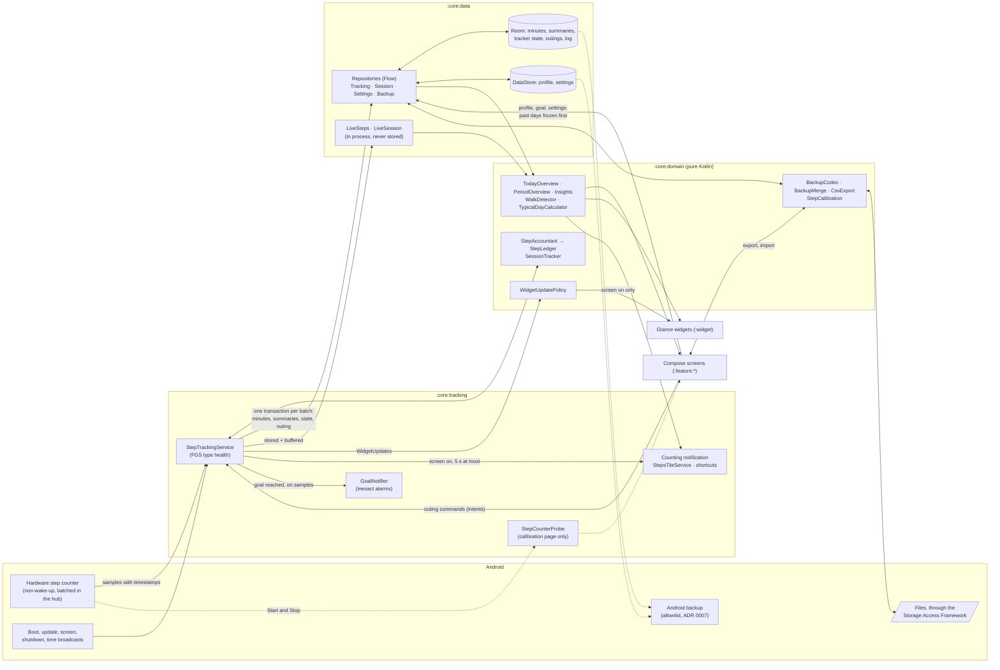

# Passo — Technical Planning

> Companion to [VISION.md](VISION.md). This document defines the architecture, the design of the tracking engine, and the delivery phases.
> It is written to be read by humans and by Claude Code.
>
> How it is kept, and where its closed parts went (the phases done, the log's past periods): «How it is made», below.

---

## How it is made (2 Nov 2026)

The same rules as the family's other plans (owner, 2 Nov 2026: "the same rules and mechanism,
so they are uniform"):

- **This file** is the live plan: how it is made, the state, what is open, the architecture
  (§1 to §10, §12 to §14, cited by number in the code), the phases not yet done (§11), and the
  log of the current period (§15). A new decision or deviation is written **at the end of §15's
  log**, one entry each, with its date and who asked, as always; a box opened or ticked goes in
  «Open» below.
- **`docs/planning/NN-<period>.md`** are the closed parts of the plan (the phases done, the log's
  past periods), **frozen**: never edited. A decision that changes an archived one is written
  here, naming the archived file and the entry it changes.
- **`docs/planning/README.md`** is the index of every archived title (`##`, `###`, `####`) and
  every log entry (its bold title), with its line: a reference by name in the code (Ǥ11
  Phase 10», «§15 "Phase 11's device checks done"») that is not in this file is found there. It
  is written by `python3 tools/planning_index.py`, never by hand, and changes only when the plan
  is archived (`--check` says whether it is behind).
- **Archive** when §15's log passes ~1,000 lines, or at a release, whichever comes first: the log
  becomes the next archive file (with the same header as the others), a phase done moves with it,
  here an empty log stays with its start date, «Open» is read again, and the index script is run.

## State

- **Released**: 1.0.0 (1 Oct 2026, `v1.0.0`) and **1.1.0** (2 Nov 2026, `v1.1.0`, tagged by the
  owner on `main` after the device checks below): its notes in `CHANGELOG.md`, its record in
  `docs/CHANGELOG-1.1.0.md`. What comes after it goes in `CHANGELOG.md`, `[Unreleased]`.
- **Done since 1.0.0**: Phase 11 (the Ways and the city walks), Phase 13 (the interval walk), Phase
  14 (more ways, beyond Europe), in archive 01 with Phases 0 to 8 and 10; Phase 12 in archive 03.
- **Done on 2 Nov 2026**: Phase 12, Your year on foot (archive 03), checked on a device by the owner.
- **Not started**: Phase 9, Google Play (optional, later; §11, below).
- **Under way** (owner, 18 Nov 2026): Phase 15, the measured outing, first of Phases 15 to 20,
  location for an outing that asks for it (`docs/adr/0016-location.md`; §11, below; archive 04,
  from «Location, for an outing that asks for it» on). Built, all of it but what a phone must
  answer: the allowlist, the manifest, the receiver, the fusion, the routes' database, the
  backup's fields, the cap's question, the card's and the notification's lines, the
  documents. Left: the proof on a phone and the measure of what it costs (the boxes in
  «Open»), which come before any release.
- **Built, on a branch of its own from Phase 15's** (18 Nov 2026): Phase 16, the outing's
  page (the route on a map that moves, the kilometres, the climb, GPX and image, Your data;
  archive 04, «Phase 16, the outing's page»). Left: its check on a phone (the box in «Open»). 15 and
  16 are released together or not at all. **Next: Phase 17**, the step that learns (§11),
  on a branch of its own from Phase 16's. Phases 17 to 20: not started.

## Open

What is left to do or decide, in one place: a box opens here, naming the entry it comes from,
and closes here, naming the one that closes it. Phase 12's own boxes stay in its section (§11).

- [ ] **Baseline Profiles; R8 full mode; startup check** (archive 01, «Phase 7»).
- [ ] **The accessibility scanner reports no critical issues** (archive 01, «Phase 7»).
- [x] **The full install and update path**: install the last release, then update to the next
  over it, with the data kept (archive 01, «Phase 8»). Done by the owner on 2 Nov 2026, 1.0.0 to
  1.1.0, before the tag («I did the tests and everything works»); the database's road from schema
  3 to 6 is also tested (`UpgradeFromFirstReleaseTest`).
- [x] **On a device (owner): the new icon** (archive 04, «The new icon: two prints on the green», 9 Nov
  2026): the launcher icon in the phone's own mask, the themed icon, the status-bar icon and the
  Quick Settings tile, the Outing shortcut and the walker on an outing's bar. Done by the owner on
  9 Nov 2026 (archive 04, «The new icon checked on the phone»).
- [x] **On a device (owner): the Outing shortcut as an adaptive icon** (archive 04, «The Outing
  shortcut, an adaptive icon», 9 Nov 2026): long press on the icon, in the phone's own mask and
  with the themed icons on. Done by the owner on 9 Nov 2026 (archive 04, «The adaptive shortcut checked
  on the phone, and Tetto in the family»).
- [x] **On a device (owner): each outing's shortcut wears its own mark** (archive 04, «Each outing's
  shortcut wears its own mark», 9 Nov 2026): after starting or saving a plan, a long press on the
  icon shows the interval walk with its slow and fast line, a run with its bolt. Done by the owner
  on 9 Nov 2026 (archive 04, «The outings' own marks checked on the phone»).
- [ ] **On a device (owner): a 30-minute interval outing with the screen off**: each change
  felt, its delay read from the log, the battery check of §9, numbers in `docs/battery/`
  (archive 01, «Phase 13»).
- [x] **On a device (owner): the new ways' maps** in both themes and on an open foldable; the
  Ways page with its groups at twice the text size (archive 01, «Phase 14»). Done by the owner
  (confirmed on 2 Nov 2026).
- [x] **On a device (owner): an outing left still on a phone with no wake-up step counter**: the
  log's `SIGNAL_WAKE` row says it was let go about 15 minutes after the last step (archive 03, «2 Nov
  2026. A review of the wakes»). Done by the owner on 2 Nov 2026, before the tag.
- [x] **Your year on foot names the cities walked that year** (archive 01, «Phase 11»): done
  with Phase 12, on its ways' page (archive 03, «Your year on foot»).
- [x] **On a device (owner): Your year on foot**: the share sheet with two or three apps, the
  image in both themes, a page saved (archive 03, «Phase 12»). Done by the owner on 2 Nov 2026,
  before the tag.

- [ ] **On a device (owner): the outings, the editor and the maps reviewed** (archive 04, «The outings,
  their editor and the city walks' maps, reviewed», 11 Nov 2026): the Outings page and an outing
  under way in both themes and at a large text size; the editor's legend, each signal felt; a
  city walk's map before a start and under way, a way's map; TalkBack on a card and on the legend.

- [ ] **On a device (owner): Phase 15's proof, before the rest is built** (§11 Phase 15, «On a
  device (owner), the proof first»; archive 04, «Phase 15, the slice for the proof on the phone», 18 Nov
  2026). With the debug build of `feature/phase-15-measured-outing`: an outing with «Measure
  with GPS» started from the Outings page and from the launcher's shortcut; the screen off for
  ten minutes; pause and Resume from the notification; the app opened and closed meanwhile; a
  stop of five minutes; "Walk now" from the evening reminder with GPS on that plan; the
  permission as «Only this time»; the process ended mid-outing and the app opened again. Each
  outing's `GPS` row in the log says whether the type was added, and whether fixes came with
  the screen off, in batches or one by one.
  With the card built (archive 04, «Phase 15, what the reader sees, and the documents»), also: the
  card's line in each state (finding the satellites at the start, a tunnel or an arcade,
  location turned off and on from the quick settings, «GPS stopped» after the process is
  ended, with «Resume GPS» from the card and from the notification); «measured» under the
  distance and the pace beside a known one; the permission refused, then allowed from the
  card, and refused twice (the system's page); in both themes, at a large text size, with
  TalkBack.

- [ ] **On a device (owner): Phase 15's measure** (§11 Phase 15, «On a device (owner), the
  measure»): a 30-minute and a 2-hour outing with GPS, the battery an hour, a known distance
  against the fused one; numbers in `docs/battery/`, then the editor's cost line, §9's rule 9
  and the CHANGELOG say the figure.

- [ ] **On a device (owner): Phase 16's page** (§11 Phase 16; archive 04, «Phase 16, the outing's
  page», 18 Nov 2026): a walk with a hill and a tunnel or an arcade, then its page: the line
  where it was walked, the dashed stretch, the climb against a known figure, each kilometre's
  pace; the map pinched, dragged and brought back whole, a bead touched, the page scrolled
  with a finger that starts on the map; the GPX opened in a map app; the image shared to two
  apps; «With the routes» in a backup, imported on the other phone; «Delete this route» and
  «Delete all routes»; the page at a large text size, in both themes, on the open foldable,
  with TalkBack. On a phone with no barometer, if one is at hand: the climb said as rough.

Read again on 2 Nov 2026, at archive 01 and 02: the boxes above are the ones the phases done had
left open, and the review's device check. Read again at 1.1.0's tag: the owner's checks of the
update, the outing let go, Your year on foot and the new ways' maps are done; §15 has no open
question.

Read again on 18 Nov 2026, at archive 04: nothing closed. Phase 15's and Phase 16's boxes wait
for a phone, and the entries they name are in archive 04 now.

---

## 1. Tech stack

| Concern | Choice |
|---|---|
| Language | Kotlin (latest stable 2.x), with the Compose compiler Gradle plugin |
| Build | Gradle with Kotlin DSL; version catalog (`gradle/libs.versions.toml`); convention plugins in `build-logic/` |
| JDK | Toolchain 21, `jvmTarget` 21 |
| SDK levels | `minSdk 34`, `targetSdk 37`, `compileSdk 37` |
| UI | Jetpack Compose, Material 3 in Chiaro's design language (its generated schemes, dynamic color on request), edge-to-edge |
| Widget | Jetpack Glance (`glance-appwidget` + `glance-material3`), latest stable (1.2.x at the time of writing) |
| Architecture | MVVM with unidirectional data flow; coroutines and `Flow` |
| Dependency injection | Hilt (`hilt-work` only if WorkManager is ever introduced) |
| Persistence | Room for step data and tracker state; DataStore (Preferences) for settings and profile |
| Navigation | Navigation 3 if stable at setup time, otherwise Navigation Compose with type-safe routes |
| Charts | Custom Compose `Canvas` components in `core:designsystem` (no third-party chart library) |
| Time | `java.time` |
| Testing | JUnit 5 or JUnit 4, Turbine, Truth or AssertK, Robolectric (Room and receivers), Compose UI tests, Glance unit test utilities |
| Quality | Android Lint, ktlint (via Spotless) or detekt; Baseline Profiles in Phase 7 |
| CI | GitHub Actions: build, unit tests, lint, formatting, and a forbidden-permission check on the merged manifest. A release workflow on version tags builds the signed APK and publishes it to GitHub Releases |
| License | GPL-3.0. Every new dependency must have a GPL-3.0-compatible license (Apache-2.0, MIT, BSD are fine) |

Always pick the **latest stable** versions at setup time and record them in the version catalog. Avoid alpha versions unless a phase needs them.

---

## 2. Project structure

```
passo/
├── app/                    # Application, MainActivity, navigation, DI entry points
├── build-logic/            # Convention plugins (android-library, compose, hilt, room…)
├── core/
│   ├── model/              # Pure Kotlin data classes (no Android deps)
│   ├── domain/             # Pure Kotlin: StepAccountant, calculators, streaks/records, outings, backup format
│   ├── data/               # Room DB, DAOs, DataStore, repositories
│   ├── tracking/           # StepTrackingService, sensor source, receivers, notification
│   ├── designsystem/       # M3 theme, typography, shared components, charts, icons
│   └── testing/            # test-only: the accessibility checks and the page walk the UI tests share
├── feature/
│   ├── today/
│   ├── history/
│   ├── insights/           # records, streaks, totals
│   ├── settings/           # Settings, your data (export, import), the step calibration
│   ├── onboarding/
│   ├── sessions/           # the Outings page and the outing editor (Phase 10)
│   ├── ways/               # the Ways and the city walks (Phase 11)
│   ├── year/               # Your year on foot (Phase 12)
│   └── guide/              # the guide, in Chiaro's shape
├── widget/                 # Glance widget(s), receiver, update coordinator
├── docs/                   # ADRs, formulas, battery test notes
├── VISION.md
├── PLANNING.md
└── CLAUDE.md
```

Rules:

- `core:model` and `core:domain` are pure Kotlin/JVM modules. All business logic lives there and is unit-tested without Android.
- Feature modules depend on `core:*`, never on each other.
- `app` wires everything together.

---

## 3. Architecture overview

Reviewed at Phase 7 (25 Sep 2026) against the code: the Phase 1 diagram showed the tracking
path alone; the app now also has outings, in-process live state, pushed widget updates, goal
alarms, the tile, the export and import, and the calibration.



**The write path, and its one writer.** Only the service writes steps. The sensor's samples go
through `StepAccountant` (deltas into minutes, §4.4) and `StepLedger` (the buffer and its write
triggers, §4.5); `SessionTracker` measures the outing under way from the same deltas. A batch
is written by `TrackingRepository.persist` in **one** Room transaction: the minutes, the
summaries of the days they touch, the tracker state, the log lines and the outing. The same
repository is the only way to change the profile or the goal, and the import's only way in: one
lock orders all of them, so a day is frozen before a new profile or goal can reach it (§5,
ADR 0003) and no batch lands inside an import.

**The read path is computed, not stored.** The screens, the widgets and the notification read
the repositories' `Flow`s and derive everything in `:core:domain`: today's sentence and pace
(`TodayOverview`), the periods (`PeriodOverview`), records and streaks (`Insights`), walks and
the usual day. Nothing of it runs in the background or is cached in a table (§5, §6).

**Live state stays in the process.** Between two writes the service publishes today's stored
plus buffered count (`LiveSteps`) and the outing as it stands (`LiveSession`). Today, the tile
and the widgets add it to what is stored (`withPending`, `byDayWithLive`), so every surface
shows the same count and it never goes back during a write. It is never persisted: the
database is the truth after any crash.

**Surfaces update only when someone can see them** (§7, §8, §9). The service tells the widgets
through `WidgetUpdates` (declared in `:core:data`, so the service never depends on `:widget`),
and `WidgetUpdatePolicy` decides now, later or not at all; with the screen off, only a change
of tracking state or of a setting repaints. The notification follows the screen; the tile reads
only between `onStartListening` and `onStopListening`. Goal reached rides on the samples; the
evening reminder and the weekly summary are one inexact alarm each (`GoalNotifier`), after a
catch-up with the sensor (`TrackerLink`).

**Control has two doors.** Pause and resume go through `TrackingControl` (Settings' switch,
Today's card, a paused widget's or tile's tap): a pause stops the service, which writes its
buffer as it goes; a resume forgets the baseline, then starts the service from the activity,
where a foreground service may start (a widget's tap opens the app to do it). An outing's
start, pause, resume, stop and "keep going" are intents to the running service
(`SessionControl`), from the screens, the notification's actions, the launcher's shortcuts and
the evening reminder's "Walk now".

**Data in and out, by the reader or by Android** (Phase 7, ADR 0011; ADR 0007). The reader's
export writes the whole history as JSON, or a table as CSV, to a file the system's picker
chose; the import reads one back and merges it (`BackupMerge`: every minute at its larger
count, never deleting). Android's backup copies the database and the settings file, nothing
else; a tracker state from another installation is dropped (`adoptTrackerState`). Passo itself
has no network access either way.

**The calibration reads the counter directly** (`StepCounterProbe`), only while its page is on
screen: the counter is cumulative, so its values at Start and Stop measure the walk whatever
happened in between, independently of the service.

`:app` wires the graph (Hilt), holds the activity and the navigation (Navigation 3: the three
tabs, Settings, the Outings page and editor, the calibration), and starts the service when the
app is opened.

---

## 4. Step tracking engine (core design)

This is the riskiest part of the app. Build it first, test it in the field, and don't build UI on top of it until it is proven.

### 4.1 Why a foreground service

- `TYPE_STEP_COUNTER` is **cumulative since boot** and **resets to 0 at every boot**.
  - Steps taken while the app isn't running are still counted by the hardware. They're only lost if the device reboots before the app reads them.
- Since Android 9, `ACTION_SHUTDOWN` is delivered **only to receivers registered at runtime**, so a live process is needed to save the last value before power-off.
- Since Android 9, apps in the background don't receive sensor events. A worker waking up periodically can't reliably read the sensor.
- A foreground service of type `health` is the documented mechanism for continuous fitness tracking.
  - Prerequisites: the `FOREGROUND_SERVICE_HEALTH` permission in the manifest, and the runtime permission `ACTIVITY_RECOGNITION`.
  - The service can be started from `BOOT_COMPLETED`. `BOOT_COMPLETED` and `MY_PACKAGE_REPLACED` are exemptions from the background-start restriction, and `health` is not among the types Android 15 forbids from a `BOOT_COMPLETED` receiver (`dataSync`, `camera`, `mediaPlayback`, `phoneCall`, `mediaProjection`, `microphone`). `ACTIVITY_RECOGNITION` is not a while-in-use permission, so it does not block a start from the background either. Established from the documentation in Phase 1 (§15).

### 4.2 Service lifecycle

| Trigger | Action |
|---|---|
| App opened (activity in foreground) | Start the service if it isn't running and permissions are granted |
| `BOOT_COMPLETED` (manifest receiver) | Start the service |
| `MY_PACKAGE_REPLACED` (manifest receiver) | Start the service after an app update |
| Service `onStartCommand` | `startForeground(FOREGROUND_SERVICE_TYPE_HEALTH)` and register the sensor listener; return `START_STICKY` |
| `ACTION_SHUTDOWN`, `QUICKBOOT_POWEROFF` (runtime receiver) | `goAsync()`, then `sensorManager.flush()`, wait for `onFlushCompleted` (at most about 1.5 s), then persist synchronously |
| `ACTION_SCREEN_ON`, `ACTION_USER_PRESENT` (runtime) | Re-register with low latency, flush, refresh notification and widget |
| `ACTION_SCREEN_OFF` (runtime) | Persist the buffer, then re-register with high latency |
| `ACTION_TIME_CHANGED`, `ACTION_TIMEZONE_CHANGED` (runtime) | Persist the buffer, recompute today's local date, refresh the surfaces |
| User toggles "Pause tracking" | Persist, unregister, `stopSelf()` |

If the user or the OEM stops the service, no data is lost as long as the device doesn't reboot in the meantime, because the counter is cumulative. The UI and widget then show a "Tracking paused" state with tap-to-resume. The limitation is that a force-stopped app doesn't receive `BOOT_COMPLETED` until the user opens it again; this is documented in the FAQ.

### 4.3 Sensor registration strategy

| Screen state | Sensor | `samplingPeriodUs` | `maxReportLatencyUs` |
|---|---|---|---|
| Off | Non-wake-up `TYPE_STEP_COUNTER` | `SENSOR_DELAY_NORMAL` | High, `SCREEN_OFF_LATENCY` (default 10 min) |
| On | Same sensor | `SENSOR_DELAY_NORMAL` | Low, `SCREEN_ON_LATENCY` (default 0 to 2 s) |

- A non-wake-up sensor never wakes the application processor. Events wait in the hardware FIFO and are delivered the next time the processor is awake.
- If the FIFO overflows, intermediate events are dropped, but the **total stays correct** because the counter is cumulative. Only minute-level attribution gets coarser.
- **Non-wake-up, decided from the platform documentation** (`docs/adr/0002-sensor-reporting.md`): the wake-up variant would only bound the loss on an *abrupt* power loss, and would pay for it with a wakeup per report window, every day. A device that has only a wake-up step counter still gets it.
- `sensor.fifoMaxEventCount`, `fifoReservedEventCount`, vendor, name and wake-up mode are written to the diagnostics log at every service start, with whether the phone has a wake-up counter (and its FIFO) and which step detectors it has (read, never registered).
- Some phones have no FIFO at all (`fifoMax=0`, the owner's Samsung, Oct 2026): with the screen off the counter's events are dropped while the processor sleeps, and its latest value arrives in a clump when the phone next wakes. The total stays exact; the attribution of §4.4 lays the clump over the minutes it took.

### 4.4 Accounting algorithm (`StepAccountant`, pure Kotlin)

Input for each sensor event: `counterValue` (total since boot), `eventElapsedNanos` (the event timestamp), plus an injected `SystemSnapshot(bootCount, elapsedRealtimeNanos, wallClockMillis, zoneId)`.
`bootCount` comes from `Settings.Global.BOOT_COUNT`.

```
state = TrackerState(bootCount, lastCounterValue, lastSampleElapsedNanos, lastSampleWallMillis)   // persisted in Room

delta = when {
    state == null                       -> 0                   // first run ever: baseline, don't count steps from before install
    snapshot.bootCount != state.bootCount -> counterValue      // new boot session: counter restarted from 0
    counterValue < state.lastCounterValue -> counterValue      // sensor/HAL reset without reboot
    else                                -> counterValue - state.lastCounterValue
}

eventWall = snapshot.wallClockMillis - (snapshot.elapsedRealtimeNanos - eventElapsedNanos) / 1e6
if (eventWall is in the future or before the lower bound) eventWall = snapshot.wallClockMillis   // guard against buggy timestamps

lowerBound = if (same boot session) state.lastSampleWallMillis else bootWallMillis

// Attribute delta to minute buckets, by the milliseconds each minute holds of the stretch walked:
//  - the stretch ends at eventWall and lasts delta / DEFAULT_CADENCE (≈110 spm), never before
//    lowerBound; a delta faster than that is spread evenly over [lowerBound, eventWall]
//  - one rule for every gap: a lone step lands in its own minute; a clump handed over at once
//    (a sensor with no FIFO, whose events are dropped while the processor sleeps) is laid over
//    the minutes it was walked in, never 170 steps in one minute and 25 in the next
//  (until Oct 2026: a gap ≤ 2 min put everything in the eventWall minute, §15)
// Sanity: if delta > MAX_CADENCE (250 spm) × gapMinutes + 50 → cap, log a diagnostics anomaly

newState = state.copy(bootCount, lastCounterValue = counterValue, lastSampleWallMillis = eventWall)
```

Output: a list of `(epochMinute, localEpochDay, steps)` increments, plus the new state.
All wall-clock and time-zone logic is injected, so the algorithm can be fully unit-tested.

### 4.5 Persistence rules

- Keep an in-memory buffer of minute increments in the service.
- Flush the buffer to Room in **one transaction** that also updates `TrackerState` and today's `DailySummary`. Flush when any of these happens:
  - a minute boundary is crossed while events are flowing
  - the screen turns off
  - shutdown
  - `onDestroy`
  - 100 or more buffered steps
  - Once per drain: a write asked for and still under way carries the samples recorded meanwhile, so a FIFO handed over in one burst asks for one write, not one per sample (2 Nov 2026, §15).
- Invariant: the steps stored in Room plus the stored `lastCounterValue` are always consistent.
  - If the process dies with an unflushed buffer, the next sample recomputes the delta from the stored `lastCounterValue`. Nothing is double-counted and nothing is lost; only the minute attribution may shift.

### 4.6 Edge cases (all need unit tests)

| Case | Expected behavior |
|---|---|
| First install mid-day | Baseline at the current value. Today starts from 0 and the UI explains this once. |
| Nightly shutdown | The shutdown flush saves the last value. After boot, the first sample has a new `bootCount`, so `delta = counterValue`. |
| Abrupt power loss or crash | Steps since the last delivered batch are lost (bounded by the latency window). Documented. |
| Walking across midnight | Event timestamps split the steps between days. The gap rule splits long gaps proportionally. |
| Time-zone change | Buckets are stored in UTC `epochMinute` together with the `localEpochDay` computed at write time. Days already recorded are never re-bucketed. |
| Manual clock change | Same as a time-zone change. Timestamps come from elapsed realtime, so they are monotonic. |
| Sensor jumps (buggy HAL) | Capped by `MAX_CADENCE` and logged. |
| A counter with no FIFO, handing steps over in clumps | Each clump laid back over the time it took at 110 spm, minute by minute: no false minute of running, the total exact. |
| `ACTIVITY_RECOGNITION` revoked | The service stops. The UI, notification and widget show "Permission needed". |
| No step counter sensor | The APK from GitHub installs on any device, so a blocking explanation screen is **required**. `uses-feature required=true` stays in the manifest for a future Play listing, where it filters these devices. |
| Counter float precision | Values are `Float`; convert with `toLong()`. Exact up to 2^24 steps per boot session, which is far beyond realistic use. |

---

## 5. Data model

### Room

```kotlin
@Entity(tableName = "tracker_state")          // single row, id = 0
data class TrackerStateEntity(
    @PrimaryKey val id: Int = 0,
    val bootCount: Int,
    val lastCounterValue: Long,
    val lastSampleElapsedNanos: Long,           // monotonic: gaps are measured on this clock (§15)
    val lastSampleWallMillis: Long,
    val updatedAtMillis: Long,
)

@Entity(tableName = "minute_steps", indices = [Index("localEpochDay")])
data class MinuteStepsEntity(
    @PrimaryKey val epochMinute: Long,         // UTC minute
    val localEpochDay: Long,                    // local date at write time
    val steps: Int,
)

@Entity(tableName = "daily_summary")
data class DailySummaryEntity(
    @PrimaryKey val localEpochDay: Long,
    val steps: Int,
    val distanceMeters: Double,
    val activeKcal: Double,
    val activeMinutes: Int,
    val briskMinutes: Int,
    val goalSteps: Int,                         // goal in effect that day
    val finalized: Boolean,                     // true after the day is over
)

@Entity(tableName = "diagnostics_event")      // ring buffer, ~500 rows
data class DiagnosticsEventEntity(
    @PrimaryKey(autoGenerate = true) val id: Long = 0,
    val wallMillis: Long,
    val type: String,                           // BOOT, SHUTDOWN_FLUSH, ANOMALY, SERVICE_START…
    val detail: String,
)
```

- Size estimate: about 300 minute rows per day, roughly 110k rows per year, a few MB. Keep minute data indefinitely; it's needed for hourly charts and recalculation.
- Today's `DailySummary` is recomputed from today's minute rows at every flush.
- Past days are **frozen**, so changing the profile doesn't silently rewrite history. Settings offers **"Apply profile to past data"**, which recomputes every summary from the minute rows.
- Use Room auto-migrations with exported schemas (`room.schemaLocation`) committed to the repo.
- **Schema v4 (Phase 11):** `way_journey`, a way the reader started (the way, its start day and instant, its state `ACTIVE` / `FINISHED` / `LEFT`, the day it ended, how far its stages were told). No distance: what was walked is the days' own estimates from the start, read with them (`docs/adr/0014-ways.md`).
- **Schema v5 (Phase 11, part two):** `session.walk` (the city walk an outing walks, by name; null for every other outing) and `session.walkFromMeters` (where along the walk it began). A walk's journey is a `way_journey` row like a way's; its progress is its outings', read with them (`docs/adr/0015-city-walks.md`).
- **No tables for walks or the typical day.** Both are computed on read from `minute_steps` (§6.1, §6.2). Add a cache table only if profiling shows a need.
- **Schema v2 (Phase 10), an auto-migration adding two tables and touching nothing else:**
  - `session_plan`: the reader's outings (name or null, goal kind and value, intensity, milestones as a bit set, vibrate, position, last started).
  - v3: `voice` (`OFF`, `HEADPHONES`, `ALWAYS`) on both, default `OFF` (the voice, ADR 0010).
  - `session`: each outing walked, with its goal copied at the start (frozen like a day), its state (`ACTIVE`, `PAUSED`, `FINISHED`) and end reason, its totals (steps, time in motion, time at its pace, estimated distance and energy), its last step and last measured moment, the milestones already told. The one under way is written in the step batch's transaction (§4.5).

### DataStore (Preferences)

- Profile: height, weight, sex (optional), step length mode (auto, manual or calibrated), walking step length, running step length.
- Goal, units, first day of week, theme, dynamic color, notification opt-ins, reminder time and threshold, tracking enabled.
- The last day whose goal was seen reached (not a setting: the record that keeps "goal reached" once a day).
- Walk detection enabled (default on), minimum walk duration (5, 10 or 15 min; default 10), typical-day line shown (default on), Today's "Start an outing" button shown (default on).
- Whether the outing presets were written once (so deleting them is final), and the last finished outing whose card Today has put away.

---

## 6. Derived metrics (`core:domain`)

All constants live in one file (`MetricsConstants.kt`) with comments that cite their sources. All defaults are to be validated.

- **Default walking step length:** `height × 0.415` (`× 0.413` when the profile says female). If height is unknown, 0.70 m.
- **Running step length:** default `walking × 1.3`, user-editable. It applies to minutes with a cadence of at least `RUNNING_CADENCE` (140 spm).
- **Distance:** the sum over minutes of `steps × stepLength(cadence)`.
- **Active calories (net):** the sum over minutes of `distanceKm × weightKg × k(cadence)`.
  - `k_walk ≈ 0.5 kcal/kg/km`, rising slightly for brisk cadences: flat up to 100 spm, then linearly to 0.6 just below 140 spm (Phase 2, §15).
  - `k_run ≈ 1.0 kcal/kg/km`.
  - Default weight if not set: 70 kg.
  - Net means basal metabolism is not included. The UI calls this "active calories".
  - Alternative considered: MET-based tables by speed. Rejected because it is less robust for sparse minutes.
- **Active minutes:** count of minutes with at least `ACTIVE_MINUTE_THRESHOLD` (40) steps.
- **Brisk minutes:** count of minutes with at least 100 steps.
- **Average cadence:** steps in active minutes divided by the number of active minutes.
- **Streak:** consecutive finalized days with `steps ≥ goalSteps`, plus today if its goal is already met.
- **Records:** best day, ISO or locale week, month, and longest streak.

### 6.1 Walk detection (`WalkDetector`, pure Kotlin)

Input: the minute buckets of one local day, plus the settings. Output: a list of `Walk(start, end, steps, distanceM, activeKcal, avgCadence, type)`.

```
1. Mark each minute as "moving" if steps ≥ WALK_MINUTE_THRESHOLD (60).
2. Merge moving minutes into runs, bridging gaps of up to WALK_MAX_GAP_MINUTES (2) non-moving
   minutes (traffic lights, doors). Steps inside a bridged gap belong to the walk.
3. Discard runs shorter than the minimum duration setting (default 10 min).
4. For each remaining run compute the metrics with the same calculators as §6.
5. type = RUN if avgCadence ≥ RUNNING_CADENCE, else WALK.
   (Optional refinement: MIXED if both walking and running minutes exceed 30% of the walk.)
```

- A walk crossing midnight is split at midnight, like every other daily metric.
- Constants live in `MetricsConstants.kt` next to the others.
- Cost: one linear pass over at most 1,440 rows, only when the day detail or Today screen is visible. No background work.
- Accuracy depends on minute attribution (§4.4). With a working FIFO it's minute-accurate; after a FIFO overflow or a service restart, walk boundaries may be off by a few minutes. This is acceptable and documented.

### 6.2 Typical day curve (`TypicalDayCalculator`, pure Kotlin)

- Take the same weekday over the last `TYPICAL_DAY_WEEKS` (4) weeks, skipping days with fewer than 500 steps (phone left at home, tracking paused).
- For each day, build the cumulative curve in 15-minute slots (96 points).
- The typical curve is the mean of those curves, slot by slot. It is shown only if at least 2 valid days exist.
- "Ahead or behind" = today's cumulative value minus the typical value at the current slot. It is shown as a short label, for example "+1,240 vs usual".
- Computed when the Today screen opens and then once every 15 minutes while it stays visible. It never runs in the background.

---

## 7. Widgets (Glance)

Two widgets since Phase 4 (owner's request), in Chiaro's dress so a Passo card and a Chiaro card on one home screen read as one family: «At a glance» / «A colpo d'occhio» (`GlanceWidget`: today's ring where Chiaro's weather glyph was) and «In words» / «In parole» (`WordsWidget`: the day in type, with two small marks). The names were swapped on 14 Nov 2026 and swapped back on 15 Nov 2026 (owner, §15): in the whole family «At a glance» is the card with a picture and «In words» the card in type alone, and the code's names say the same again. «At a glance» is first in the manifest and opens at 4×1; a new card wears the app's green. Decisions and reasons: `docs/adr/0005-widgets.md`.

### Configuration

- `SizeMode.Exact`: every form is read off the size the launcher really granted.
- **One size spec for both cards** (`WidgetProviderTest`): default placement 4×1 (`targetCellWidth` 4, `targetCellHeight` 1, where Chiaro's pair opens), minimum one cell (`minResizeWidth`/`minResizeHeight` 40 dp), `resizeMode="horizontal|vertical"`, and **no maximum**: Launcher3 turns a dp maximum into cells on every grid profile and keeps the smallest, so no value means "four cells" everywhere (ADR 0005). Each layout has a form for any grant instead.
- `updatePeriodMillis = 0`; `configure` is the per-widget settings screen, `reconfigurable|configuration_optional`.
- Reference grants the layout tests measure against (Chiaro's): one row ≈ 85 dp tall, two cells ≈ 159 dp, three ≈ 250, four ≈ 340; two rows ≈ 189 dp.

| «At a glance» (`GlanceWidget`) form | When | Content |
|---|---|---|
| DOT | narrower than 120 dp | The ring with the count inside (compact where the language shortens thousands) |
| NARROW | one row | Ring, count, «of 10,000 steps» |
| WIDE | one row with a sentence column (4 cells) | The same, and the day's sentence at the far edge; or mirrored, the ring on the right |
| TALL | two rows and up | Ring in the top corner; count, sentence and goal from the bottom. At every form and size the ring is the family's circle, the dial of Tempo's «At a glance» at the same size (§15, 4 Nov 2026, «at every size») |
| PANEL | two rows and up, three cells or wider | The row on top, its ring the family's circle, larger without the sentence as the tall card's (the sentence under the count where the ring leaves it no room at the far edge), and under it today's steps by hour (24 bars built from boxes, current hour highlighted) or, as the reader chooses, the last 7 days against the goal (7 bars, today highlighted, a line at today's goal; §15, 2 Nov 2026) |

| «In words» (`WordsWidget`) form | When | Content |
|---|---|---|
| LINE | one row, one or two cells | «Steps today», the count, the share of the goal where it costs the number nothing |
| ROW | one row, three cells and up | The count on the leading side; the sentence, the goal and the distance and calories at the far edge |
| STACK | two rows and up | The eyebrow on top; the count large, the sentence and the facts at the bottom; «the day in figures» with height to spare |
| PANEL | two rows and up, four cells | The count beside the words, on one baseline; the day in figures under both |

### Rendering

- Colours are resolved at render time against the ground the card really has (Chiaro's ink rule, `widgetInk`), never left to the launcher's day/night resolution: white inks on one of Chiaro's six card colours, the dress's own inks on light or dark, and below 50% solidity the wallpaper's hint decides. Material 3 dynamic color when the reader turned wallpaper colours on in the app.
- **The ring is a bitmap** painted at the size shown, capped at 416 px a side (at most 0.7 MB, about 50 KB in a row), one per card: far under the Android 17 RemoteViews bitmap cap. Vector levels were rejected (5% steps for the arc and the notch). The bars are boxes.
- Previews: a static `previewLayout` of the default card, and generated previews on Android 15+ (`providePreview`), published once per app version.
- Tapping a card opens the Today screen. A paused card opens the app asking it to resume (the service is started from the activity). A card without the permission or stopped by the system opens the app, which fixes or restarts it.

### Update strategy (battery-aware)

- Push-based from `StepTrackingService` through `WidgetUpdates` (interface in `:core:data`, `WidgetUpdateCoordinator` in `:widget`), decided by `WidgetUpdatePolicy` (pure, `:core:domain`). There is **no periodic polling**.
  - Screen on or user present: flush the sensor, then update immediately.
  - While the screen is on: update at most every 60 s, and only if the steps changed (a trailing timer, cancelled at screen-off).
  - Day rollover (detected by the screen-on ticker), goal reached: update immediately.
  - Settings or profile changed, tracking started or stopped, an outing started, paused or ended: update immediately, with the screen off too (one repaint, and a stopped service cannot repaint at the next screen-on).
- While an outing is under way, both cards say it in the sentence's place («Brisk walk: 12 of 20 min»), as the tile's line does (Phase 10).
  - Screen off: no updates.
- The widget reads the repository plus the service's in-process buffer (`LiveSteps`), exactly as Today does, so it shows persisted truth and the steps not written yet.

---

## 8. Notifications and Quick Settings tile

- **Channel `tracking`** (low importance, silent, `setOnlyAlertOnce`): the ongoing foreground service notification.
  - Content: collapsed, today's steps; expanded, the way to the goal (or when it was reached), the share of the goal with the active minutes, the estimated distance and calories, and a progress bar to the goal.
  - Updated only while the screen is on, at most every 5 s. Both forms are built in the same update; today's minutes are read again only after a write.
  - How it shows (in full, minimized, off) is the reader's, on the system's channel page: Settings reads it and opens that page (§15).
- **During an outing** (Phase 10) the `tracking` notification is the outing's: its name, its sentence, «12 of 20 min», the pace against the outing's, the steps and the estimates, Pause/Resume and Stop. Android 16+: `ProgressStyle` with the milestones as points, promoted to a Live Update (`POST_PROMOTED_NOTIFICATIONS`); below, `BigTextStyle` and a progress bar. Updated as the day's form is (screen on, every 5 s at most), plus once at each milestone.
- **Channel `sessions`** (default importance, no sound, no vibration of its own): an outing's goal reached, with "Keep going" for 15 minutes; an outing ended by a long stillness, with "Resume" for as long. The milestones on the way are Passo's own vibration patterns, played only while this channel is on.
- **Channel `goals`** (default importance, opt-in): goal reached once per day, the evening reminder (with "Walk now": an outing for the rest of the day), the weekly summary.
  - Goal reached rides on the service's samples. The reminder is an inexact `setAndAllowWhileIdle` with a wakeup, the summary an inexact `RTC` alarm without one; both armed again at every start of the process, every change of what they depend on, every clock or zone change, and every firing. No exact alarm permission (Phase 6, §15).
  - Each alerts when posted (no "only alert once": under a fixed id it silenced today's while yesterday's was still shown). Goal reached and the reminder go by themselves at the end of their day (`setTimeoutAfter`); the reminder also when its "Walk now" is touched or the goal is reached. No reminder during an outing, and no reminder alarm armed while the goals' notifications cannot show (armed again when they can: the app's return, the system's block-state broadcasts) (2 Nov 2026, §15).
- **Channel `ways`** (default importance, Phase 11): a stage reached on the way under way, and its end. Told by the days being written (`WayNotifier`), never by a timer; touching it opens the Ways page.
- If `POST_NOTIFICATIONS` is denied, the foreground service still runs; its notification only shows in the system's task manager. Explain this in onboarding; don't block on it.
- **QS tile (`TileService`):** reads today's steps from `onStartListening()` to `onStopListening()`, following the live count meanwhile. It costs nothing when the panel is closed.

---

## 9. Battery rules (non-negotiable)

1. No accelerometer. No continuous `TYPE_STEP_DETECTOR` unless measurements prove it's cheap.
2. No wakelocks held by the app, except inside `goAsync()` for the shutdown flush, and the one of §9.7: an outing with signals on a phone whose step counter cannot wake it.
3. No exact alarms, no `REQUEST_IGNORE_BATTERY_OPTIMIZATIONS`, no periodic workers for tracking.
4. Nothing runs on a timer while the screen is off. All screen-on tickers are coroutines tied to the screen state.
5. Database writes are batched (§4.5).
6. Each phase that touches the service ends with a battery check:
   - `adb shell dumpsys batterystats --charged <pkg>`
   - `adb shell dumpsys sensorservice` (confirm batching is active)
   - Doze simulation: `adb shell dumpsys deviceidle force-idle`
   - Battery Historian for the longer field tests
7. **The one exception (Phase 10, `docs/adr/0009-sessions.md`):** while an outing the reader started is counting, the wake-up step counter (if the phone has one besides the usual one) reports within 30 s, and 2 s in the 40 s before a change of an interval outing (Phase 13, `docs/adr/0013-interval-walks.md`), so its signals reach a phone in a pocket on time: about two brief wakes a minute while walking, a few more in each of an interval outing's last 40 s before a change, none while still, no wake lock or timer of the app's own. Paused, over or with no outing, the registration is the usual one. An outing ends by itself (goal, 15 min still, 1 h paused, 4 h), noticed at a step or a screen-on, never by a timer.
   *Amended 4 Oct 2026 (owner, after the first interval walk; `docs/adr/0013-interval-walks.md`):* on a phone with **no** wake-up step counter, an outing that tells its signals (vibration or voice, and the outings' channel on) holds a partial wake lock while it counts, so the counter's steps arrive as they are taken and every signal with them; the screen stays off; let go at a pause, the end or the service's, bounded at 4 h 10 min; logged when taken and let go. No timer: the signals still ride on the steps. An outing with no signal, a paused one, and every phone with a wake-up counter never hold it. About 1 to 3% of a battery an hour, to be measured.
   *Amended 2 Nov 2026 (owner, after a review):* that wake lock is also let go once the outing has been still for 15 minutes (`SignalWake.letGoAt`), when it is over and has nothing left to tell on time; it is closed at the next step or look, as on every phone. A forgotten outing had kept the processor awake until the screen came on, up to the 4 h 10 min bound. The moment is kept by a timer in the service, the one timer that runs with the screen off, and only while the wake lock already keeps the processor awake: it shortens a wake and never makes one.
8. OEM task killers: onboarding shows a battery tip, with a button to the app's own settings page, only when `Build.MANUFACTURER` is on a known list (`OemTips`). Samsung is not on it (§15).

9. **The second exception (Phase 15, `docs/adr/0016-location.md` decisions 5, 10 and 14):** the satellite receiver, for an outing the reader started with «Measure with GPS» on. On while it counts and the reader walks (a fix a second; with the screen off the fixes are held up to 60 s and asked for by each step batch, in the wake that batch already made); asleep 2 minutes after the last step, awake at the next (`GpsDuty`); off at a pause and at the end; for at most 15 minutes after an end that can be taken back, steered the same way, and off when the card is put away. Never for the day's count, never with no outing, never by a timer or a geofence; every part rides on a step batch, a batch of fixes, a touch or the screen. Its cost is to be measured on a phone and written in `docs/battery/` (expected: a few percent of a battery an hour while walking).
   *Rule 7, amended with it (18 Nov 2026):* its wake lock is also held by an outing with GPS, with signals or without, on a phone with no wake-up step counter: there the steps steer the receiver, and nothing else could bring the step that wakes it. Its bound is ten minutes past the outing's own cap, which «Keep going» moves, no longer 4 h 10 min from when it is taken.

---

## 10. Permissions and manifest

| Permission / element | Type | Why |
|---|---|---|
| `ACTIVITY_RECOGNITION` | Runtime | Read the step counter; prerequisite for the `health` foreground service |
| `POST_NOTIFICATIONS` | Runtime | Show the tracking and goal notifications (optional) |
| `FOREGROUND_SERVICE` | Normal | Foreground service |
| `FOREGROUND_SERVICE_HEALTH` | Normal | Foreground service of type `health` |
| `RECEIVE_BOOT_COMPLETED` | Normal | Restart tracking after boot |
| `VIBRATE` | Normal | An outing's signals, in their own patterns (Phase 10) |
| `POST_PROMOTED_NOTIFICATIONS` | Normal | The outing under way as a Live Update on Android 16+ (Phase 10) |
| `<queries>` for `TTS_SERVICE` | Manifest | Lets Android 11+ show Passo the text-to-speech engine, for the outings' voice (ADR 0010). Not a permission |
| `WAKE_LOCK` | Normal | An outing's signals on a phone whose step counter cannot wake it: the processor kept awake while the outing counts (§9.7, ADR 0013). Also brought by WorkManager, held by the job while a widget card is drawn |
| `ACCESS_FINE_LOCATION`, `ACCESS_COARSE_LOCATION` | Runtime | An outing the reader started with «Measure with GPS» on: the satellites, read from its start to its pause or end (Phase 15, ADR 0016). Asked together, in context, the first time such an outing starts; approximate alone measures no walk, and the outing then counts from the steps |
| `FOREGROUND_SERVICE_LOCATION` | Normal | The service's second type, `location`, added while such an outing counts and dropped at its pause or end |
| `<uses-feature android:name="android.hardware.location.gps" android:required="false"/>` | Feature | So that a phone with no receiver is not filtered out on a future listing: there the switch is absent |
| `ACCESS_NETWORK_STATE` | Normal | Brought by WorkManager, which Glance runs its widget sessions on (Phase 4): it lets nothing leave the phone without `INTERNET`. Passo's own code does not use it |
| `android:allowBackup="true"` + `dataExtractionRules` | Manifest | Android's backup and device transfer carry the step history, the profile and the settings, an allowlist (`docs/adr/0007-backup.md`). No permission: Android sends the copy, not Passo |
| `<uses-feature android:name="android.hardware.sensor.stepcounter" android:required="true"/>` | Feature | Documents the requirement; filters devices on a future Play listing. It does not block APK installs, so the app also checks the sensor at runtime |

**Forbidden, by name:** `INTERNET`, `ACCESS_BACKGROUND_LOCATION`, `REQUEST_IGNORE_BATTERY_OPTIMIZATIONS`, `SCHEDULE_EXACT_ALARM`, `USE_EXACT_ALARM`, `HIGH_SAMPLING_RATE_SENSORS`, `BODY_SENSORS`.

**An allowlist** (since Phase 15, 18 Nov 2026; `docs/adr/0016-location.md` decision 2). A CI task checks each variant's merged manifest and fails unless it requests exactly the permissions above, written in `build-logic` (`AllowedPermissions`): one more fails the build, a forbidden one by name, and so does one on the list that nothing requests any longer. Letting location in made the gate stricter than the list of forbidden names it was. A library that adds a permission must be removed or patched with `tools:node="remove"`. Beside the table, the list holds the one permission AndroidX declares for the app itself, named after the application id (`DYNAMIC_RECEIVER_NOT_EXPORTED_PERMISSION`).

---

## 11. Delivery phases

Each phase ends with a merged PR, green CI and its acceptance criteria met.
Phases 1 and 4 need **field testing on a physical device**; an emulator is not enough for sensors or batching.

The phases done, with their acceptance and their boxes as they stood, are frozen in the archive:
0 to 8, 10, 11, 13 and 14 in [`docs/planning/01-phases-0-14.md`](docs/planning/01-phases-0-14.md),
12 in [`docs/planning/03-towards-1.1.0.md`](docs/planning/03-towards-1.1.0.md); the boxes they left
open are in «Open» above. Here stay the phases not done yet.

### Phase 9 — Google Play (optional, later)

Kept open, not planned yet. Notes to avoid closing the door:

- [ ] Enroll in Play App Signing **with the existing release key** (upload your own key during enrollment), so builds from GitHub and from Play share the same signature and users can move between them without reinstalling
- [ ] Build an AAB in addition to the APK
- [ ] Privacy policy (e.g. on GitHub Pages): no data collected or shared
- [ ] Play Console:
  - foreground service permission declaration (`health` use case, with a demo video)
  - health apps declaration, if required
  - Data safety form
  - content rating
- [ ] Store listing in Italian and English, with screenshots and a feature graphic
- [ ] Internal test track, then closed testing (check the current tester requirements for personal developer accounts), then production

### Phases 15 to 20 — Location, for an outing that asks for it

Asked for and approved by the owner on 18 Nov 2026 (archive 04, «Location, for an outing that asks for
it»). The decisions, with their reasons and the platform's rules, are in
`docs/adr/0016-location.md`: **read it whole before any of these phases**; the sections below
say what to build and in what order, not why.

In one paragraph: location is a measuring tape, never a tracker. It is read only inside an
outing the reader started with «Measure with GPS» on; the day's count, the widgets and every
screen are untouched for a reader who never turns it on. `INTERNET` and
`ACCESS_BACKGROUND_LOCATION` stay forbidden. The steps and the fixes are fused (the steps say
when the reader moves, the fixes how far); routes live in a database of their own that Android's
cloud backup never carries; the day's distance stays the steps'.

| Phase | Name | Brings | Needs |
|---|---|---|---|
| 15 | The measured outing («Uscita misurata») | Permissions and the gate, the receiver, the fusion, the storage, the switch, the numbers | nothing before it |
| 16 | The outing's page | The route drawn, splits, climb, GPX and image, Your data | 15 |
| 17 | The step that learns («Il passo che impara») | The step length by cadence, from the outings with GPS | 15 |
| 18 | On the spot: the cities («Sul posto») | A city walk walked there: real arrivals, off the route, back on it | 15, 16 |
| 19 | On the spot: the ways | A way walked in person: a fine line, stamps in a second ink, the stretches walked there | 18 |
| 20 | Your routes («I tuoi percorsi») | Follow a route (a GPX, a past outing), the usual round | 16, 18 |

**One phase, one session.** Each section is written to be enough for a session that has read
CLAUDE.md, ADR 0016 and that section: it names the files to read first, the steps in order, the
acceptance, the edge cases (each a test) and what only the owner's phone can check. A session
starts in plan mode on its section, builds on a branch, and ends by ticking its boxes here,
writing its entry at the end of §15's log (what was built, what was decided on the way, what was
checked) and opening its device box in «Open». A decision that departs from ADR 0016 is written
there as an amendment, with its date and reason, before the code that needs it.

**Releases.** Phases 15 and 16 are released together or not at all (ADR 0016, consequences);
17 to 20 may each follow in a release of their own, in this order unless the owner changes it.

**The bar** (owner, 18 Nov 2026: "precise work, premium quality as this app is; no compromises,
no shortcuts, complete and feasible features, premium in the code and in the design and
UI/UX"). It holds for every step below and is part of each phase's acceptance:

- *Code.* The logic is pure Kotlin in `:core:domain`, written with its tests: every row of a
  phase's edge-case table is a test that says so in its name. The service stays the one writer;
  a page's ViewModel is a `stateIn(WhileSubscribed)` and collects nothing in `init`. Constants
  carry their reason and, where there is one, their source. No `!!`, no `TODO`, no stub, no
  switch or row for something not built yet, no new dependency. `spotlessCheck`, `test`,
  `:app:lintDebug` and the permission check are green before the phase is called done.
- *Design.* Passo's own language (`docs/adr/0004-design-language.md`): one sentence before any
  number, every number with the line that says what it means, colour, type and shape as roles,
  icons from `PassoIcons`, maps and charts in Canvas, every animation a fade under reduced
  motion. Every state is designed, not only the happy one: nothing yet, waiting for the
  satellites, refused, turned off on the phone, under way, lost and found again, done. The
  screenshots of each new or changed screen are looked at in both themes and both dresses
  before the phase ends, and the README's are regenerated where one changed.
- *Reach.* `assertAccessible()` on every state drawn, `walkPage()` at twice the text size and on
  an open foldable, `pageGutter()` on each side, a sentence for TalkBack for every map and
  chart, the vibrations felt before they are chosen (the editor's "Try them").
- *Words.* Every string a resource in English and Italian, plurals where a count appears.
  «Measured» / «misurati» only for a distance at least nine tenths from fixes (ADR 0016
  decision 6); an estimate still says it is one. A refusal is told once, with what it costs and
  the way back, and never asked again by itself. Nothing that describes the Ways names a faith
  (CLAUDE.md, «The Ways' words»). The sister apps are never named in code or strings.
- *The record.* CHANGELOG's `[Unreleased]`, the guide's chapter, VISION and this file kept true
  in the same change; a README screenshot where the phase brings something worth showing.

### Phase 15 — The measured outing («Uscita misurata»)

An outing whose plan has «Measure with GPS» on reads the satellites while it counts: its
distance is measured, it has a pace per kilometre, and its route is kept. This phase lets
location into the app, so it is also the change that amends the documents and the build's gate.
It ends with numbers on the card and the notification; the route's own page is Phase 16.

**Read first:** `docs/adr/0016-location.md` (all), `docs/adr/0009-sessions.md`,
`docs/adr/0013-interval-walks.md` (the wake lock), `docs/adr/0007-backup.md`; here §3, §4.5, §9,
§10. In the code: `build-logic/.../ForbiddenPermissions.kt` and the plugin that wires it;
`core/tracking/src/main/AndroidManifest.xml`; `StepTrackingService.kt` (`onStartCommand`,
`applyRegistration`, `onSessionSteps`, `onSessionSignals`, `publishSession`),
`StepSensorSource.kt`, `SignalWakeLock.kt`, `StepTracking.kt` (`TrackingReadiness`),
`SessionControl.kt`, `SessionNotifications.kt`, `NotificationText.kt`; `SessionTracker.kt`,
`SessionConstants.kt`, `SessionAnnouncement.kt`, `SessionProgress.kt`; `Session.kt`
(`:core:model`); `Entities.kt`, `PassoDatabase.kt`, `SessionMapping.kt`, `SessionDao.kt`,
`TrackingRepository.kt` (`persist`); `BackupFile.kt`, `BackupCodec.kt`, `BackupMerge.kt`,
`CsvExport.kt`; `app/src/main/res/xml/data_extraction_rules.xml`; `PlanEditorScreen.kt`,
`PlanEditorViewModel.kt`, `SessionsScreen.kt`; `SessionCard.kt`, `WalkList.kt`.

- [x] **The platform, read again.** Android 17's official pages for anything on location (the
  press's "Location Button", the permission's dialog, the `location` service type), since Passo
  targets API 37. What is found is written in this phase's §15 entry; if it changes the
  permission's flow, ADR 0016 is amended first. Read on 18 Nov 2026 (archive 04, «The five answered,
  and the platform read again»): nothing changes the flow; the location button is an alpha
  Jetpack library for momentary access, not for a walk measured by a service (ADR 0016,
  the platform's facts).
- [x] **The gate becomes an allowlist** (ADR 0016 decision 2). `build-logic` holds the exact
  list of permissions the merged manifest may request (today's, read from a green build's
  report, plus the three below); the task fails on any permission not on it, and names a
  forbidden one as forbidden (`INTERNET`, `ACCESS_BACKGROUND_LOCATION`, the exact alarms, the
  battery exemption, the high-rate and body sensors). **Exactly, both ways** (the ADR's word): a
  permission on the list that the manifest no longer asks for fails the build too, so the list
  cannot keep a name nothing needs. A permission named after the application id (a library's
  own, which differs between the debug build and the release by the `.debug` suffix) is written
  relative to the id and resolved per variant. The task keeps its name,
  `checkForbiddenPermissions`: the workflows and the documents call it. The verdict is a pure
  function (requested, allowed, forbidden) with its own tests in `build-logic`. Proven as in
  Phase 0: an unlisted permission and `ACCESS_BACKGROUND_LOCATION`, each added to
  `:core:tracking`'s manifest, turn the build red by name; then removed.
- [x] **The manifest** (`:core:tracking`): `ACCESS_FINE_LOCATION`, `ACCESS_COARSE_LOCATION`,
  `FOREGROUND_SERVICE_LOCATION`; the service's `foregroundServiceType="health|location"`;
  `<uses-feature android:name="android.hardware.location.gps" android:required="false" />`.
  The manifest's opening comment is rewritten to say what each is for and that nothing else is
  held.
- [x] **The documents, in this same change** (ADR 0016, «Amends»): VISION.md (principle 1:
  steps are the core, and location, when the reader asks for it, measures what the steps
  estimate, never replaces them, and nothing depends on it; principle 3; the non-goals' GPS
  lines; the success criterion «Privacy is enforced»; the outings' section; the glossary:
  «measured»); §9 here (rule 9, written like rule 7: when, what bounds it, what it costs once
  measured, the receiver while an ended outing can be taken back included; and rule 7 itself:
  its wake lock is also an outing with GPS's on a phone with no wake-up counter, and is
  bounded ten minutes past the outing's cap, not at 4 h 10 min) and §10 (the table, the
  forbidden list, the allowlist); CLAUDE.md (the two invariants, the battery one saying «for
  an outing with signals or with GPS» where it says «with signals only», the modules table);
  the README (the privacy table and every "no location" line, with no em or en dash); ADR
  0007, ADR 0009 and ADR 0013 (an «Amended» line each, pointing to ADR 0016);
  the strings that promise no location (`ways_intro`, `settings_calibrate_note`, the guide's
  «Your distance, not your location» and the first run's promises: grep the `strings.xml` files
  for "location", "posizione" and "GPS" and rewrite each so that it is true: the ways from home
  still use no location, and say so). Nothing may still say that Passo cannot know where the
  phone is; everything still says that Passo sends nothing.
- [x] **The model** (`:core:model`). `SessionPlan.gps` (false by default); `Session.gps` (copied
  at the start, frozen like the goal), `Session.stepsMeters` (what the steps alone said),
  `Session.measuredShare` (0 to 1, null without GPS). In an outing with GPS
  `SessionTotals.distanceMeters` is the fused distance (ADR 0016 decision 5): the goal, the
  signals, a walk's places and the energy read it unchanged. `Session.capAtMillis` (when it ends
  by itself if nobody says to go on: four hours from the start, moved on by «Keep going») and
  `Session.capAskedForMillis` (the cap the question was last asked for: asked once a cap, and
  not again by a process that restarted). `RoutePoint` (time, latitude, longitude, altitude or
  none, accuracy, whether it is a fix or a point laid from the steps) and `Route` (the outing,
  its points, its box).
- [x] **The domain** (`:core:domain/routes`, pure, tests first):
  - `RouteFilter`: a fix is accepted at 25 m of accuracy or better, later than the one before,
    and no faster from it than the cadence allows (3.5 m/s below `RUNNING_CADENCE`, 8 m/s at or
    above). A mock fix is accepted only in a debug build (the flag is passed in), so a route
    can be replayed on a desk with the system's mock-location setting and never fakes a walk in
    a release.
  - **One clock for the two streams.** A fix's time is its `elapsedRealtimeNanos`, turned to
    wall time by the same snapshot the ledger uses for a step sample (`StepSample.eventElapsedNanos`),
    never `Location.getTime()`: that is the satellites' clock, which can stand seconds from the
    phone's, and steps and fixes laid on two clocks would be interleaved wrongly. «Later than
    the one before» is read on that clock; a clock set by hand mid-outing moves both together.
  - `RouteMeter`: fed the accepted fixes and the accounted steps with their own times, in any
    interleaving, it gives the fused distance, the steps' own, the measured share, the pace now
    (over the last 200 m) and the points to keep (one every 3 m moved or 5 s, whichever first).
    Its rules are ADR 0016 decision 5, one test each: the stretch before the first fix; no
    steps, no distance; movement without steps; a gap covered by the steps and never shorter
    than the straight line across it; the receiver asleep.
    **Steps ahead of their fixes.** The two streams reach the service in batches of their own,
    so the steps of a stretch can be in hand before its fixes. A stretch is *open* until a fix
    later than its last step is in, or until `OPEN_STRETCH_MILLIS` has passed without one (then
    it is a gap: the steps' for good, and never shorter than the straight line once the next
    fix comes). An open stretch is counted from the steps for what the card shows; the goal,
    the milestones and a walk's places are told on the *settled* distance only, so nothing is
    told, and no outing ended, on metres the fixes then take back. The settled distance never
    goes down.
  - `GpsDuty`: when to ask for updates and when to remove them (asleep after 2 minutes without
    a step, awake at the next one, off at a pause and at the end), as `SignalWake` decides the
    wake lock: pure, the service only obeys. It is asked at whatever arrives, a step batch or
    a batch of fixes, never by a timer. While an ended outing can still be taken back
    (`canKeepGoing`), it answers as while the outing counts, and off once it cannot or the
    card is put away (ADR 0016 decision 14, amended).
  - `SignalWake.needed` and `neededFor` gain the outing's `gps`: on a phone whose step counter
    cannot wake it, an outing with GPS keeps the processor awake while it counts, with signals
    or without (ADR 0016 decision 5, amended), since there the steps steer the receiver. Let
    go as before: a pause, the end, 15 minutes still. The editor's line about the wake lock
    follows `neededFor`.
  - `RouteCodec`: points to chunks and back, as offsets in varints (time in seconds, latitude
    and longitude in millionths of a degree, altitude in decimetres, accuracy in metres): exact
    round trip, about 10 KB an hour of walking, a chunk self-contained so a lost one loses only
    itself.
  - `Pace`: time in motion over distance, formatted by `MeasureFormatter` per kilometre or
    mile as the units say; none under 200 m.
  - `StepLengthSample`: for each stretch measured from end to end for a minute or more at a
    steady cadence (within 8 steps a minute), its cadence, steps and metres. `RouteMeter` emits
    them; Phase 17 learns from them, so the first outings already teach.
- [x] **The storage** (`:core:data`). `passo.db` schema v7 by auto-migration: `session_plan.gps`,
  `session.gps`, `session.stepsMeters`, `session.measuredShare`, `session.capAtMillis` and
  `session.capAskedForMillis` (an outing from before v7 reads its cap as four hours from its
  start), and a table
  `step_length_sample` (outing, cadence, steps, metres): numbers, never places. A second Room
  database, `routes.db` (`RouteDatabase`, its schema exported like the first): `route` (the
  outing's id and start instant, the points' count, the box) and `route_chunk` (outing, order,
  bytes). `RouteRepository` appends a chunk after the step batch's transaction and never inside
  it: `passo.db` stays the truth, and a crash costs a route its last chunk, not the outing.
  Deleting an outing deletes its route, **the route first**: two databases share no
  transaction, and a crash between the two must leave an outing without its route (a state
  the app already draws), never places with no outing. That holds for an outing too short to
  be kept (`MIN_KEPT_STEPS`), which the service deletes, and for one a restore brought without
  `routes.db` (the cloud copy: its numbers stay, said as they were). At each start of the
  service, a route whose outing is not in `passo.db` is deleted: one read, no wake of its own.
  `UpgradeFromFirstReleaseTest` walks to v7.
- [x] **The backup** (ADR 0016 decision 9). `data_extraction_rules.xml`: `routes.db` and its
  write-ahead log under `<device-transfer>` only, with the comment saying why. The JSON backup
  and the CSV gain the outing's new numbers as added fields (`gps`, `stepsMeters`,
  `measuredShare`; no new format version), the plan its `gps`; the routes themselves are
  Phase 16's. The JSON also carries each outing's `step_length_sample` rows, as an added field
  of the outing (numbers, no places): what Phase 17 learns from must not be lost by a reader
  who moves phone with their own file; an outing the import leaves out leaves its samples out.
- [x] **The receiver** (`:core:tracking`). `LocationSource`, beside `StepSensorSource`:
  `LocationManager`, `GPS_PROVIDER`, a `LocationRequest` at 1 s, high accuracy, with
  `setMaxUpdateDelayMillis` asked for (60 s with the screen off, none with it on), batches
  taken through `onLocationChanged(List<Location>)`, `requestFlush` when the screen comes on
  **and at each step batch**: the steps lead, as everywhere in Passo. The step batch has
  already woken the processor (ADR 0009's two brief wakes a minute); the fixes are asked for
  in that same wake, and the meter moves when they are in (`onFlushComplete`, or
  `FLUSH_TIMEOUT_MS` as for the sensor's). The receiver's own delay is twice the steps', so by
  itself it wakes the phone only when no step came: two streams, one rhythm of wakes, not two.
  Whether the phone batches at all is measured, never assumed (ADR 0016 decision 10).
  Only the points kept (one every 3 m or 5 s) have their altitude turned to mean sea level by
  `AltitudeConverter`, off the main thread: the others are measured and let go.
  `GpsReadiness`: ready, permission needed, approximate only, turned off on the phone, no
  receiver.
- [x] **The service.** One function adds or drops the `location` type (`startForeground()` with
  `health|location`, or `health`), called when an outing with GPS starts, resumes, pauses or
  ends, and only from where the while-in-use rule allows it (ADR 0016 decision 4); a refusal is
  caught, logged, and the outing goes on from the steps. **`onStartCommand` asks that same
  function which types to pass**: today it calls `startForeground()` with `health` alone every
  time the app is opened and at every command, which in an outing with GPS would take the
  `location` type away at each look at the app. And a refused `location` type must never reach
  the catch that stops the service: it falls back to `health` and the count goes on (no lost
  steps); only a refused `health` stops it, as today. The fixes reach `RouteMeter` on the
  thread that drives `SessionTracker`; the outing's distance in a GPS outing comes from the
  meter; the chunks are written with each batch. A process restarted mid-outing rebuilds the
  meter from the outing's stored numbers and goes on from the steps. **The stop is told, and
  GPS comes back by itself** (ADR 0016 decision 4, amended): once, a notification on the
  `sessions` channel («GPS stopped. Your outing goes on from your steps», with «Resume GPS»)
  and the voice if the outing speaks, no vibration of its own; «Resume GPS» on the counting
  notification and on the card; and with no touch at all the next time the app is brought
  forward (`onStartCommand` from the activity: an outing with GPS whose receiver is off, the
  permission granted, asks for the type again). With the permission gone the button opens
  the app. **"Walk now" keeps the plan's word**: the evening reminder's outing starts with GPS
  when the rest-of-the-day plan has it on, the precise permission is already granted and
  location is on; otherwise on the steps, and the card says so once. It never asks for the
  permission. The diagnostics log gets
  one row an outing with GPS (fixes taken and refused, the measured share, how long the
  receiver slept, the type refused or not), like the interval outing's.
- [x] **The longest outing asks before it ends** (ADR 0016 decision 14; it amends ADR 0009
  decision 6, for every outing, with GPS or not). `Session` keeps its own cap (four hours from
  the start, stored, so an answer survives a restart). At the first step batch within 15
  minutes of it, once per cap: the stillness's two long pulses and a notification on the
  `sessions` channel, «Still walking? This outing ends in 15 minutes», with «Keep going»; the
  card says the same while it is on screen. «Keep going», from either, moves the cap four hours
  on. Unanswered, the outing ends at its cap, is told (it was silent: `SessionEnd.CLOSED` was
  neither told nor reopenable), and can be taken back for `KEEP_GOING_MILLIS` with the steps
  since, as after the goal; in an outing with GPS the receiver stays on through that window
  and its points are kept aside, joined to the route if the outing is taken back and dropped
  if not. **The same after the goal and after an end by stillness** (ADR 0016 decision 14,
  amended): while an ended outing with GPS can be taken back, the receiver is steered as
  while it counts (asleep 2 minutes after the reader stops), the service keeps the `location`
  type, and `RouteMeter` keeps what comes aside, as the tracker keeps the steps; «Keep going»
  or «Resume» joins them, and putting the card away, a new outing or the 15 minutes' end
  drops them and turns the receiver off. `SignalWake` follows the outing's own cap, and so does the bound of its lock
  (`TIMEOUT_MILLIS`, today ten minutes past four hours from when it is taken): the lock is
  taken again at «Keep going» with ten minutes past the new cap, and §9.7's "bounded at 4 h 10
  min" is rewritten as "ten minutes past the outing's cap" in the documents' box above. Whether
  an end can be taken back is the tracker's own knowledge (`reopenableFrom`), never read from
  `SessionEnd.CLOSED`, which an import also gives to an outing that was under way in the file.
  No timer: every part rides on a step
  batch, a screen-on or a touch. The voice, if the outing speaks, says the question too.
- [x] **The switch, and the permission in context** (`:feature:sessions`). In the editor,
  «Measure with GPS» / «Misura con il GPS», with two lines under it: what it gives (a measured
  distance, a pace, the route) and what it costs (the battery, in the words the owner's
  measurement allows; until it is measured, "more battery, only while you walk"). Absent on a
  phone with no receiver. The permission is asked when an outing with GPS is first started,
  both permissions in one request, after one screen in Passo's own words that says when
  location is read and that it is never sent; granted precise, the outing starts with GPS;
  approximate only or refused, it starts on the steps and its card says so once, with the way
  to change it (the upgrade request, or the system's page after a second refusal). Location
  turned off on the phone: the same, with the button to the system's switch. None of the
  four presets has it on.
  **One door for every start.** An outing starts from the Outings page (`SessionsViewModel`),
  from a launcher's shortcut (`MainActivity.startOutingIfAsked`, which goes straight to
  `SessionControl`) and, from Phase 18, from a walk's page: three modules that do not know each
  other. The check (`GpsReadiness`), Passo's own screen and the request live behind one door
  in `:app`, where the activity that owns the permission's launcher is; each start goes through
  it, by a lambda as the pages' other crossings do, so no start with GPS can skip the screen
  and none asks twice.
  **«Only this time»** is a grant: the outing starts with GPS. The system takes it back by
  itself later, and the next outing with GPS asks again, by the system's dialog alone (Passo's
  own screen is shown once). How long it lasts under a service that never stops is not written
  anywhere: proven on the phone, below.
- [x] **What the reader sees while it counts.** The card (`SessionCard`): «Finding the
  satellites» until the first fix, then the distance with «measured» under it (or the share
  from the steps when over a tenth), the pace and the pace now, the cadence as before; the
  counting notification and its Live Update the same in words; the voice, if the outing
  speaks, says the pace at each signal. The widgets' and the tile's line are unchanged. The
  outing's rows in Today and History show the measured distance with its quiet mark. Every
  state of the receiver has its line on the card, and one only: finding the satellites,
  measuring, asleep while the reader is still (nothing said: the numbers stand), the signal
  lost (a tunnel), location turned off on the phone (with the button to the system's switch),
  GPS stopped (with «Resume GPS»), started on the steps (approximate only, refused, or "Walk
  now" without the permission: said once, with the way to change it).
- [x] **Tests.** `RouteFilterTest`, `RouteMeterTest`, `GpsDutyTest`, `RouteCodecTest`,
  `PaceTest`, the tracker's with a meter; Robolectric for the two databases, the migration and
  the service's type change (granted, refused, restarted, the app opened mid-outing); the
  editor's and the card's UI tests with every state above, `assertAccessible()`, `walkPage()`;
  the allowlist's (unlisted, forbidden, listed and missing, named after the application id);
  the backup's round trip with the samples, and an older file without them. Built (archive 04,
  «Phase 15, what the reader sees, and the documents»): the type change is tested on
  `ForegroundTypes`, the class the service changes its types through, not on the service
  whole.
- [x] Strings in English and Italian; CHANGELOG; the guide's outings chapter (a short «With
  GPS» part: when it is on, what is kept, what is never sent).
- [ ] **On a device (owner), the proof first:** start an outing with GPS from the editor, from
  Today and from the launcher's shortcut; the screen off for ten minutes; pause and Resume
  from the notification. The log says the type was added each time and fixes kept coming with
  the screen off. The app opened and closed during the outing: the type is still there. The
  permission given as «Only this time»: whether the outing keeps its fixes to its end with the
  app out of sight, and what the next outing finds. "Walk now" from the evening reminder, the
  plan with GPS on, the app not open: the type added from the notification's touch. The
  process ended mid-outing (the developer options, or `adb shell am kill`): the stop told,
  and GPS back when the app is opened. An outing with GPS and no signal on the owner's phone
  (no wake-up counter): a stop of five minutes, and fixes again from the first steps after
  it. If the second type is refused on a running
  service, the fallback of ADR 0016 decision 4 is built before anything else in Phase 16.
  **This box comes before what depends on its answer** (ADR 0016 decision 4: "Phase 15 proves
  which one it is before building on it"): the gate, the manifest, the plan's `gps`,
  `LocationSource`, the function that changes the type, the log's row, the switch and the
  request were built first, as a thin slice, and its debug APK is the owner's to try. What
  hangs on the answer is one thing, how the service comes by its fixes (a second type, or the
  fallback's second service): "everything above the source is the same" (the same decision).
  So the fusion, the storage and the screens are built meanwhile (owner, 18 Nov 2026, unable
  to test for now: "can you go on safely, and in keeping with the plan?"; archive 04, «Phase 15, the
  domain»), and nothing is released, nor Phase 16 called done, before this box is answered.
- [ ] **On a device (owner), the measure:** a 30-minute and a 2-hour outing with GPS, screen
  off, phone in a pocket: the battery an hour (`dumpsys batterystats`, the system's page), the
  measured share, the receiver asleep at a stop and awake at the first step; a known distance
  (a track, a measured path) against the fused one. Numbers in `docs/battery/`, then the
  editor's cost line and §9's rule 9 say the figure. The record says which phone it was and
  whether it held the wake lock of §9.7 (the owner's has no wake-up counter, so with signals
  on it does, and batching saves nothing there): the figure is that phone's, not every
  phone's, and the cost line is worded so that it stays true on both kinds.

**Acceptance:** with the switch off, no screen, number, permission or wake differs from
1.1.0's; with it on, an outing on a known distance reads within 2% of it under an open sky,
ends by itself as every outing does, and its cost an hour is measured and written; the build
fails on any permission outside the list.

**Edge cases** (`RouteMeterTest`, `RouteFilterTest`, `GpsDutyTest`, the service's tests):

| Case | Expected behavior |
|---|---|
| No fix for the first minute | The outing counts from its first step; that stretch is the steps', and in the share |
| A fix 60 m off between two good ones | Refused; the line goes from good to good |
| Standing ten minutes, fixes wandering | No distance, no points; the receiver asleep after 2 min; the outing ends at 15 as always |
| A tram between two walks, phone in a pocket | Movement without steps adds nothing; the walk resumes where the steps do |
| A tunnel of 300 m | Covered by the steps, never shorter than the straight line across; drawn later as laid from the steps |
| A sensor with no FIFO handing 170 steps at once | The meter lays them over their time in motion, as the tracker does |
| Paused | The receiver off, the type back to `health`; Resume from the notification brings both back |
| The permission revoked mid-outing | Android ends the process: it is the restarted process below, with the permission gone. The outing goes on from the steps and says so; the way back opens the app, where it can be asked, never a button that would be refused |
| The permission given «Only this time» | The outing starts with GPS; the next one asks again, by the system's dialog alone |
| The app opened, or a button of the notification touched, mid-outing | `onStartCommand` passes `health\|location` again: the type and the fixes stay |
| The `location` type refused where the rule does not allow it | Back to `health`, logged; the service and the count go on, the outing from the steps |
| A fix whose satellite time is 5 s from the phone's | Laid by its elapsed time, on the steps' clock: in its place among them |
| The steps of the last 30 s in hand, their fixes not yet | An open stretch: shown from the steps, no goal or place told on it; told once the fixes are in, or the stretch is a gap |
| The goal 20 m away on the steps' estimate, the fixes say 45 m | Not ended: the goal is told on the settled distance |
| An outing with GPS ended under 30 steps | Not kept: its route deleted first, then the outing |
| A crash between deleting a route and its outing | An outing without a route; the next start of the service finds no route without an outing |
| A restore from the cloud copy, with outings measured by GPS | Their numbers as they were, no route: `routes.db` was never in that copy |
| «Keep going» on a phone that keeps the processor awake (§9.7) | The lock taken again, bounded ten minutes past the new cap |
| Approximate only granted | No GPS, said once, with the way to precise |
| Location turned off on the phone, mid-outing | As the tunnel, until it is back; the card says it |
| The process restarted by the system | The outing continues from the steps; told once (notification, voice); «Resume GPS» on the notification and the card |
| The app brought forward after that restart | The receiver is back with no touch; the stretch between is the steps', never shorter than the straight line |
| "Walk now", the plan with GPS on, the precise permission granted | Starts with GPS: a touch on a notification |
| "Walk now", the plan with GPS on, no permission | Starts on the steps; the card says so once; nothing is asked from a notification |
| A phone with no wake-up counter, an outing with GPS and no signal | The processor kept awake while it counts (§9.7, amended): the receiver asleep at a stop, awake at the first step |
| The goal reached with GPS, the reader walks on, «Keep going» 10 minutes later | The receiver never stopped: the route has no hole |
| The goal reached with GPS, the card put away | The receiver off at once, the `location` type dropped, the points kept aside dropped |
| The goal reached with GPS, the reader sits down | The receiver asleep after 2 minutes, off at 15 |
| Ended by stillness, noticed by a step, «Resume» | The receiver awake from that step; the stillness adds nothing, the route goes on from where it stopped |
| An interval outing with GPS | The changes still ride on the steps (ADR 0013); the fixes change nothing of their timing |
| 3 h 45 min into an outing, walking | Asked once, by vibration and notification; nothing stops |
| «Keep going» before the cap | The cap is four hours later; asked again 15 minutes before that one |
| The question unanswered | Ended at four hours and told; «Keep going» for 15 minutes takes it back with the steps and the route since |
| Taken back 10 minutes after its cap, with GPS | The receiver never stopped: the route has no hole |
| Not taken back | The receiver stops 15 minutes after the cap; the points kept aside are dropped |
| 3 h 45 min into an outing, sitting since 3 h 35 | Not asked: no step brings the question, and the stillness ends it at 3 h 50 as always |
| The process restarted after «Keep going» | The moved cap is read from what was stored |
| A city walk from home | Never with GPS (ADR 0016 decision 13, made plain): its outing has `gps` false, and no switch offers it; on the spot is Phase 18 |
| A mock fix in a release build | Refused |

### Phase 16 — The outing's page: the route, the splits, the climb

Every outing gets a page of its own; one with GPS shows its route drawn, its kilometres one by
one and how much it climbed, and can be shared as an image or a GPX file. With this phase the
measured outing is whole and can be released (with Phase 15).

**Read first:** ADR 0016 (decisions 5 to 9 and 11), `docs/adr/0014-ways.md` (decisions 8 and 9:
how a map is drawn), `docs/adr/0012-foldables-and-accessibility.md`,
`docs/adr/0011-export-import-and-calibration.md`. In the code: `WayMap.kt`, `ContinentMap.kt`
and `WayProjection.kt` (a map in Canvas, a touch that names), `BarChart.kt`,
`DayTrendChart.kt`, `SessionCard.kt`, `WalkList.kt`; `Ways.kt` and `Geo.kt` (a city's frame and
map); `feature/year/.../YearImage.kt` and that module's manifest (an image shared through the
app's own provider); `DataSection.kt`, `DataViewModel.kt`, `BackupRepository.kt`;
`MetricsCalculator.kt`, `MetricsConstants.kt`; `app/.../shell/PassoNavigation.kt`; the
`ReadmeScreenshots` class of `:feature:sessions`.

- [x] **The climb** (ADR 0016's facts on altitude). `:core:tracking`: `PressureSource`
  (`TYPE_PRESSURE`, no permission), registered only while an outing with GPS counts, batched,
  never waking the processor by itself. `:core:domain/routes`: `Altitude` (the barometer for
  the short term, the satellites' altitude above mean sea level for the long term, blended so
  that the weather's drift over hours does not read as a hill; satellites alone on a phone
  with no barometer) and `Climb` (metres up and down, counted only past a threshold that
  noise does not cross: 3 m with a barometer, 10 m without). Each point keeps the blended
  altitude; `route` keeps which source it was; `session` gains `ascentMeters` and
  `descentMeters` (schema v8, or v7 if Phase 15 is not released yet: one migration a release).
  Said as an estimate («about 240 m up»). Not floors: VISION's non-goal stands.
- [x] **Energy on a slope**, for an outing with GPS only: the walking cost per kilometre gains
  the grade's term from the ACSM walking equation (which on the flat is the 0.5 kcal/kg/km
  `MetricsConstants` already has), no credit downhill, the running cost its own; the formula
  and its sources in `MetricsConstants.kt`, a test at 0, 5 and 10%. The day's energy stays the
  steps' (ADR 0016 decision 6).
- [x] **Splits** (`:core:domain/routes`, `Splits`): one a kilometre or a mile, as the units say,
  each with its time in motion, pace, cadence and climb; the last, partial one says its length.
- [x] **`RouteMapView`** (`:core:designsystem`), Passo's first map that moves: north up, pinch
  and double tap to zoom, drag to pan, a button back to the whole route; under reduced motion
  no glide. The line in the goal's colour, dashed where it was laid from the steps (the honest
  mark), a ring at the start, a bead at the end, a small bead each kilometre, a scale bar in
  the reader's units. Where at least four fifths of the route lies inside the frame of a city
  Passo carries, that city's map is the ground (water, parks, streets, as on the walk's page);
  elsewhere the ground is plain, and the page says in a line that Passo carries no street map.
  A touch names the kilometre and its pace. One sentence to TalkBack («Your route: 5.2 km,
  from north to south, 3 stops»); the splits below are its words. Its gestures are a piece of
  their own, since Phases 18 and 19 reuse them. Drawn in every theme and dress in a gallery
  test, as the ways' maps are.
- [x] **The outing's page** (`:feature:sessions`, a new entry in `PassoNavigation.kt`), for
  every outing, with or without GPS: the sentence first (what it was and how it went against
  its goal), then its numbers, each with its line; for an interval outing its intervals, as
  the card has them; for one with GPS the map, «5.20 km measured; your steps said 5.05», the
  splits as bars (the fastest marked, the goal's pace as a line when the outing had one), the
  profile of the climb (a Canvas area over the distance), and what the route can do: share,
  save, delete. Without GPS: the same page without those parts and without an empty box in
  their place. Reached from the finished card («See the outing»), from an outing's row in
  Today and in History (a lambda from `:app`: the feature modules still do not know each
  other), and from the goal's notification.
- [x] **Sharing and saving** (ADR 0016 decision 9). `GpxCodec` (`:core:domain`, GPX 1.1: track,
  segments at the pauses, time, elevation), written by hand, no library. «Save as GPX» through
  the Storage Access Framework; «Share» as a GPX or as an image (the map, the sentence and
  three numbers, in the card's dress, as Your year on foot shares a page), through the one
  file provider the app already has: move `YearImage`'s plumbing where both features reach it,
  never a second provider. What is shared is the route as it was walked, whole (ADR 0016
  decision 9, amended 18 Nov 2026: no «Trim the ends»; no switch, no remembered setting). The
  image is a line on Passo's own ground and names no street; the GPX holds every point, and
  its choice says so in one line under it («The file says where you walked, from the first
  step to the last»), once, where the reader chooses, never as a dialog.
- [x] **Your data** (`:feature:settings`, `DataSection`). How many routes are kept and their
  size; the export's «With the routes» (off by default; the JSON then carries each route with
  its outing, as an added field); «Delete all routes», after a dialog that says the outings and
  their numbers stay. On an outing's page, «Delete this route». The import adds routes by their
  outing's start instant and never removes one (`BackupMerge`).
- [x] **Tests.** `ClimbTest`, `AltitudeTest`, `SplitsTest`, `GpxCodecTest` (a file another app
  reads: checked against the schema's shape, and a round trip), the map's gallery, the page's
  UI tests in each of its forms (`assertAccessible()`, `walkPage()`), the export and import
  with and without routes. Built (archive 04, «Phase 16, the outing's page»): the climb's tests are
  in `AltitudeTest` and `RouteHeightsTest`, the map's gallery is `RouteMapGalleryTest`, the
  page's forms `OutingScreenTest`.
- [x] Strings in English and Italian; CHANGELOG; the guide (the outing's page in the outings
  chapter); README: one screenshot, `outing-route.png`, the page of an outing with GPS inside
  a city Passo carries, with its caption, and the feature list's line.
- [ ] On a device (owner): a walk with a hill and a tunnel or an arcade, then its page: the
  line where it was walked, the dashed stretch, the climb against a known figure; the GPX
  opened in a map app; the image shared to two apps; the page at a large text size, in both
  themes, on the open foldable, with TalkBack.

**Acceptance:** an outing with GPS opens a page that shows where it went, how each kilometre
went and how much it climbed, each number saying what it is; its GPX opens in another app on
the streets actually walked; the choice of a GPX says what the file holds; routes leave the
phone only by the reader's hand or in a phone-to-phone transfer.

**Edge cases** (`ClimbTest`, `SplitsTest`, `GpxCodecTest`, the page's tests):

| Case | Expected behavior |
|---|---|
| A flat walk under a passing weather front | No climb invented: the blend follows the satellites over the long term |
| A phone with no barometer | Satellites alone, the higher threshold, the same sentence, said as an estimate |
| An outing shorter than 1 km | One partial split; no "fastest" mark |
| A route with no accepted fix at all | The page of an outing without a map, with a line saying the satellites never answered |
| A route half inside a carried city | The plain ground: under four fifths, a city's map would end mid-route |
| An outing whose route was deleted | Its numbers stay; the page has no map and no empty box |
| An import with routes for outings this phone lacks | The outings come first (as today), their routes with them |
| A pause of ten minutes | A new segment in the GPX; no line drawn across a place not walked |

### Phase 17 — The step that learns («Il passo che impara»)

Every outing with GPS has said, since Phase 15, how long the reader's step is at the cadence
they walked (`step_length_sample`). This phase turns those samples into a step length by
cadence, proposes it, and uses it for every estimate from then on: the distance of a day with
no GPS comes closer to the truth (ADR 0016 decision 12).

**Read first:** ADR 0016 (decisions 6 and 12), `docs/adr/0011-export-import-and-calibration.md`,
`docs/adr/0003-daily-summaries.md` (frozen days); here §5 and §6. In the code: `StepLengths.kt`,
`MetricsCalculator.kt`, `MetricsConstants.kt`, `ProfileLimits.kt`, `StepCalibration.kt`,
`Profile.kt`, `ProfileInputs.kt`, `UserPreferencesDataSource.kt`,
`TrackingRepository.kt` (how a profile change freezes the past first), `BackupFile.kt`
(`ProfileDto`), `CalibrationScreen.kt`, `CalibrationViewModel.kt`, `SettingsScreen.kt` (the
step length's rows).

- [ ] **The learner** (`:core:domain/calibration`, `StepLengthLearner`, pure). From the samples:
  bins of 10 steps a minute from 80 to 180; a bin counts with 400 m or more in all, from at
  least two outings; its length is the median of its samples' (metres over steps), each sample
  within `ProfileLimits` for its gait (the walking step's below `RUNNING_CADENCE`, 140, the
  running step's from it); the curve is made non-decreasing with the cadence (a step does not
  shorten as the pace rises: pooled, weighted by steps, where the data says otherwise). It has
  two parts, split at `RUNNING_CADENCE`: walking and running. Within a part that has bins, a
  straight line between two bins and flat beyond its ends, up to the split; a part with no bin
  is not learnt and keeps the profile's own length (review, 19 Nov 2026: «beyond the ends flat»
  and «the profile's own elsewhere» said two things). It also gives the reader's usual walking
  cadence (the median step count of their active minutes, 40 steps or more, over the last 28
  days), the curve's length there, and what the curve would change: the last 28 days' distance
  with it against the lengths in use.
- [ ] **The profile.** `StepLengthMode.LEARNED` and the curve in `Profile` and DataStore: its
  bins (cadence and length pairs), its usual cadence and the length there, the kilometres and
  outings it was learnt from. `walkingStepLengthMeters` and `runningStepLengthMeters` keep what
  the reader had: a length measured or typed is not lost by accepting. `StepLengths.forCadence`
  reads the curve where a part is learnt and the walking and running lengths elsewhere, so
  every caller that measures (the day minute by minute, an outing without GPS, a plan's
  estimate, the ways from home) follows with no change of its own. The callers that read one
  walking length (`walkingMeters`: Today's line under the distance, «at a step of 74 cm»; a
  city walk's steps before it is walked, `WalkScreen`; the step's rows in Settings and on the
  calibration page) read, in `LEARNED`, the curve's length at the usual cadence: the length the
  card named, so every screen says one number. Applied only when the reader accepts it,
  through the one door a profile change has (`TrackingRepository.changeProfile`), which freezes
  the past first; «Apply profile to past data» works with it as with any profile. An outing
  under way keeps the lengths it started with, as today. A running length the reader sets
  after accepting (typed, or the wizard's running walk, which changes no mode) wins over the
  curve's running part: the last one chosen is the one in use, gait by gait.
- [ ] **The backup.** `ProfileDto` gains the curve as an added field and writes `LEARNED` as
  its mode. 1.1.0 was read for it (tag `v1.1.0`, `BackupCodec`): it ignores unknown fields and
  reads a mode it does not know as the height's estimate, without failing, so no other mode is
  written in its place; a file from this version imported by 1.1.0 falls back to the height,
  silently, which is what a downgrade may cost. From this version on, a file with a mode it
  does not know falls back to the height's estimate and says so in the import's summary. The
  last curve proposed (the proposal's box) is the phone's state, not the reader's choice: in
  DataStore, never in the file, like the first run; on a new phone the proposal comes once
  more.
- [ ] **The proposal** (`:feature:settings`). When the bin holding the reader's usual walking
  cadence counts (the two around it, if it falls between two), and the curve would move the
  last 28 days' distance by 2% or more: a card at the step length's rows and on the
  calibration page, sentence first («Passo has measured your step on 14 km of your outings:
  at your usual pace it is 79 cm, not 74, so distances and calories read 6% higher»; calories
  are distance's (`MetricsCalculator.minute`) and move by the same share, and an honest
  estimate says so), the curve drawn in Canvas (the bins as points, the line through them, the
  length in use as a dashed line named by where it comes from, the height's, the wizard's or
  the one typed, cadence across and centimetres up, one sentence for TalkBack), «Use it» and
  «Not now». Never a notification. After «Use it», the row says where the length comes from
  and from how many kilometres, with «Go back to the estimate from your height». Choosing
  another length while a curve counts (the wizard, or one typed) puts that curve away as «Not
  now» does: the card would otherwise come back at once, the curve differing from the new
  length by 2% or more. It is proposed again only when
  new outings move it by another 2% from the curve last proposed (the one put away with «Not
  now» or gone back from), never from the length in use, which differs by 2% already or nothing
  would have been proposed (owner, 19 Nov 2026). «Not now» puts the card away from Settings;
  the calibration page, where the reader comes on purpose, keeps a quiet row whenever a curve
  counts and is not in use («Passo has learnt your step on 14 km of your outings with GPS»),
  and touching it opens the card again, «Use it» and «Not now» with it: a reader who changes
  their mind does not wait for a new 2% (owner, 19 Nov 2026). The finished page of an outing
  with GPS gains one quiet line, «Your step at this pace: 79 cm»: from that outing's own
  samples (their metres over their steps), not from the curve, and only when it has some.
- [ ] The wizard stays: a reader without GPS measures their step on a known distance as today.
  A length measured by the wizard and a learnt curve do not fight: the last one the reader
  chose is the one in use, and the row says which (a choice puts the curve away: the
  proposal's box).
- [ ] **Tests.** `StepLengthLearnerTest`, `StepLengthsTest` with a curve (each part learnt or
  not, a running length set after), the repository's (accepting freezes the past first), the
  backup's round trip, an older file and a mode unknown, the settings' UI tests with the card
  in each state and the calibration page's row (shown, not shown, opening the card), Today's
  line and a city walk's steps in `LEARNED`.
- [ ] Strings in English and Italian; CHANGELOG; the guide («Estimates, and what they rest on»
  in Today and «With GPS» in Outings gain the step that outings with GPS measure; the guide has
  no «Measure your step», which is the calibration page's title); README: `calibration.png`
  regenerated if its screen changed, and its caption (today it says "no GPS").
- [ ] On a device (owner): after three or more outings with GPS, the proposal with figures
  that make sense against the wizard's own measure; accepted, a walk without GPS on a known
  distance reads closer than before; the card in both themes and at a large text size.

**Acceptance:** with enough outings behind it, a walk without GPS on a known distance reads
within 3% of it; nothing changes for a reader until they accept, and no past day changes unless
they ask.

**Edge cases** (`StepLengthLearnerTest`, `StepLengthsTest`):

| Case | Expected behavior |
|---|---|
| One long outing only | No proposal: a bin needs two outings |
| Samples only at a brisk cadence | A curve of one bin: that length across the walking part, flat up to 140; running keeps its own |
| A bin whose median is shorter than a slower bin's | Pooled: the curve never goes down |
| A sample outside `ProfileLimits` (a bad stretch) | Left out |
| The running bins empty | Running is not learnt: it keeps its own length, or the factor, as today |
| A running length set after accepting | It wins over the curve's running part; walking keeps the curve |
| The wizard or a typed length while a curve counts | That length is in use; the curve is put away as by «Not now», its row stays on the calibration page |
| A file of this version imported by 1.1.0 | The height's estimate, silently: 1.1.0 reads an unknown mode so and cannot say it |
| An outing with GPS and no sample | No «Your step at this pace» line |
| The curve accepted, then the height changed | The curve stays in use: it was measured, the height is only an estimate |
| «Go back to the estimate» | The mode returns to the height's; the samples stay, and a new proposal waits for a new 2% from the curve gone back from |
| «Not now», then new outings | No card in Settings until the curve moves 2% from the one put away; the calibration page's row stays |
| «Not now», then a change of mind | The calibration page's row opens the card again, with today's curve |
| An outing deleted | Its samples go with it; the curve in use is not recomputed behind the reader's back |

### Phase 18 — On the spot: the cities («Sul posto»)

A city walk is imaginary and says so. A reader who is in the city can now walk it for real:
«I'm here» / «Sono qui» binds the outing to the route itself, so a place is told when the
reader reaches it, the point on the map is theirs, and a vibration of its own says the route
was left and another that it was found again (ADR 0016 decision 13).

**Read first:** ADR 0016 (decisions 4, 5 and 13), `docs/adr/0015-city-walks.md` (all),
`docs/adr/0010-voice.md`. In the code: `SessionTracker.kt` (`placesPassed`), `WalkPlaces.kt`,
`WalkDays`, `WayProgress.kt`, `Geo.kt` (`WayLine`), `WayProjection.kt`, `Way.kt`;
`WayRepository.kt`, `WayDao.kt`; `SessionControl.kt` (`startWalk`), `SessionHaptics.kt`,
`SessionSpeech.kt`, `SessionAnnouncement.kt`; `WalkScreen.kt`, `WaysViewModel.kt`,
`WayMap.kt`, `WayStamp.kt`, `SessionCard.kt` (the walk's small map); Phase 16's `RouteMapView`
and its gestures; `tools/build_ways.py` (`LINE_TOLERANCE`) and `tools/walks/`.

- [ ] **The line is fine enough, proven.** A city's line is simplified to a 4,000th of its
  frame's diagonal, a metre or two: a data test measures, for every walk, the largest distance
  between the committed route (`tools/walks/*.geojson`) and the line in `WayData.kt`, and fails
  over 5 m. No data changes if it passes.
- [ ] **`LineSnap`** (`:core:domain/routes`, pure): the nearest point of a `WayLine` to a fix,
  as metres along and metres aside; searched near the last place first, so a route that
  crosses itself or comes back along a street does not jump; the whole line at the start and
  after a long gap. Progress along the line only moves forward.
- [ ] **The outing on the spot.** `Session.onTheSpot` and `Session.walkAtMeters` (the furthest
  point reached), stored with each batch. A place is told when the position passes it within
  the corridor, or comes within 30 m of the place itself; the goal is the last place reached,
  not a distance covered. Off the route: more than 40 m aside for three accepted fixes and
  15 s, told once; back within 25 m, told once; while off, the progress waits and the outing's
  own distance still counts. With no fix (an arcade), the position goes on along the line by
  the steps until the fixes return. Never told twice across a restart: the progress is read
  from what was stored.
- [ ] **Two vibrations of their own**, unlike the seven there are (one, two, three short; the
  goal's long one; the stillness's two long; "faster", four quick taps; "slower", a long and a
  short): proposed, "off the route" short, long, short (120, 450, 120 ms) and "back on it" two
  quick taps (70 ms, 80 ms apart); the owner confirms them in the editor's "Try them" on the
  phone. With the voice: «You have left the route», «Back on the route», and each place as
  today.
- [ ] **The start** (`WalkScreen`). «I'm here» beside Start, shown only where GPS can be used
  (Phase 15's readiness), with one line saying what changes. The first fix decides: within the
  corridor of the route, the walk begins at that point of it («You are by San Babila: the walk
  goes on from here»); within 2 km, it waits for the route, the card saying how far the
  nearest place is; farther, the outing says the walk is not near and goes on as from home, by
  the steps, with nothing lost. No way to the start is drawn or spoken: Passo has no streets
  to route on.
- [ ] **The map under way.** The walk's page and the outing's card show the reader's own point
  with its accuracy as a halo, the trace walked over the route, the next place named; the page's
  map moves with Phase 16's gestures and can follow the point. One sentence to TalkBack, kept
  true as the walk goes («On the route, 300 m to the Duomo»).
- [ ] **The record.** A walk finished on the spot is stamped in a second ink, «walked there»
  with its day (`WayStamp`; an ink that holds its contrast in both dresses, in `ContrastTest`);
  a walk's progress (`WalkDays`) reads `walkAtMeters` for an outing on the spot and the
  distance for one from home, so a walk may be continued either way. Schema by
  auto-migration; the backup's added fields.
- [ ] **Tests.** `LineSnapTest`, the tracker's on the spot (routes replayed from
  `tools/walks/`, with noise, a detour, a gap), the data test above, the walk page's UI tests in
  each state, the stamps' gallery.
- [ ] Strings in English and Italian; CHANGELOG; the guide's chapter on the cities; README: a
  screenshot of a walk on the spot if it reads well (`walk-on-the-spot.png`).
- [ ] On a device (owner): the Milan walk on the spot, or part of it: each place told at the
  place, a street left on purpose and found again, an arcade or a gallery crossed, the start
  from the middle of the route, the voice through headphones with the screen off; the battery
  against Phase 15's figure.

**Acceptance:** on the route, every place is told within 30 m of it and none twice; leaving the
route is felt within about 20 s and finding it again as soon; away from the city the same walk
still works from home exactly as before.

**Edge cases** (`LineSnapTest`, `SessionTrackerTest`):

| Case | Expected behavior |
|---|---|
| A route that returns along the same street | The position does not jump to the later stretch: the search stays near the last place |
| A shortcut that skips a place | The place is not told; the next one is, when reached; the walk can still be finished |
| A square crossed 50 m from the line | Told as off the route only after 15 s there; back on it at the far side |
| Fixes lost for two minutes under an arcade | The position goes on by the steps; no "off the route" from silence |
| Started 5 km from the city | Goes on as from home, said once; the flag is cleared in what is stored |
| Paused in a café for forty minutes | As every outing: a pause, or the end by stillness with "Resume"; the next outing continues from the place reached |
| The reader walks the route backwards | Off the route is not said (they are on it); no place is told; the card says which way the walk goes |
| The process restarted | Places already told stay told; the position is found again from the first fix |

### Phase 19 — On the spot: the ways

A way is walked from home over months. A reader who goes there walks it for real, a stage or a
week at a time, perhaps over years: the outing follows a line fine enough to follow on a path,
each stage reached on foot is stamped in the second ink, and the stretches walked in person are
kept and drawn, beside and independent of the journey from home (ADR 0016 decisions 13 and 14).

**Read first:** ADR 0016 (decisions 13 and 14), `docs/adr/0014-ways.md` (all), Phase 18's
section and its code (`LineSnap`, the outing on the spot, the two vibrations),
`tools/CITY_WALKS.md`. In the code: `tools/build_ways.py` (how a way's path is built, the
cache in `tools/ways-cache/`, `LINE_TOLERANCE`, `splice`), `tools/ways_content.py`; `WayData.kt`
(generated, never edited), `Way.kt`, `Polyline.kt`, `WaysDataTest.kt`; `WayScreen.kt`,
`WayMap.kt`, `WayStamp.kt`; `SessionConstants.kt` (`MAX_SESSION_MILLIS`), `SignalWake.kt`,
`WayNotifier.kt`.

- [ ] **A fine line for each way** (the script, then its output). A way's line is simplified to
  a 4,000th of its frame's diagonal, about 250 m on the longest: right for a map of a country,
  useless on a path. `build_ways.py` writes, beside it, the same path simplified to 5 m, with
  the same metres along it, as generated data of its own that is decoded only when a way is
  walked on the spot (a generated Kotlin file in chunks, or a resource of `:core:domain`,
  whichever keeps the build and the first decode fast: measure both). The two lines must come
  from the same fetched path: if `tools/ways-cache/` no longer holds the relations the ways
  were built from, a fetch moves the lines with OpenStreetMap's edits since (ADR 0014 decision
  14), so the coarse line, the stops' metres and the fine line are then rebuilt together, way
  by way, and a test proves that no stage of any way moved by more than 200 m along it. The
  APK's growth is measured and written here; over 2 MB, the tolerance becomes 8 m.
- [ ] **The outing on a way.** `session.walk` may name a way; on the spot only (a way from home
  is the days', as before). Its goal is the next stage, reached when the reader is within
  300 m of its stop or passes it on the line; "Keep going" then makes the stage after it the
  goal, so a day of two stages is one outing. The corridor is 60 m (a path is mapped less
  exactly than a street). Its signals: a stage or a place reached (its name and its sentence,
  as the ways' notifications say them), off the way, back on it. The start needs the first
  fix within 500 m of the way: otherwise the page says how far the way is and offers an
  ordinary outing.
- [ ] **The longest outing** (ADR 0016 decision 14). An outing on a way on the spot (and
  Phase 20's followed route) starts with a cap of twelve hours instead of four, so a day's
  stage is not interrupted by Phase 15's question; before twelve it asks in the same way, and
  «Keep going» moves it four hours on. The end after 15 minutes still and after an hour paused
  are unchanged: a lunch ends the outing, and the next one starts from where the reader is.
- [ ] **What was walked in person** (`passo.db`, by auto-migration; numbers along a public
  line, never coordinates): `way_stretch` (way, from and to in metres, the day) merged as they
  touch, and `way_visit` (way, stop, the day) for each stage reached on foot. The way's page
  says «37 of 123 km walked there» when there is any, draws those stretches in the walked
  colour at full weight over the faint line, and sets the second ink's stamp, with its day, on
  each stage visited, beside the stamp from home if there is one. A journey from home is not
  needed, not started and not moved by a walk on the spot: the two never touch. The backup
  carries both tables as added fields.
- [ ] **The stage's map.** Under way, the page shows the stretch around the reader (about 2 km
  across, Phase 16's gestures, north up): the fine line, the stops, the reader's point and
  halo, the way's own ground (its rivers, lakes, parks and towns, drawn for a country's scale)
  and one line that says what it is: «A line to follow, not a map of the ground».
- [ ] **The words.** Nothing here names a faith or calls the reader a pilgrim (CLAUDE.md, «The
  Ways' words»): «walked there» / «percorso sul posto», «on the way» / «sul cammino».
- [ ] **Tests.** The data tests (both lines of each way agree in length and in each stop's
  metres; the stage test above), the tracker's on a way (a stage replayed with noise, a
  variant taken and left, a day of two stages, the cap told), the stretches' merge, the way
  page's UI tests with stretches and both inks, the stage map's gallery.
- [ ] Strings in English and Italian; CHANGELOG; the guide's chapter on the Ways; README: the
  Ways' line and a screenshot of a way with stretches walked there.
- [ ] On a device (owner): a stretch of a way within reach, or the same replayed with the
  system's mock-location setting on a debug build: a stage reached, the way left and found,
  the stretches and the stamp on the page afterwards; a long outing's battery, written in
  `docs/battery/` with what a full stage would cost.

**Acceptance:** on a way, the reader's place is on the line within what the receiver allows,
leaving the path is felt within about 30 s, each stage reached on foot is stamped once, and
what was walked there over any number of visits adds up on the way's page; a reader at home
sees the ways exactly as before.

**Edge cases** (`SessionTrackerTest`, `WaysDataTest`, the stretches' tests):

| Case | Expected behavior |
|---|---|
| A variant of the way, off the mapped line for 3 km | Off the way, told once; the stretch is not counted as walked there; back on it where it joins |
| The same stretch walked twice, a year apart | One stretch in the total; the earlier day kept |
| Two stretches that meet | Merged into one |
| A stage reached from home and on foot | Two stamps, two inks, two days |
| Kilimanjaro, whose line goes up and down the same path | The search near the last place keeps the climb and the descent apart |
| The outing nears twelve hours | Asked as every outing is before its cap; unanswered, ended and told, the stretches up to there kept |
| Lunch of forty minutes | Ended by stillness as always, with "Resume" for 15 minutes; a new outing continues the same day's stretch |
| A way deleted from Your ways | The journey from home goes, as today; what was walked there stays unless the reader deletes it too, asked apart |

### Phase 20 — Your routes («I tuoi percorsi»)

The same guidance for any line the reader brings: a GPX from elsewhere, or an outing they walked
before. And for the walk most readers repeat, Passo's own question asked of a route: am I ahead
of my usual or behind it?

**Read first:** ADR 0016 (decisions 11, 13, 14 and 16), Phases 16, 18 and 19 here and their code
(`GpxCodec`, `RouteMapView`, `LineSnap`, the outing on the spot, the twelve hours);
`TypicalDayCalculator.kt` and `TodayOverview.kt` (how "ahead of your usual" is said for a day);
`SessionsScreen.kt` (the door to the cities), `SessionPlans.kt`.

- [ ] **A route kept** (`routes.db`: `saved_route`, its name, length, climb and line in chunks;
  simplified to 5 m with its metres along). From an outing's page, «Walk it again»; from a
  file, «Open a GPX» through the system's picker, and Passo offered for a `.gpx` opened from a
  file manager (an intent filter on the activity; no permission). `GpxCodec` reads what the
  world writes: a track or a route, several segments, with or without times and elevations;
  a file with no line, or broken, is told as such; a very large one is simplified, never
  refused for its size alone. The reader names it, or it keeps the file's name.
- [ ] **Following it.** The Outings page gains «Your routes», a door like the cities': each
  route with its small map, its length and climb. Start, or «The other way round». The outing
  is one on the spot (Phase 18's rules, a 60 m corridor, the twelve hours): the distance left,
  the shares of the route as its signals if the reader chose them, off the route and back on
  it, the arrival. Its page afterwards is an outing's, with the route followed drawn faint
  under the one walked.
- [ ] **The usual round** (`:core:domain/routes`, `RouteMatch`, pure). Two outings with GPS are
  the same round when they start within 100 m of each other, their lengths are within a tenth,
  and four fifths of each lies within 40 m of the other; rounds are found when an outing ends,
  from its box first, and kept (`round`, in `routes.db`). From the third time on, the outing's
  page says it, sentence first («Your usual round, the sixth time: 2 minutes faster than
  usual»), against the median of the times in motion before; and while a free outing with GPS
  that began where a round begins is still on it after 500 m, the card says at each kilometre
  how far ahead or behind the usual it is, in the day's own words. The reader may name a round
  or tell Passo that two are not the same. Never a record board, never a segment: one reader,
  their own walks.
- [ ] **Tests.** `GpxCodecTest` (files as other apps write them, kept as test resources: check
  each one's licence, or write them by hand), `RouteMatchTest`, the follow's replays, the
  Outings page's and the route pages' UI tests.
- [ ] Strings in English and Italian; CHANGELOG; the guide; README: the feature line and a
  screenshot if one earns its place.
- [ ] On a device (owner): a GPX from another app followed from start to end; a usual walk
  taken three times, then the fourth with the card's line; the other way round.

**Acceptance:** a GPX made by another app is followed with the same signals as a city walk; the
third time a round is walked Passo knows it without being told, and is right about which walks
are the same one.

**Edge cases** (`GpxCodecTest`, `RouteMatchTest`):

| Case | Expected behavior |
|---|---|
| A GPX with waypoints only | Told: there is no line to follow |
| A GPX of 200 km | Kept, simplified; started from wherever the reader joins it |
| The same streets walked the other way | Not the same round |
| A round with a detour of 300 m one day | Still the round (four fifths), its time compared |
| Two rounds from the same door | Told apart by their lines, not by their start |
| A round walked once with a long pause | Compared by time in motion, as every outing |
| A route's source outing deleted | The kept route stays: it is its own copy |

---

## 12. Testing strategy

- **Unit (JVM):** `StepAccountant`, calculators, streaks and records, formatting. Use a fake clock and system snapshot. This is where most of the test effort goes.
- **Robolectric:** Room DAOs and transactions, receivers, the notification builder.
- **Compose UI tests:** onboarding, Today, Settings (with its data rows), the step calibration, History, Insights, the Outings page and its editor. Each state they draw also passes `assertAccessible()` (`:core:testing`), and each screen is walked at twice the text size on a 360dp phone and on an open foldable (Phase 7, `docs/adr/0012-foldables-and-accessibility.md`).
- **Contrast:** `ContrastTest`, every text ink on every ground, both dresses and themes, at 4.5:1.
- **Glance:** unit tests for the layout chosen at each size.
- **Manual device protocol** (`docs/testing/device-protocol.md`):
  - reboot
  - full shutdown overnight
  - Doze
  - time-zone change
  - revoking the permission
  - stopping the app from the system's task manager
  - app update
  - low battery
- **Battery:** the §9 checks at the end of Phases 1, 4 and 6, with the numbers logged in `docs/battery/`.

---

## 13. Working with Claude Code

### `CLAUDE.md` (create in Phase 0; keep it short)

Include:

- A one-paragraph project summary and links to `VISION.md` and `PLANNING.md`.
- Commands:
  - `./gradlew assembleDebug`
  - `./gradlew test`
  - `./gradlew lint`
  - `./gradlew spotlessApply`
  - the forbidden-permission check task
- The module map and dependency rules (§2).
- **Invariants:**
  - Never add `INTERNET`, location or other forbidden permissions (§10).
  - Business logic goes in `core:domain`, with unit tests.
  - Never poll or run timers while the screen is off.
  - Don't change the tracking engine without updating the tests for the §4.6 edge cases.
  - All user-facing strings go in resources, in both English and Italian.
  - No new third-party dependency without approval; its license must be GPL-3.0-compatible. Charts are custom Compose `Canvas` code, never a chart library.
- Code style: Kotlin official style, no `!!`, `Flow` over `LiveData`, immutable UI state.

### Workflow

1. One phase at a time. Start each session in **plan mode**, pointing to the phase section: *"Read PLANNING.md §11 Phase 1 and §4, propose a plan."*
2. Use one branch and PR per coherent chunk (e.g. `phase-1/accountant`, `phase-1/service`). Keep PRs small.
3. Write tests first for `core:domain` logic, and ask Claude Code to run them before finishing.
4. After each merge, tick the checkboxes in this file and record decisions as ADRs in `docs/adr/`.
5. Field-test the device-dependent phases yourself; paste the diagnostics logs back to Claude Code when something is off.

---

## 14. Risks and mitigations

| Risk | Impact | Mitigation |
|---|---|---|
| OEM task killers stop the service | Steps lost if a reboot happens while the service is stopped | Onboarding guidance; paused state in the widget and UI; the counter is cumulative, so no loss without a reboot |
| Buggy sensor timestamps on some devices | Wrong minute or day attribution | Timestamp validation and fallback to the arrival time; diagnostics log |
| Small or zero FIFO on low-end devices | Coarser minute attribution | Totals stay correct; the gap distribution heuristic |
| Lost or leaked release signing key | Users can't update without uninstalling (and losing data); a future Play listing can't reuse the key | Keystore created in Phase 0, kept outside the repo with an offline backup, stored only in GitHub Actions secrets |
| Play policy review of the `health` foreground service (only if Phase 9 happens) | Delay of a Play release | Continuous step tracking is the documented use case; prepare the declaration and video early |
| Users dislike the persistent notification | Uninstalls | Low-importance, useful content (live steps); explain why in onboarding; the user can minimize the channel |
| Abrupt power loss | Steps since the last batch are lost | Bounded by the latency window (10 min with the screen off), and only for steps the processor has not been awake for since; the wake-up variant was weighed and rejected (`docs/adr/0002-sensor-reporting.md`) |
| The wake-up step counter during an outing costs more than planned, or a phone lacks it | Battery, or late signals | Only while an outing counts, two wakes a minute at most while walking, ending by itself; without the sensor the page says signals can be late. To measure on a device (§9) |
| Android 17 RemoteViews bitmap cap | Widget crash | One ring bitmap per card, capped at 416 px a side (0.7 MB); the bars are boxes; test on API 37 |

---

## 15. Decisions log and open questions

### Decided

The decisions up to 1 Nov 2026, from Phase 0 on, are in
[`docs/planning/02-decisions-to-1-nov-2026.md`](docs/planning/02-decisions-to-1-nov-2026.md),
those of 2 Nov 2026 (the review, Your year on foot, 1.1.0 prepared) in
[`docs/planning/03-towards-1.1.0.md`](docs/planning/03-towards-1.1.0.md), and those from 1.1.0's
tag to 18 Nov 2026 (the family's circle and icon, the reviews of the pages, location: ADR 0016,
Phases 15 and 16 as built) in
[`docs/planning/04-decisions-2-to-18-nov-2026.md`](docs/planning/04-decisions-2-to-18-nov-2026.md),
all frozen (the index, [`docs/planning/README.md`](docs/planning/README.md), lists each by its
title).

This log starts with Phase 16 built (18 Nov 2026); its entries are written below.

- **18 Nov 2026.** **Four answers after Phase 16, and the plan archived** (owner, on the four
  points left with them at the end of Phase 16: "OK for all four").
  - **The legs are in ADR 0016.** Decision 8 is amended: an outing's numbers also hold its
    legs (`session_leg`) and the climb's two columns, schema 8; `routes.db` is at schema 2.
    Numbers, not places. It closes what archive 04, «Phase 16, the outing's page», left to
    the owner's word.
  - **CLAUDE.md names Phase 16's classes** in its table of modules, and says where the phases
    stand: 15 and 16 built and waiting for a phone, 17 next.
  - **The permission's three behaviours stay as built.** An outing that started from the
    steps stays on the steps, also when the permission is given from its card (the card says
    «your next outing is measured»); the editor's switch does not ask again after a refusal;
    an outing started with location off on the phone stays on the steps. Each keeps an outing
    what it was when the reader started it: what it costs does not change under way, and no
    outing is called measured whose start no satellite saw. One thing was put to the owner
    and is not decided: after a refusal the card says it once, and from then on a plan with
    «Measure with GPS» on counts from the steps without a word; turning that switch on
    again could be read as asking again, so the next start of the plan puts the question
    once more. It would amend what `GpsStart` says of a refusal (ADR 0016 decision 2's
    "asked in context"), so it waits for their word.
  - **The plan archived** (`docs/planning/04-decisions-2-to-18-nov-2026.md`): the log had
    reached some 965 lines, and Phase 17 starts from a short one. Phases 15 and 16 stay in
    §11, not done until a phone has proved them. «Open» read again: nothing closed; where a
    box or a phase's section named an entry of that log, it now names archive 04. The index
    is run again.

- **18 Nov 2026.** **The switch turned on again asks again** (owner, on the one behaviour of
  the three that was put to them as worth changing: "what if you change it, so as to do the
  best thing, one that adds value to the app and keeps it premium?"). It changes the third
  point of the entry above, and ADR 0016 decision 2 is amended with it.
  - **The rule** (`GpsStart.asksAgain`, pure): a plan saved with «Measure with GPS» turned on
    by the reader's own hand, on a phone where the permission is what is missing and Passo
    would not ask by itself, forgets the remembered refusal (and that it was told). The next
    start of an outing with GPS then asks as the first did, through the one door
    (`OutingStarter.planSaved`). The editor never asks; a plan saved with the switch as it
    was asks nothing.
  - **The gesture is kept, not inferred** (`PlanEditorState.gpsTurnedOn`). The first rule
    compared the stored plan with the draft, and a test failed on it rightly: off and on in
    one sitting, which is what the note tells the reader to do, left the two equal.
  - **Approximate alone follows.** It is a refusal of what was asked, so it had the same
    silence. `GpsStart.step` now asks for the precise one, as the first time, where Passo has
    no answer to remember (after the gesture, or the approximate one given in the system's
    page without Passo ever asking); never by itself after a refusal or a grant taken back
    to approximate there.
  - **The switch says what is true** (`GpsSwitchNote`): what it gives and costs; «Passo asks
    for your location when the outing starts» wherever it will, the first time included; and
    after a refusal, with the switch still on, that the outing counts from the steps and that
    off and on is the way to be asked. In that state the estimate's note no longer says
    «measured with GPS», and the note on the phone kept awake is not shown for a receiver that
    will not run (`measuresWithGps`).
  - **Not changed**: an outing that started from the steps stays on the steps, and one
    started with location off too (the entry above). Where Android no longer shows its
    request, the card's «Allow location» still opens the system's page.
  - The guide (a sentence in «With GPS»), CHANGELOG. `GpsStartTest` (the gesture, each note,
    approximate alone), `PlanEditorScreenTest` (each note, off and on, Italian on a small
    phone), screenshots looked at.

- **19 Nov 2026.** **The review of Phases 15 and 16, and its fixes** (owner: a full review of
  the two branches not yet in `main`, then "fix every bug, major and minor, with the tests",
  keeping the app premium). The two branches were reviewed against `main` and against each
  other; the fixes sit on a branch of their own on top of Phase 16, so the three merge in
  order with nothing rewritten. Seventeen findings, sixteen fixed; one was already mended by
  Phase 16 (deleting a short outing no longer makes `routes.db`: `RouteFile`).
  - **No metre lost by the meter** (`RouteMeter`). A fix late for its batch (the receiver's
    own delay behind a settle through now, with the screen on) was read as stillness: the
    line's end jumped to it and the metres to it were lost. It is now measured from the line's
    end as any other. The steps after the last fix are kept span by span (the tail): a late
    fix covers only what was walked before its moment, and a pause or a stop after a few
    seconds under an arcade counts them as the steps' instead of dropping them. The service
    asks the receiver for its fixes in line (`settleRequests`) and settles through the request
    each completed flush answers, never through a later one still on its way. §4.6's spirit:
    `RouteMeterTest` (late fixes, a pause under an arcade).
  - **The cap** (ADR 0016 decision 14, amended the same day). «Still walking?» says the
    minutes really left (`SessionAnnouncement.capAhead(session, now)`): asked late, after a
    sit at a café, it said fifteen. A pause is no longer time towards the cap: `resume` moves
    it on by the pause, and a question already open stays open for it, so an outing paused
    across its cap is asked before it ends instead of ending at the first step, unasked.
  - **The service's last write.** As it goes (stopped by the system, counting turned off, the
    phone shutting down), an outing with GPS has its line cut where it stands
    (`SessionTracker.cutRoute`), its distance written with it and its last points with the
    route; before, the open batches' metres and the points not yet written went with the
    process.
  - **The legs** are written whenever they changed: a batch writes every leg changed since the
    last write (`TrackingRepository`, a cache of what it wrote, lost with the process, so the
    first batch after one writes them all), not the last five; «Keep going» lays a quarter of
    an hour's at once. `Legs.lay` numbers a new leg after the last, never by count.
  - **A deleted route stays deleted.** An outing's page offers «Delete this route» only once
    the outing is over (while it counts it says when it can); `RouteRepository.forget` keeps
    the route deleted in this process, by the outing's id and start (an outing reopened by
    «Keep going» writes nothing to it). «Delete all routes» keeps the one still being written,
    and its dialog says so while there is one. New strings, English and Italian.
  - **The first route seen as it comes.** What watches the routes (the outing's page, Your
    data) watches for `routes.db` too: it decided once whether the file was there, so on the
    first outing with GPS a page already open never showed the route.
  - **The climb.** On a phone with a barometer, a height the satellites gave alone (readings
    lost or late) is counted past the satellites' ten metres, not three
    (`Altitude.Height.fromPressure`); a point waits for the readings to reach its own second;
    a climb is priced at the cadence of the leg it was walked in (`Legs.cadenceOf`), not the
    latest batch's: a hill run up and told after the walk began again cost the walk's rate.
  - **A damaged backup stays harmless**: a leg longer than a leg is dropped on import and never
    cut into splits (`Legs.MAX_METERS`): a figure of thirteen digits hung the outing's page.
    A non-finite number reads as none.
  - **Small ones**: saving or sharing an image says it failed when it could not be encoded
    (`SharedFiles`, its writers say whether they wrote); a height just below the sea reads
    «0 m»; `Fix.altitudeMeters` documented as above the ellipsoid; the manifest's comment
    keeps to the words §10 allows. `:core:designsystem` gets its `robolectric.properties`, for
    its first Robolectric test.
  - **The control review** of these fixes (the same day) found nine more, eight mended:
    an import puts back a route the reader deleted in this process (`RouteRepository.restore`;
    the guard is for the service's writes); the metres a cut of the line settles (a pause, the
    service going) are taken as any settled metres, so what they cross is told and a goal they
    reach ends the outing there (`SessionTracker.takeHeldSignals`; a pause had the same silence
    before); the phone going down asks the receiver for its fixes first, and writes the climb
    of the last points; every request for the fixes is in line with its own answer, a command's
    too (`FixRequest`); «Still walking?» is asked even from a batch handed over after the cap,
    at one minute; a fix at a stop after steps no fix saw measures them instead of moving the
    line's end (a pre-existing case beside the late fix); a climb on a leg too short to say its
    pace takes the one before it (`Legs.cadenceAt`); a damaged leg skipped keeps the next split's
    time right. Not changed: an open question cannot read «15 minutes» for an hour after a long
    pause, since the cap moves by the pause and the minutes left are those before it (pinned by
    a test).
  - Tests for each: `RouteMeterTest`, `SessionTrackerCapTest`, `SessionTrackerRouteTest`,
    `SplitsTest`, `RouteHeightsTest`, `BackupCodecTest`, `MeasureFormatterTest`,
    `SessionRepositoryTest`, `RouteRepositoryTest`, `OutingScreenTest`, `DataSectionTest`,
    `SharedFilesTest`. Phases 15 and 16 stay open for their checks on a device.

- **19 Nov 2026.** **The fixes reviewed for what the reader sees** (owner: a critical review of
  the fixes above for function and UI, then "do points 1, 2 and 4, with premium finishes", and
  point 3, the pause that moves the cap, accepted as decided). Each changes what the entry
  above built:
  - **«Delete all routes» never runs empty.** Its row counts and weighs the routes the reader
    can delete, every one but the route still being written (`DataContents.deletableRoutes`,
    `deletableBytes`; `routes` still counts them all, for «With the routes»), and is not shown
    for that one alone. Before, the row stayed after the deletion with «1 route», and a second
    touch deleted nothing. The dialog's extra sentence goes with the problem it explained.
  - **The question before the cap is never stale.** Its notification states the cap's clock
    time («ends at 14:05»), not minutes counted when it was posted, and the system counts down
    to it in its header (`setUsesChronometer`, `setChronometerCountDown`: drawn by Android, no
    timer of Passo's, §9 untouched); it goes by itself at the cap (`setTimeoutAfter`), is put
    away at a pause, whose time is not passing for the cap, and posted again at the resume
    while the question is open, silent (the channel is). The voice still says minutes: said
    once, at that moment, they are true.
  - **An outing's page follows the outing while it counts**: what a route can do (share, save,
    delete) appears once it is over, all together, and the note saying when deletion would be
    possible goes. The image shared is a summary of an outing that is over, and no longer
    recorded for a live one.
  - **Two finishes found on the way** (screenshots looked at): while the outing counts and no
    satellite has answered yet, the page no longer says «The satellites never answered during
    this outing», but that the route will appear there as soon as one does
    (`outing_no_fix_yet`); and an outing with no fix at all says its distance once, as the
    estimate it is, not «100% of it from your steps» over the same figure.
  - **Point 3 checked to its end**: the wake lock of a phone with no wake-up counter is bounded
    by the cap; it is let go at a pause and taken again at the resume with the moved cap
    (`applyRegistration`), so the moved cap leaves nothing behind. ADR 0016 decision 14's
    amendment says the owner confirmed it, and the notification's new shape.
  - The guide (the end of an outing, a route), CHANGELOG and VISION say so. Tests:
    `SessionNotificationsTest`, `OutingScreenTest`, `DataSectionTest`, `BackupRepositoryTest`.
  - **Its control review** (the same day) found the edges, all mended: «over» is over for good,
    not only not counting: an outing ended a moment ago that «Keep going» or «Resume» can still
    take back offers nothing of its route on its page (`OutingUiState.over`, from `LiveSession`),
    and «Delete all routes» keeps its route too (`BackupRepository`, the outing written as under
    way or held by the service as reopenable); otherwise a route deleted then would have stayed
    cut short when the outing went on. A paused outing with no fix reads «No satellite has
    answered so far», never that the steps are counting. The dialog of «Delete all routes» says
    which lines go when one is kept (`data_delete_routes_text_keeping`), instead of «every
    line». The question before the cap comes back at the resume only if it was on show when the
    pause put it away (one swiped away stays away), comes back after an end taken back before
    the cap, and is not asked at all from a batch handed over after the cap, where nothing can
    answer it and the end that follows offers «Keep going». `DataContents`' counts have no
    default that hides a row.

- **19 Nov 2026.** **Phase 17's proposal: put away, and found again** (owner, reading Phase 17
  before it starts, on the card that once dismissed could come back only by itself: "record
  both decisions"). Two points of §11 Phase 17 settled before the work begins; its proposal's
  box, its tests' box and its edge cases say them.
  - **Another 2% is measured from the curve last proposed**, the one the reader put away with
    «Not now» or went back from with «Go back to the estimate from your height», never from
    the length in use: that one differs by 2% or more already, or nothing would have been
    proposed, and the card would return at the next outing.
  - **The calibration page keeps the way back.** «Not now» puts the card away from Settings,
    where the reader did not ask for it; on the calibration page, where they come to look at
    their step, a quiet row stays whenever a curve counts and is not in use («Passo has learnt
    your step on 14 km of your outings with GPS»), and touching it opens the card again, with
    the curve as it is that day. A reader who changes their mind does not wait for outings
    that may never move a steady step by 2%; that rule is kept for what Passo puts forward
    unasked. Still never a notification.
  - Nothing built yet; the strings come with the phase.

- **19 Nov 2026.** **Phase 17 reviewed against the code before it starts** (owner: a review of
  the phase "to check the other points too", then "yes, all of them; settle the points to
  clarify with your proposals too; always the choices of a premium app"). §11 Phase 17 was read
  against Phase 16's code with its review's fixes (#74); seven points corrected, four made
  exact. Its boxes and edge cases say each; here, why.
  - **The curve has two parts, split at `RUNNING_CADENCE`.** «Beyond the ends flat» and «the
    profile's own elsewhere» (two edge cases) said two things. Now within a gait that has bins
    the curve is flat beyond them up to the split; a gait with none keeps the profile's length.
  - **Five places read one walking length, not the curve** (`walkingMeters`: Today's line under
    the distance, a city walk's steps, the step's rows in Settings and on the calibration page;
    the first run too, where no curve can be). The box said every caller follows unchanged:
    true of those that measure, not of these. In `LEARNED` they read the curve's length at the
    usual cadence, the card's own figure, so the app says one number. The curve carries it; the
    reader's own lengths stay beside it, so accepting loses no length measured or typed.
  - **1.1.0 reads `LEARNED` without failing** (tag `v1.1.0`: `ignoreUnknownKeys`, an unknown mode
    read as the height's), so the mode is written as it is; the fallback the box held in reserve
    is dropped. A downgrade costs the curve, silently.
  - **The dashed line is the length in use**, named by its source: against the height's alone,
    the card would compare a reader who calibrated with a number they do not use.
  - **Another length chosen puts the curve away.** The wizard or a typed length while a curve
    counts would have brought the card back at once, by the 2% of the entry above. The wizard's
    running walk changes no mode, so a running length set after accepting wins over the curve's
    running part, gait by gait.
  - **Calories are named with the distances**: they are computed from the distance and move by
    the same share; the sentence said only distances.
  - **The guide has no «Measure your step»**: that is the calibration page's title. The part on
    the step learnt goes in «Estimates, and what they rest on» and «With GPS».
  - **Made exact**: a bin's 400 m are in all, from two outings or more; each sample within the
    limits of its gait; pooling weighted by steps; the usual cadence is the median step count of
    the active minutes (40 steps or more) over 28 days, and the bin holding it is the one that
    must count; «Your step at this pace» is that outing's own samples, not the curve, and absent
    without one; the last curve proposed is the phone's state, in DataStore and never in the
    backup file. Checked and right as written: the minutes are kept for good (the 28 days can be
    computed), the day's distance is minute by minute through `forCadence`, `changeProfile`
    freezes the past first, «Apply profile to past data» reads the profile in use, the samples
    go with their outing and travel in the JSON, an outing under way keeps its lengths.

### Open

- [ ] **On a device (owner): the shortcuts after an update** (archive 04, 15 Nov 2026, «The shortcuts
  written again at every start of the service»): install the build over the old one, then a long
  press on the icon: four outings, the Japanese walk with its slow and fast line, a run with its
  bolt, the other walks with the flag, without starting or saving a plan first. On the tablet the
  marks are right (owner, 15 Nov 2026); the fourth shortcut and the phone remain.

- [ ] **On a device (owner): Today's premium review** (archive 04, «Today reviewed for a premium first
  screen»): the ring, the row of three, the streak by the date, the chart and the Intensity card,
  in the light and the dark, at a large text size and with TalkBack.

- [ ] **On a device (owner): History's review** (archive 04, «History reviewed, after Today and the
  Outings»): the four scales in Italian, a bar's reading and «Open», the tiles' quiet marks (in
  Insights too), a day's walks on two lines, in the light and the dark, at a large text size and
  with TalkBack.

- [ ] **On a device (owner): Insights' and the year's review** (archive 04, «Insights and Your year on
  foot reviewed, after Today, the Outings and History»): Insights with and without a streak, a way
  under way, the averages' strip and the tiles in Italian, in the light and the dark and at a
  large text size; Your year on foot page by page, a page shared and one saved (the image without
  the hint, the snackbar); a way kept on the Ways page; TalkBack on the averages and on a page.
